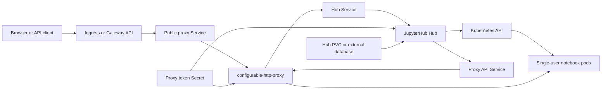

# JupyterHub Chart Design

## Scope

This chart deploys the long-lived JupyterHub control plane needed to authenticate
users and create single-user notebook pods in one Kubernetes namespace. Its
owned resources include the Hub and configurable-http-proxy Deployments,
Services, configuration and token Secrets, optional Hub PVC, namespaced RBAC,
NetworkPolicies, exposure resources, PodDisruptionBudgets, ServiceMonitor,
ExternalSecret, and Helm test pod.

The chart translates stable Helm values into JupyterHub, KubeSpawner, and
configurable-http-proxy configuration. It is intended for local evaluation,
classrooms, research teams, and production platforms whose operators own the
identity provider, storage classes, external database, observability stack,
capacity planning, and notebook image lifecycle.

## Architecture

The public proxy is the only application component intended to receive user
traffic. The Hub talks to the proxy control API over an internal Service and
uses namespaced Kubernetes RBAC to manage notebook pods, PVCs, Services, and
related resources. Separating proxy and Hub workloads lets the proxy continue
routing existing notebook sessions while the Hub restarts.

## Design Decisions

The chart uses official pinned images and explicit values instead of floating
tags. Hub state defaults to SQLite on a PVC because that provides a useful
single-replica installation without an external dependency. Multiple Hub
replicas are rejected unless configuration contains a real
`c.JupyterHub.db_url` assignment. Single-writer chart-created Hub storage is
also rejected for multiple replicas, and an HA Hub without persistence must
reference a shared cookie Secret.

Hub, public proxy, and proxy API ports are modeled independently. The
`containerPorts` values are process-listener settings: they configure
JupyterHub bind URLs and configurable-http-proxy command-line arguments as well
as container declarations. The `service` values are stable Kubernetes Service
ports. Named target ports preserve routing when either side changes. The public
proxy and proxy API listener ports cannot collide because both bind in the same
proxy container.

The proxy token is stored in a Secret and consumed by both control-plane
components. It may be generated, provided inline, read from an existing Secret,
or reconciled by External Secrets Operator. `hub.cleanupServers=false` is an
intentional availability decision: notebook servers should survive routine Hub
rollouts, while operators retain explicit control over abandoned-server cleanup.

## Production Boundary

The chart creates Kubernetes resources and validates internally inconsistent
settings, but it does not operate external dependencies. Production operators
must select and maintain a supported identity provider, external relational
database for HA, storage classes, certificates, DNS, ingress or Gateway
controllers, Prometheus Operator, External Secrets Operator, backups, and
disaster-recovery procedures.

Scaling the Hub does not by itself create a highly available platform. The
external database must be highly available, cookie material must be shared,
storage semantics must match the replica topology, and proxy and Hub disruption
budgets must fit node capacity. Operators must test login, spawn, stop, resume,
Hub restart, proxy restart, node drain, and database failover in their cluster.
Notebook images and user code are separate software supply chains and require
their own patching, provenance, and vulnerability policies.

## Security Boundary

The chart provides non-root containers, a read-only root filesystem, dropped
capabilities, runtime-default seccomp, resource requests and limits, and
KubeSpawner defaults that avoid automounting service-account tokens into user
pods. Namespaced RBAC limits the Hub to the resources needed for KubeSpawner.
NetworkPolicy can restrict ingress and egress when the installed CNI enforces it.

These defaults do not make notebooks a trusted workload. Authenticated users
can execute arbitrary code inside their assigned pod. Cluster admission policy,
runtime isolation, namespace boundaries, quotas, image allowlists, node pools,
secrets handling, and egress controls remain operator responsibilities. A
public route using DummyAuthenticator is blocked unless a password or explicit
insecure opt-in is supplied. Custom public authentication requires an explicit
`authenticator_class` assignment in `hub.extraConfig`.

The proxy token and cookie secret are credentials and must not be committed to
source control. Prefer existing Secrets or External Secrets in production.
`hub.extraConfig` is executable Python and belongs in the same review and change
control process as application code. Unauthenticated metrics can disclose
operational information and require explicit acknowledgement when the release
is publicly exposed.

## Observability Boundary

The Hub and proxy write application logs to standard output. Kubernetes
readiness, startup, and liveness probes express component health, while the
Helm test checks reachability through the public proxy Service. Optional
ServiceMonitor integration exposes Prometheus scraping when the operator has
made an explicit metrics-authentication decision.

The chart does not install Prometheus, log aggregation, tracing, dashboards, or
alert rules. Operators should alert on Hub and proxy availability, restart
loops, spawn latency and failures, pending notebook pods, PVC failures, proxy
route errors, authentication failures, database health, quota pressure, node
capacity, and certificate expiry. Behavioral validation must include the user
journey because healthy control-plane pods do not prove that a notebook can be
spawned and reached.

## Known Gaps and Limitations

- ServiceMonitor scraping currently requires unauthenticated metrics; scrape
  credentials are not modeled by this chart.
- The chart validates the presence of external database configuration but does
  not provision, migrate, back up, or test that database.
- NetworkPolicy cannot express every identity-provider, package-repository, or
  user-workload egress need; operator-supplied rules remain necessary.
- Notebook lifecycle, idle culling policy, profile governance, and GPU support
  depend on `hub.extraConfig` and environment-specific cluster capabilities.
- The chart cannot validate storage access semantics beyond declared values or
  determine whether an existing claim safely supports multiple Hub replicas.
- A successful Helm test confirms proxy reachability, not authentication,
  spawning, kernel execution, persistence, or failover.

## Explicit Non-Goals

This chart does not install a cluster-wide ingress controller, Gateway
controller, CNI, CSI driver, certificate manager, Prometheus Operator, External
Secrets Operator, identity provider, or external database. It does not build
or patch notebook images, execute arbitrary package installation during pod
startup, grant cluster-admin permissions, or promise multi-tenant isolation
between mutually hostile users.

It also does not automatically infer production authentication or database
configuration. Those decisions require environment-specific credentials,
availability objectives, compliance requirements, and operational ownership.
The chart supplies controlled extension points and validation, while keeping
those external systems outside its release lifecycle.
