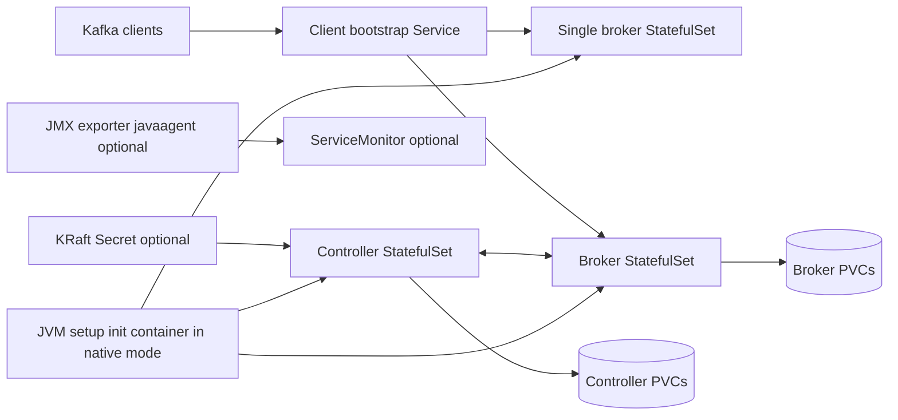

# Kafka Chart Design

## Scope

This chart deploys Apache Kafka in KRaft mode with the official `apache/kafka`
JVM runtime by default and the optional experimental `apache/kafka-native`
runtime. Native mode uses the JVM image in a setup init container to generate
configuration and format storage before the native process starts. It supports
a development-oriented single-broker topology and production-oriented cluster
topologies with either dedicated controller and broker StatefulSets or combined
controller/broker pods.

The chart is intentionally Kafka-only. It does not install ZooKeeper, Kafka
Connect, MirrorMaker, Schema Registry, UIs, TLS/SASL automation, or external
listener matrices.

## Architecture

Topology selection:

- `architecture=single-broker` renders one StatefulSet that runs broker and
  controller roles together.
- `architecture=cluster` with `cluster.brokers.replicaCount > 0` renders
  dedicated controller and broker StatefulSets.
- `architecture=cluster` with `cluster.brokers.replicaCount=0` renders combined
  controller/broker pods for a 3-node HA topology with fewer pods.

Runtime selection:

- `runtime=jvm` runs the standard `apache/kafka` image and supports JMX agent
  metrics.
- `runtime=native` runs `apache/kafka-native` after a JVM setup init container
  completes.
- JMX javaagent metrics are rejected in native mode because they require a JVM
  runtime.

## Main Design Choices

- Use KRaft only because Kafka 4.x is the supported runtime line for this chart.
- Keep the bootstrap service internal by default.
- Use StatefulSets and stable pod DNS for advertised listeners.
- Persist controller metadata and broker logs by default.
- Support an existing KRaft Secret so production deployments can keep the
  cluster ID stable across reinstall and upgrade events.
- Keep topic creation explicit by default through
  `config.autoCreateTopicsEnabled=false`.
- Support Prometheus metrics through the JMX exporter javaagent and an optional
  ServiceMonitor.
- Keep external listener, TLS, SASL, ACL, and ecosystem component lifecycle out
  of scope until each can be modeled safely.

## Production Boundary

Production users should use `architecture=cluster`, pin a stable KRaft cluster
ID in `kraft.existingSecret`, size PVCs for expected retention and partition
count, set resource requests and limits, enable PodDisruptionBudget, and test
topic creation, producer, consumer, and pod rescheduling flows before promotion.

Combined mode is supported for constrained clusters, but it couples controller
and broker capacity. Dedicated controllers and brokers remain the preferred
topology for higher-throughput production workloads.

Topics created without an explicit replication factor use
`default.replication.factor`, which follows the internal topic replication
factor: 1 in single-broker mode and up to 3 in cluster mode.

## Security Boundary

- Pods run as uid and gid 1000 with `runAsNonRoot`, no privilege escalation,
  every capability dropped, `RuntimeDefault` seccomp, and no ServiceAccount
  token. The root filesystem stays writable because the startup scripts render
  `server.properties` inside the container.
- Every listener is `PLAINTEXT`. Client, controller, and inter-broker traffic is
  unauthenticated and unencrypted, so the chart is only safe inside a trusted
  network boundary; restrict access with NetworkPolicies or a service mesh.
- The KRaft cluster ID is stored in a chart Secret or `kraft.existingSecret`.

## Observability Boundary

- Brokers (single-broker pods and cluster brokers or combined nodes) use TCP
  startup and liveness probes on the client listener; with the JVM runtime,
  their readiness probe runs `kafka-broker-api-versions.sh`. Dedicated cluster
  controllers use TCP probes on the controller listener for startup,
  liveness, and readiness, with either runtime. None of the probes verify
  partition health or under-replicated partitions.
- With `metrics.enabled=true`, the JMX exporter javaagent exposes broker and
  controller metrics on `metrics.port`, and `metrics.serviceMonitor.enabled`
  creates ServiceMonitors. Alerting rules and dashboards are not shipped.
- Broker and controller logs go to the container stdout.

## Current Gaps and Improvement Candidates

- Add first-class NetworkPolicy support for client, controller, broker, and
  metrics traffic.
- Add explicit resource defaults for production examples without forcing
  restrictive defaults on development installs.
- Add an offline-friendly JMX exporter option for clusters that cannot download
  the javaagent artifact from Maven Central during init.
- Add TLS/SASL and external listener designs only after the value contract can
  represent certificate, credential, DNS, and load balancer lifecycles clearly.

## Explicit Non-Goals

- ZooKeeper mode
- automatic KRaft migration from ZooKeeper-based clusters
- external listener automation
- TLS, SASL, ACL, and credential lifecycle management
- Kafka Connect, MirrorMaker, Schema Registry, REST Proxy, or Kafka UI
- installing Prometheus Operator or External Secrets Operator

<!-- @AI-METADATA
type: design
title: Kafka Chart Design
description: Design document for the Kafka Helm chart
keywords: kafka, kraft, statefulset, streaming, messaging
purpose: Document chart architecture, decisions, production boundaries, and non-goals
scope: Chart Design
relations:
  - charts/kafka/README.md
  - charts/kafka/docs/cluster.md
  - charts/kafka/docs/combined-mode.md
  - charts/kafka/docs/single-broker.md
path: charts/kafka/DESIGN.md
version: 1.0
date: 2026-06-14
-->
