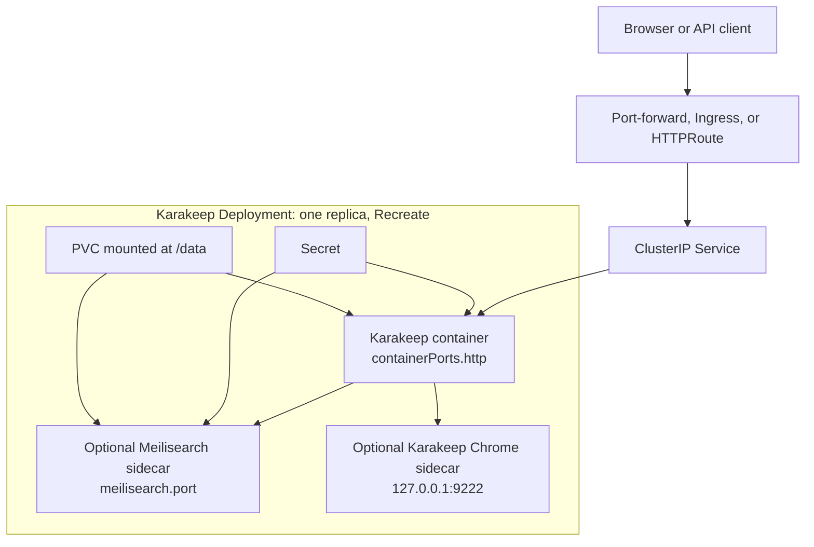

<!-- SPDX-License-Identifier: Apache-2.0 -->

# Karakeep Design

## Purpose

The Karakeep chart packages the official Karakeep application with the two
sidecars that complete the default product experience: Meilisearch for full-text
search and the official Karakeep Chrome image for screenshots and archived page
capture. The
chart keeps the runtime simple and explicit: one application pod, one writable
PVC, one Service, and optional edge routing.

## Default Architecture



Default characteristics:

- one pod and one writable PVC;
- Meilisearch and Chromium enabled for the full bookmark/search/archive
  experience;
- generated credentials reused through Helm `lookup` during upgrades;
- no public ingress by default;
- application-aware HTTP probes on `/api/health` and Meilisearch `/health`;
- a dedicated ServiceAccount without API token mounting and a default ingress
  NetworkPolicy.

## Scope and Non-Goals

The chart owns a production-oriented, single-pod Karakeep deployment, local
search and browser sidecars, persistent storage, credentials, health checks,
and optional HTTP edge resources. It does not provide a highly available SQLite
topology, provision external AI providers, or manage external Meilisearch and
browser services. Independent sidecar scaling and multi-writer storage are
outside the supported architecture.

## Storage Model

Karakeep stores SQLite data, uploaded content, and application state under
`/data`. The Meilisearch sidecar stores its index under `/data/meilisearch`
through a subPath mount. This keeps backup and restore centered on a single PVC.

The Deployment uses `strategy.type=Recreate` because the default storage model is
single-writer. Running multiple replicas against the same SQLite database and PVC
is outside this chart's supported contract.

## Secret Strategy

When `karakeep.existingSecret` is empty, the chart creates an Opaque Secret with
the keys configured by `karakeep.existingSecretNextAuthKey` and
`karakeep.existingSecretMeiliMasterKey`. The helper templates use `lookup` to
reuse existing Secret data during Helm upgrades.

Production operators can set `karakeep.existingSecret` to use a platform-managed
Secret. External Secrets Operator support intentionally requires that existing
Secret path so the chart-managed Secret and ExternalSecret do not compete as
credential writers.

## Sidecar Boundary

Meilisearch and Chromium are sidecars rather than external dependencies by
default. This makes the chart self-contained and easy to validate, but it also
means one pod carries application, search, and browser resource pressure.

Operators that need independent scaling, stricter isolation, or separate backup
policies should disable the sidecars and point Karakeep at externally managed
services through `karakeep.extraEnv` only after validating the upstream
configuration variables for their target version.

The official `karakeep-chrome` entrypoint owns the unauthenticated socat proxy
on port 9222 and Chrome's internal debugging endpoint on port 9223. Chrome binds
9223 to IPv4 loopback, while the proxy exposes 9222 on all pod IPv4 interfaces.
Karakeep therefore connects through `127.0.0.1`; `localhost` can resolve to IPv6
first. Keep the NetworkPolicy enabled or provide another access boundary for
port 9222. These ports must not be overridden, so 9222 is an explicit
fixed-protocol exception. In contrast, `containerPorts.http` is passed
to Karakeep through `PORT`, and `meilisearch.port` is passed to Meilisearch
through `MEILI_HTTP_ADDR`; both overrides change the actual listeners.

Meilisearch receives `MEILI_UPGRADE_DB=true` by default so a PVC created by an
older supported release can be migrated by the pinned image. Operators own a
pre-upgrade snapshot because the upstream migration is not atomic.

## Routing Model

The chart supports three access paths:

- no edge resource, using `kubectl port-forward` for local or private testing;
- Kubernetes Ingress for controller-managed HTTP/TLS routing;
- Gateway API HTTPRoute for clusters standardized on Gateway API.

`karakeep.nextAuthUrl` must match the user-facing URL. Authentication callback
URLs are sensitive to scheme, host, and trailing slash differences.

## Production Boundary

The chart supplies secure runtime defaults, probes, persistence, routing, and
credential integration, but production operators still own capacity planning,
PVC snapshots and restore drills, TLS issuers, DNS, restricted ingress peers,
Secret access policy, and monitoring. Resource requests and limits are
intentionally workload-specific and must be set before production rollout.

## Security Boundary

The default pod uses runtime-default seccomp, non-root UIDs, dropped Linux
capabilities, and disabled privilege escalation. The Chrome root filesystem is
read-only with a writable in-memory `/tmp`. The main container keeps a writable
root filesystem because its s6 runtime and Next.js cache write outside `/data`;
this is the only default filesystem-hardening exception.

The dedicated ServiceAccount does not mount a Kubernetes API token. The default
NetworkPolicy limits inbound traffic to the named HTTP port, while allowing
peers from any namespace so cluster ingress controllers remain portable. Set
`networkPolicy.ingressFrom` to restrict source namespaces or pods. Egress stays
open because web archiving and optional AI providers require arbitrary external
destinations. Credentials are the operator's boundary: production deployments
should use an existing Secret or External Secrets Operator and restrict Secret
read access with namespace RBAC.

## Observability Boundary

Kubernetes probes cover Karakeep and Meilisearch health endpoints and the fixed
Chrome listener. Container logs are the supported diagnostic signal. The chart
does not create metrics exporters, ServiceMonitors, alert rules, or log sinks;
operators should integrate those at the platform layer.

## Design Decisions and Known Gaps

- `Recreate` is deliberate because SQLite and the default PVC are single-writer.
- Search and browser run as sidecars to keep installation self-contained.
- Chrome port 9222 is fixed by the upstream entrypoint, while application and
  search listeners are configurable and behaviorally tested.
- Resource requests and limits remain unset for portability; production values
  must size all enabled containers.
- The ingress policy is enabled by default, but unrestricted egress is a known
  requirement for the crawler rather than an accidental omission.

## Validation

The HelmForge gate for this chart is:

```bash
make validate-chart CHART=karakeep
```

This runs dependency, lint, template, unittest, kubeconform, Artifact Hub lint,
and k3d behavioral validation. Site documentation must also remain synchronized
with chart-facing examples and value contracts.
