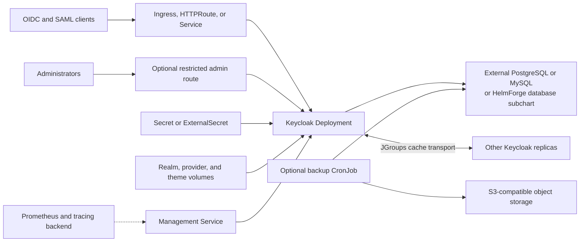

# Keycloak Chart Design

## Scope

This chart deploys the official Keycloak server as a Kubernetes Deployment for
development or production-oriented identity workloads. It models public and
administrative routing, database connectivity, clustered embedded caches,
bootstrap credentials, realm import, provider and theme mounts, health,
metrics, tracing, backup, and External Secrets integration.

The chart manages Kubernetes resources around Keycloak. It does not reconcile
realms, clients, users, identity providers, or custom extensions after startup.

## Architecture



Public application traffic and management traffic use separate Services. In a
multi-replica deployment, Keycloak uses the configured embedded-cache bind port
for JGroups traffic and the upstream offset of 50000 for failure detection.
Changing that bind port requires a `Recreate` rollout because old and new pods
cannot share a cache cluster while listening on different transport ports.

## Product Goal

Deliver a Keycloak chart that is explicit about production correctness.

This chart should optimize for:

- clear hostname and reverse proxy modeling
- explicit separation between public HTTP traffic and the management interface
- external database as the normal production path
- predictable realm import and extension mounting
- small but production-aware values

It should not try to behave like the Keycloak Operator.

## Image and Version Baseline

- image: `quay.io/keycloak/keycloak`
- current app baseline: `26.8.1`

## Supported Modes in v1

### `mode: dev`

Purpose:

- local development
- quick validation
- non-production bootstrap testing

Characteristics:

- single replica
- local development database only
- no HA claims
- ingress optional
- realm import optional

### `mode: production`

Purpose:

- real reverse-proxy deployments
- external database
- optional multi-replica runtime

Characteristics:

- external database required
- explicit hostname configuration required
- TLS or trusted proxy termination required in docs and examples
- multiple replicas supported
- optional realm import
- optional providers/themes
- metrics and health exposed through the management interface

## Core Design Decisions

### 1. Production requires external DB

The chart will not bundle PostgreSQL or another production database.

Production mode requires:

- database vendor
- host
- port
- database name
- username
- password from secret or inline values
- optional JDBC parameters
- optional database TLS parameters

Reason:

- Keycloak is operationally critical
- embedded databases create the wrong default for production
- the repository already has dedicated database charts and should not hide a stateful subchart under Keycloak

### 2. `hostname` and proxy are first-class configuration

The chart must explicitly model:

- `hostname`
- `hostnameAdmin`
- `hostnameStrict`
- `hostnameBackchannelDynamic`
- `proxyHeaders`
- `httpRelativePath`
- ingress enablement
- service ports

Reason:

- Keycloak correctness depends on proper external URL construction
- reverse-proxy mistakes create broken redirect flows, admin exposure issues, and cookie/session problems

### 3. Management stays separate from public traffic

The chart will expose:

- one application service for HTTP/HTTPS client traffic
- one management service for health and metrics

The management interface:

- uses the management port
- is the target for probes
- is the target for `ServiceMonitor`
- must not be routed through public ingress

### 4. Multiple replicas are supported, but documented honestly

Multiple replicas are supported in production mode.

That means:

- cache/discovery configuration is part of the chart surface
- readiness must reflect real Keycloak startup, not just container boot
- `PDB`, placement rules, and session/cache behavior must be documented clearly

This does not mean:

- operator-style cluster lifecycle management
- zero-downtime realm orchestration
- automatic topology healing beyond standard Deployment semantics

### 5. Realm import is supported, but not sold as a mutable control plane

Realm import will use:

- mounted JSON files under `/opt/keycloak/data/import`
- startup flag `--import-realm`

This should be documented as:

- predictable for bootstrap and lower-environment seeding
- acceptable for create-once and idempotent import flows
- not a safe substitute for continuous realm lifecycle management

### 6. Providers and themes must be predictable

The chart will support:

- provider JAR mounts into `/opt/keycloak/providers`
- theme mounts into `/opt/keycloak/themes`

The initial contract should prefer:

- existing ConfigMaps for small text assets
- existing Secrets only when sensitive assets are involved
- `extraVolumes` and `extraVolumeMounts` as the escape hatch

No opaque automation should pretend to build or manage provider lifecycle invisibly.

## Proposed Values Structure

High-level shape:

```yaml
mode: production

image:
  repository:
  tag:
  pullPolicy:

admin:
  username:
  password:
  existingSecret:
  existingSecretUsernameKey:
  existingSecretPasswordKey:

http:
  enabled:
  httpPort:
  httpsPort:
  managementPort:
  relativePath:

hostname:
  hostname:
  admin:
  strict:
  backchannelDynamic:

proxy:
  mode:
  headers:

database:
  vendor:
  host:
  port:
  name:
  username:
  password:
  existingSecret:
  existingSecretPasswordKey:
  jdbcParameters:
  tls:
    enabled:
    existingSecret:

replicaCount:

cache:
  stack:
  transport:
    discovery:
    dnsQuery:

realmImport:
  enabled:
  existingConfigMap:
  files: {}

extensions:
  providers:
    existingConfigMap:
    existingSecret:
  themes:
    existingConfigMap:
    existingSecret:

service:
  type:
  httpPort:
  httpsPort:
  managementPort:

ingress:
  enabled:
  ingressClassName:
  annotations: {}
  hosts: []
  tls: []

metrics:
  enabled:
  serviceMonitor:
    enabled:

health:
  enabled:

networkPolicy:
  enabled:

resources:
podSecurityContext:
securityContext:
affinity:
topologySpreadConstraints:
pdb:
```

## Database Contract

### Development mode database

- local development database is allowed
- chart should make this clearly non-production

### Production mode database

- external database required
- missing database configuration must fail template rendering with clear messages

Expected v1 vendors:

- `postgres`
- `mariadb`
- `mysql`

Bias:

- documentation and examples should prefer PostgreSQL

## Cache and Clustering Direction

v1 should support a limited, explicit cache/discovery contract.

Recommended default for production multi-replica:

- distributed cache enabled
- explicit Kubernetes-friendly discovery mode

Preferred initial direction:

- keep discovery choices minimal
- do not expose every JGroups knob
- choose one documented production-first approach and one fallback only if needed

The chart must document that:

- `replicaCount > 1` is not just a Deployment scaling flag
- clustering and cache transport are part of the runtime contract

## Security Direction

Security defaults should include:

- non-root container
- dropped Linux capabilities
- optional network policy
- no public management ingress
- secret-based admin bootstrap

Production docs must explicitly recommend:

- separate admin hostname when possible
- reverse-proxy restrictions for admin/API exposure
- external TLS termination or end-to-end TLS, depending on platform policy

## Realm Import Contract

v1 supports:

- ConfigMap-based realm files
- inline `realmImport.files` convenience for smaller realm JSON content

v1 does not promise:

- full mutable reconciliation of realm changes
- operator-like drift correction
- safe overwrite semantics for production realm lifecycle

## Providers and Themes Contract

v1 supports:

- deterministic mounts for providers and themes
- restart-based rollout behavior

v1 does not promise:

- build-time packaging
- hot-reload behavior
- plugin lifecycle orchestration

## Templates Expected in v1

- `_helpers.tpl`
- `secret.yaml`
- `configmap.yaml`
- `deployment.yaml`
- `service.yaml`
- `service-management.yaml`
- `ingress.yaml`
- `serviceaccount.yaml`
- `pdb.yaml`
- `servicemonitor.yaml`
- `networkpolicy.yaml`
- `NOTES.txt`

Optional, depending on final realm import contract:

- `job-realm-import.yaml`

Current preference:

- avoid a separate import job if startup import is sufficient and clearer

## CI Matrix for v1

- `ci/minimal.yaml`
  - `mode: dev`
  - single replica
  - no ingress

- `ci/external-db.yaml`
  - `mode: production`
  - external PostgreSQL
  - single replica

- `ci/realm-import.yaml`
  - production
  - realm import enabled

- `ci/ingress.yaml`
  - production
  - ingress + hostname + TLS shape

- `ci/metrics.yaml`
  - management metrics + `ServiceMonitor`

- `ci/multi-replica.yaml`
  - production
  - multiple replicas
  - cache/discovery explicitly enabled

## Production Boundary

The chart provides production-oriented Kubernetes primitives, but the operator
remains responsible for database high availability, database migration and
restore testing, stable public and admin hostnames, TLS policy, capacity
planning, PodDisruptionBudget selection, and safe upgrade sequencing.

Bundled PostgreSQL or MySQL is useful for a self-contained installation, but an
externally operated database is the recommended production boundary. Realm
import is a startup mechanism and must not be treated as continuous desired
state reconciliation. The bundled database defaults pre-create Liquibase's
bookkeeping tables so a fresh multi-replica deployment can acquire the schema
migration lock without racing table creation. External empty databases must be
bootstrapped with one replica or prepared equivalently before scaling out.
Fresh installations using bundled MySQL also start with one replica and scale
out through a later Helm upgrade because concurrent MySQL schema migration can
deadlock on Keycloak's Liquibase row lock.

## Security Boundary

- The Keycloak container runs non-root with dropped capabilities and a
  read-only root filesystem by default.
- Bootstrap, database, truststore, backup, and integration credentials belong
  in Kubernetes Secrets or External Secrets; inline values are conveniences,
  not the preferred production path.
- The management Service is cluster-internal and is never attached to the
  public ingress or HTTPRoute by this chart.
- NetworkPolicy is opt-in because the chart cannot infer every ingress
  controller, monitoring namespace, database destination, or identity-provider
  egress dependency.
- Keycloak realm roles, client permissions, administrator privileges, and
  identity-provider trust are application concerns outside the chart boundary.

## Observability Boundary

- Startup, readiness, and liveness probes use Keycloak's management health
  endpoints and validate the local process, not downstream identity providers.
- The management Service can expose Keycloak metrics to an optional
  ServiceMonitor. Prometheus installation and alert policy are external.
- OpenTelemetry tracing and metrics endpoints can be configured, but the chart
  does not deploy or operate the receiving backend.
- Database, ingress, object-storage, and external identity-provider telemetry
  must be monitored separately by the platform operator.

## Current Gaps and Improvement Candidates

- Realm resources are not reconciled after startup import.
- Provider and theme artifacts must already exist in ConfigMaps, Secrets, or a
  custom image; the chart does not build or download extensions.
- Cross-site clustering and operator-managed rolling topology changes are not
  implemented.
- Backup automation covers database exports to S3-compatible storage; complete
  disaster recovery still requires tested restore procedures and external
  retention controls.

## Explicit Non-Goals for v1

- bundled production database
- every Keycloak preview or feature flag exposed in values
- operator-style realm reconciliation
- public ingress for the management interface
- hidden cluster magic behind `replicaCount`
- cross-site clustering

## What This Chart Should Do Better Than Bitnami

- smaller and clearer values surface
- hostname/proxy modeled as correctness requirements
- explicit separation of app traffic from management traffic
- external DB as the production-first path
- realm import and extension mounting documented more honestly
- fewer surprising values that do not map cleanly to runtime behavior

<!-- @AI-METADATA
type: design
title: Keycloak Chart Design
description: Design document for Keycloak Helm chart focusing on production correctness and reverse proxy

keywords: keycloak, design, architecture, production, reverse-proxy, iam

purpose: Document design decisions and non-goals for the Keycloak chart
scope: Chart Design

relations:
  - charts/keycloak/README.md
path: charts/keycloak/DESIGN.md
version: 1.0
date: 2026-03-20
-->
