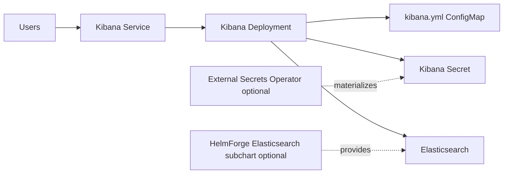

# Kibana Chart Design

## Scope

This chart deploys Kibana as the Elastic Stack UI, connected to an existing
Elasticsearch service or to an optional HelmForge Elasticsearch subchart for
local and development environments.

Kibana state is mostly stored in Elasticsearch. The chart only persists
`/usr/share/kibana/data` when operators explicitly enable persistence for local
plugins and runtime cache.

## Architecture

Optional integrations:

- HelmForge Elasticsearch subchart through `bundledElasticsearch.enabled`
- Ingress or Gateway API HTTPRoute
- NetworkPolicy for inbound and Elasticsearch egress boundaries
- ExternalSecret for service account tokens and encryption keys
- Wolfi image flavor for hardened runtime baselines
- ServiceMonitor for Prometheus-compatible metrics endpoints

## Main Design Choices

- Use Elastic's official Kibana image by default.
- Keep the Wolfi image opt-in through `image.flavor=wolfi`.
- Keep Elasticsearch connectivity explicit in `elasticsearch.hosts`.
- Use a dependency alias for bundled Elasticsearch to avoid breaking the
  existing `elasticsearch.*` connection values.
- Keep `containerPorts.http` independent from `service.port`; the former
  configures Kibana's real `server.port`, while the Service targets the named
  `http` container port.
- Require stable encryption keys for multi-replica deployments.
- Render External Secrets Operator resources only when requested.
- Keep Gateway API and Ingress as separate, non-overlapping entry points.

## Production Boundary

Production deployments should connect to a managed or separately operated
Elasticsearch cluster with TLS, authentication, and static Kibana encryption
keys. The bundled Elasticsearch subchart is primarily for local validation,
development, demos, and tightly scoped platform-owned stacks.

Operators own Elasticsearch availability, capacity, backups, restore tests,
version compatibility, TLS certificates, authentication policy, ingress or
Gateway controllers, DNS, and monitoring infrastructure. The chart does not
turn the bundled development profile into a production Elasticsearch service.

## Security Boundary

The chart runs Kibana as a non-root user, drops Linux capabilities, disables
service account token mounting, and supports the official Wolfi image. It can
mount an Elasticsearch CA and credentials from an existing Secret or External
Secrets Operator resource. Static Kibana encryption keys are required for
multiple replicas.

The chart does not configure Kibana users, roles, spaces, SSO, or an
authorization boundary at the ingress layer. Operators must secure external
Elasticsearch, restrict network access, terminate TLS at a trusted edge, and
control access to Secrets and saved objects.

## Observability Boundary

Kubernetes startup, readiness, and liveness probes validate the Kibana status
endpoint on the configured application listener. The optional ServiceMonitor
is intended only for deployments that expose Prometheus-compatible metrics at
the configured path. Operators own the metrics integration, dashboards, alert
thresholds, log aggregation, and Elasticsearch health monitoring.

## Known Gaps and Limitations

- Bundled Elasticsearch uses the unauthenticated development profile and is
  not a production database topology.
- The chart does not automate saved object exports, Elasticsearch snapshots,
  or rollback of saved object migrations.
- ServiceMonitor creation does not install or configure a Kibana metrics
  exporter.
- Secured external Elasticsearch skips the BusyBox wait container because it
  does not mount the external credentials or CA material.

## Explicit Non-Goals

- operating a full Elastic Stack lifecycle
- Elasticsearch data migration orchestration
- Fleet Server, APM Server, or Beats deployment
- automatic Kibana saved object migration rollback
- installing ingress, Gateway, Prometheus, or External Secrets operators

<!-- @AI-METADATA
type: design
title: Kibana Chart Design
description: Design document for the Kibana Helm chart
keywords: kibana, elasticsearch, observability, dashboard, gateway-api
purpose: Document chart architecture, decisions, and production boundaries
scope: Chart Design
relations:
  - charts/kibana/README.md
  - charts/kibana/docs/production.md
  - charts/kibana/docs/elasticsearch.md
path: charts/kibana/DESIGN.md
version: 1.0
date: 2026-05-29
-->
