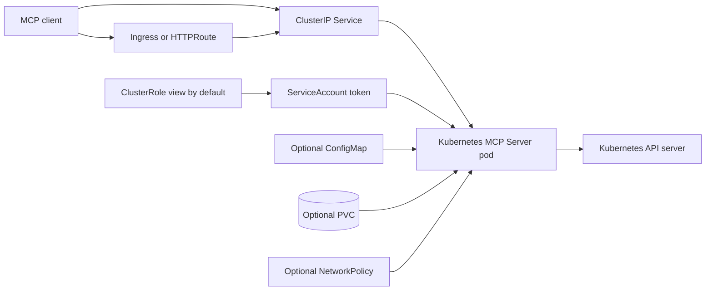

<!-- SPDX-License-Identifier: Apache-2.0 -->

# Kubernetes MCP Server Chart Design

## Scope

This chart runs the official Kubernetes MCP Server as an in-cluster Streamable
HTTP endpoint. It supports inspection-oriented agent workloads, optional
controlled write access, Ingress or Gateway API exposure, and optional
persistence for operator-supplied data.

The workload is a control-plane bridge. Its effective permissions are always
the intersection of the server safety flags, its Kubernetes RBAC binding, and
any network controls applied by the cluster.

## Architecture

The Deployment serves MCP over the named `http` port. The Service targets that
named port so changing `app.port` updates the process listener without coupling
it to the client-facing `service.port`.

## Design Choices

- Use the official `ghcr.io/containers/kubernetes-mcp-server` image.
- Keep read-only, destructive-operation blocking, and stateless mode enabled by
  default.
- Bind the ServiceAccount to the built-in `view` ClusterRole by default instead
  of creating broad chart-owned permissions.
- Keep ServiceAccount token automounting enabled because in-cluster Kubernetes
  authentication requires it.
- Require non-root execution without fixing a UID, GID, or `fsGroup`, allowing
  OpenShift SCCs to assign namespace-specific IDs. Apply `RuntimeDefault`
  seccomp, dropped capabilities, no privilege escalation, and a read-only root
  filesystem.
- Trigger a Deployment rollout when `mcp.configToml` changes through Helm.
  Direct edits to the ConfigMap require an explicit Deployment restart because
  the rendered checksum and `subPath` mount do not update in a running pod.
- Leave external exposure, persistence, and NetworkPolicy opt-in because their
  correct configuration depends on the target cluster.

## Production Boundary

Production operators are responsible for authenticating and authorizing MCP
clients before traffic reaches the chart, restricting network access, sizing
resources, selecting durable storage when persistence is enabled, and backing
up any persistent data before upgrades.

Multi-replica releases with persistence require a storage class that supports
`ReadWriteMany`. The chart rejects a shared `ReadWriteOnce` claim when replicas
are scaled above one for chart-created claims. When `persistence.existingClaim`
is set, the chart cannot inspect its access modes, so the operator must verify
that the existing claim supports `ReadWriteMany` before scaling.

## Security Boundary

The default server flags and `view` ClusterRole provide inspection access but
do not replace client authentication. Full write and destructive behavior is
rejected unless `mcp.allowUnsafeWriteAccess=true` is explicitly set when the
chart generates arguments from `mcp.*`. A nonempty `app.args` replaces every
generated safety flag; include `--read-only` or `--disable-destructive` there to
retain those protections. The default `view` ClusterRole still blocks writes,
and write access also requires an explicitly bound write-capable role.

The application needs its ServiceAccount token to call the Kubernetes API.
Operators must not replace `rbac.clusterRoleName` with a broader role without
also reviewing the MCP toolsets and exposure path. Secrets supplied through
`app.env` or `app.envFrom` are referenced by the pod; inline values remain in
Helm release state.

## Observability Boundary

Startup, readiness, and liveness probes verify the named TCP listener. Logs are
written to the container stream and are not retained by the chart. Metrics and
distributed tracing can be configured through upstream environment variables,
but the chart does not create a ServiceMonitor because the pinned release does
not expose a stable chart-level metrics contract.

## Known Gaps

- The chart does not provide MCP client authentication or authorization.
- NetworkPolicy cannot infer the Kubernetes API endpoint on every cluster, so
  operators may need to add API-server egress through `networkPolicy.extraEgress`.
- The optional persistence mount is generic; the upstream server remains
  stateless unless an operator configures a feature that writes to it.
- Metrics scraping is not enabled by default.

## Non-Goals

- Managing kubeconfigs for out-of-cluster access.
- Granting cluster-admin permissions by default.
- Providing public internet exposure for a cluster-control MCP endpoint.
- Managing an external identity proxy or MCP client credentials.
