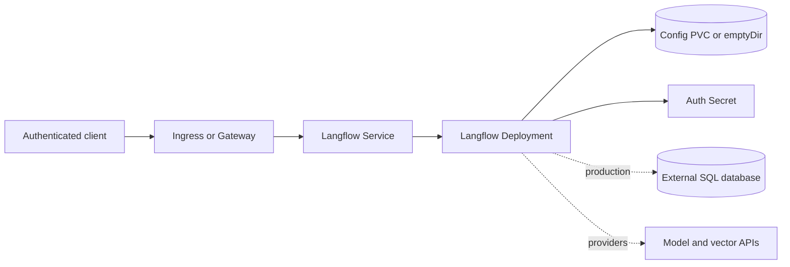

# Langflow Chart Design

## Scope

This chart deploys the official all-in-one Langflow web/API image. It owns the
Kubernetes workload, Service, optional routes, persistent configuration,
credentials, database connection, scheduling, and network controls. Langflow
owns flows, migrations, provider integrations, authorization, and application
data semantics.

## Architecture

The default is one replica with SQLite in `/app/langflow` on a PVC. Production
horizontal scaling requires a shared external SQLAlchemy-compatible database.
If persistence remains enabled for multiple replicas, the config volume must
also support `ReadWriteMany`.

## Key Design Decisions

- `Recreate` stops the old process before migrations and avoids concurrent
  writers during single-replica upgrades.
- The chart validates that multiple replicas use an external database and, when
  persistence is enabled, shared RWX storage.
- Generated auth credentials are retained with `lookup`; existing Secrets keep
  credential custody outside Helm values.
- `app.env` and `app.envFrom` expose provider-specific settings without the chart
  pretending to model every upstream integration.
- The optional security profile is disabled by default so upgrades preserve the
  2.0.4 pod contract. When enabled it uses the image's verified UID 1000, group
  0, RuntimeDefault seccomp, a read-only root filesystem, dropped capabilities,
  and writable ephemeral mounts required by the official image.

## Production Boundary

The chart does not provision PostgreSQL, model providers, vector databases,
OpenTelemetry collectors, identity providers, DNS, TLS, or ingress controllers.
Operators own their availability, credentials, backups, network reachability,
and capacity. Switching from SQLite to an external database does not migrate
data automatically.

Helm rollback restores manifests and values but cannot reverse Alembic or other
application data migrations. Back up the database, config volume, encryption
key, and exported flows before changing application versions.

## Security Boundary

Authentication is required by default. `auth.autoLogin=true` is an explicit
development-only setting. `LANGFLOW_SECRET_KEY` protects encrypted provider
credentials and JWT signing, so replacing it can invalidate or make stored data
unreadable. Production deployments should use existing Secrets and restrict
network access to intended clients and provider/database destinations.

The optional hardening profile is opt-in because custom components may require
additional writable paths. Explicit pod and container security contexts override
profile defaults. Kubernetes NetworkPolicy enforcement depends on the cluster
CNI.

## Observability Boundary

Startup, readiness, and liveness call `/health_check`. Kubernetes events,
container logs, restarts, latency, database health, provider errors, and PVC
capacity remain platform monitoring responsibilities. The chart does not create
a collector, dashboards, alerts, or a ServiceMonitor without a verified native
metrics contract.

## Known Gaps

- The all-in-one topology does not model separate frontend, backend, worker, or
  queue deployments.
- Provider behavior and writable-path requirements vary with custom components.
- Changing the database URL or encryption key is not a migration mechanism.
- NetworkPolicy cannot express application-level provider authorization.

## Non-Goals

- Bundling PostgreSQL or managing exported flows as Kubernetes resources.
- Installing every historical integration or the `langflow-all` image profile.
- Automating database migration repair, credential rotation, or data recovery.
- Claiming zero-downtime upgrades for the default single-writer topology.
