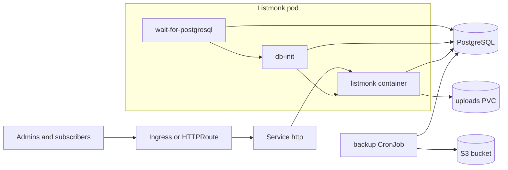

<!-- SPDX-License-Identifier: Apache-2.0 -->

# Listmonk Design

## Scope

The chart deploys the Listmonk newsletter application with what it needs to
start safely on Kubernetes: PostgreSQL connectivity, database bootstrap and
upgrade, a superadmin from a Secret, uploads storage, an HTTP Service,
optional Ingress or Gateway API routes, and optional S3-compatible database
backups.

## Architecture

- `wait-for-postgresql` runs `pg_isready` until the database answers or
  `setup.databaseWaitTimeoutSeconds` passes.
- `db-init` runs `listmonk --install --idempotent` and `listmonk --upgrade`.
  On a fresh database the install creates the superadmin from
  `LISTMONK_ADMIN_USER` and `LISTMONK_ADMIN_PASSWORD`.
- `listmonk` serves the admin UI, public pages, and the API on
  `listmonk.port`.

## Design Choices

- **Configuration through environment only.** The chart runs
  `listmonk --config=""` and sets `LISTMONK_app__*` and `LISTMONK_db__*`
  variables, so no config file or ConfigMap is needed and the root filesystem
  can be read-only.
- **Superadmin from a Secret.** Without `LISTMONK_ADMIN_*`, a fresh Listmonk
  shows a first-run page where the first visitor creates the admin. The chart
  always supplies the credentials; the generated password is kept across
  upgrades.
- **Database selection.** `database.mode=auto` selects the subchart unless
  external settings are present. Explicit modes fail fast on conflicting
  values.
- **Pinned PostgreSQL clients.** The wait and backup images use a pinned
  PostgreSQL 18 client so `pg_dump` is never older than the bundled server.
- **Listener separate from the Service.** `listmonk.port` sets the process
  address and container port; the Service targets the named `http` port.

## Production Boundary

- One replica. Several active Listmonk instances process the same campaigns,
  and the uploads volume is `ReadWriteOnce`.
- Configure SMTP and the root URL (`LISTMONK_app__root_url` through
  `listmonk.extraEnv`, or the Settings UI) before sending campaigns.
- Built-in backups cover PostgreSQL only. Back up the uploads PVC separately,
  or use an S3 media provider in the Listmonk settings.

## Security Boundary

- The pod runs as uid 65534 with `runAsNonRoot`, a read-only root filesystem,
  no privilege escalation, every capability dropped, `RuntimeDefault` seccomp,
  and no ServiceAccount token.
- Database, backup, and superadmin credentials come from Secrets or
  ExternalSecret resources; inline values render into chart Secrets.
- The chart does not render NetworkPolicies; apply namespace policies for the
  database and SMTP egress your platform allows.

## Observability Boundary

- Probes call `/health`, which confirms the HTTP server is serving.
- Logs go to stdout of the `listmonk` container; bootstrap logs stay in the
  `db-init` container.
- Listmonk exposes no Prometheus endpoint, so the chart ships no
  ServiceMonitor.

## Current Gaps and Improvement Candidates

- No NetworkPolicy or PodDisruptionBudget templates.
- No first-class SMTP values; SMTP is configured in the UI or through
  `listmonk.extraEnv`.
- The backup CronJob does not apply the pod hardening used by the application
  pod and does not archive uploads.

## Explicit Non-Goals

- Multi-replica or active-active Listmonk.
- Running an SMTP relay or managing DNS records for sending domains.
- Managing PostgreSQL high availability; use the PostgreSQL chart or a managed
  service.
