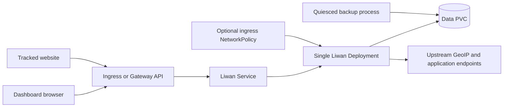

# Liwan design

## Scope

This chart deploys the official Liwan image as one privacy-focused web
analytics service backed by embedded DuckDB. It owns the Kubernetes workload,
durable `/data` storage, internal Service, optional Ingress or HTTPRoute,
optional ingress NetworkPolicy, scheduling, and health configuration.

The chart does not replace Liwan's storage engine, add a distributed control
plane, or make the embedded database safe for concurrent writers.

## Architecture

Liwan serves the dashboard and tracking endpoint from one Rust process. DuckDB,
analytics history, and runtime assets share `/data`. The Deployment is fixed at
one replica and uses Recreate so old and new writers never overlap during a
normal rollout.

## Main Design Choices

- Pin the official multi-architecture image without rebuilding it.
- Keep the application listener in `liwan.port` distinct from `service.port` and
  route the Service through the named `http` target port.
- Render exactly one replica with Recreate strategy because DuckDB is an
  embedded, single-writer database.
- Persist the complete `/data` directory by default and support externally
  managed claims through `persistence.existingClaim`.
- Keep `liwan.baseUrl` explicit because generated tracking URLs must match the
  operator's public TLS endpoint.
- Support both Ingress and Gateway API without installing either controller.
- Offer an opt-in ingress NetworkPolicy. An empty peer list permits only pods in
  the release namespace, while explicit peers support dedicated edge namespaces.
- Disable ServiceAccount token automount and run the application as non-root
  with dropped capabilities and RuntimeDefault seccomp.

## Production Boundary

Operators must provide a suitable expandable StorageClass or existing PVC,
configure the public URL and TLS edge, size CPU, memory, and storage for traffic
and retention, and protect backups outside the cluster. They must also configure
trusted proxy addresses precisely when an edge supplies forwarded client IPs.

The chart retains a chart-managed PVC when Helm deletes the release, but
namespace deletion and storage-provider lifecycle are outside Helm. Consistent
backup requires pausing incoming writes or stopping the Deployment before
snapshotting `/data`. Restore must be rehearsed in an isolated namespace.

## Security Boundary

The default container runs as UID/GID 1000, cannot gain privileges, drops all
Linux capabilities, uses RuntimeDefault seccomp, and receives no Kubernetes API
token. The data claim is the only chart-managed durable write surface.

NetworkPolicy enforcement depends on the cluster CNI and is disabled by default
to preserve the established networking contract. When enabled, it isolates
ingress to same-namespace pods unless explicit peers are supplied. Public edge
authentication, TLS policy, trusted proxy configuration, dashboard access,
tracking consent, and retention compliance remain operator responsibilities.

`liwan.extraEnv`, extra volumes, extra manifests, annotations, and explicit
NetworkPolicy peers extend the trust boundary and must be reviewed as privileged
configuration. The chart rejects the removed `LIWAN_USE_FORWARD_HEADERS`
setting so upgrades cannot silently restore unsafe unrestricted proxy trust.

## Observability Boundary

Startup, liveness, and readiness probes verify the configured TCP listener.
Kubernetes Deployment, Pod, PVC, event, and log signals cover workload health.
Operators should monitor public tracking requests, dashboard availability,
storage growth, backup age, restart count, and edge certificate expiry.

The pinned application does not expose a stable Prometheus contract consumed by
this chart, so no ServiceMonitor or unrelated exporter is fabricated. Analytics
business metrics in DuckDB are not a substitute for platform health signals.

## Known Gaps and Improvement Candidates

- Recreate upgrades intentionally include downtime.
- Embedded DuckDB prevents horizontal scaling and concurrent writers.
- TCP probes prove listener availability but not a complete authenticated
  dashboard workflow.
- NetworkPolicy is opt-in because existing installations may depend on traffic
  from namespaces that cannot be inferred by the chart.
- The chart does not coordinate quiesced backups or retention jobs.
- A read-only root filesystem is not enabled until the upstream image's complete
  temporary-file contract can be validated across releases.

## Explicit Non-Goals

- replacing DuckDB with an external database
- horizontal autoscaling or multiple writers against one data directory
- installing an Ingress controller, Gateway API CRDs, CNI, certificate manager,
  storage provider, or monitoring stack
- operating a trusted proxy or identity provider
- deciding tracking consent, privacy policy, or analytics retention requirements
- transporting, encrypting, or retaining off-cluster backups
- treating Helm rollback as a database rollback

## Validation Strategy

The mandatory chart gate validates dependencies, strict lint, every CI values
profile, unit tests, real CRD schemas, Artifact Hub metadata, and sequential k3d
runtime scenarios. Runtime validation checks rollout readiness, Service
endpoints, the application listener, stable pods and logs, persistent storage,
Ingress, Gateway API, dual-stack rendering, trusted-proxy configuration, and the
opt-in NetworkPolicy.

Upgrade validation starts from the latest public chart package and exercises
both reset/default values and `--reuse-values`. It verifies that the same PVC
and a pre-upgrade marker remain available and that the application becomes ready
after the Recreate rollout.

<!-- @AI-METADATA
 type: guide
 title: Liwan Chart Design
 description: Explain Liwan architecture, boundaries, and operational tradeoffs
 audience: contributors, operators
 purpose: Explain chart architecture and limits
 scope: chart
 path: charts/liwan/DESIGN.md
 version: 1.1
 date: 2026-11-01
-->
