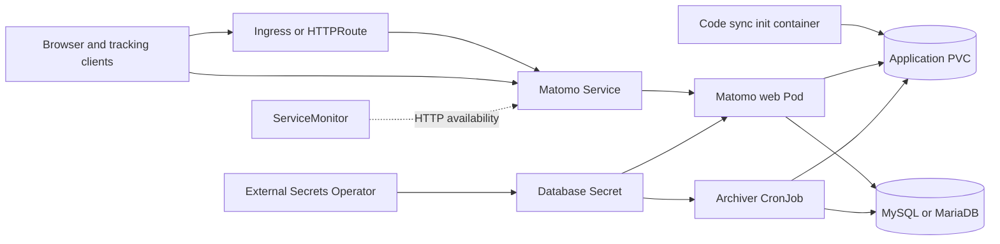

# Matomo Chart Design

## Scope

This chart deploys the official Matomo image as a web analytics workload. It
provides persistent application storage, a Service, optional Ingress or Gateway
API exposure, a bundled HelmForge MySQL dependency or an external MySQL/MariaDB
connection, and a CronJob for production report archiving.

The default image is the Apache variant. An explicit `webServer.mode=external`
contract supports FPM images when an additional container, such as nginx,
serves the Pod's HTTP port. The chart does not infer runtime behavior from an
image tag.

## Architecture

The web Deployment and archiver share `/var/www/html`. The code synchronization
init container copies release-managed files from `/usr/src/matomo` into that
volume before the web process starts while preserving PVC-only configuration,
plugins, and user content. Database credentials are consumed through a Secret,
regardless of whether that Secret is chart-managed, pre-existing, or reconciled
by External Secrets Operator.

## Design Decisions

### Official images and explicit serving mode

The chart uses `docker.io/library/matomo` and pins a concrete tag. Apache is the
default serving mode because the image contains both PHP and the HTTP server.
When `containerPorts.http` differs from 80, the container copies the packaged
Apache configuration to a writable temporary directory and changes both the
listener and virtual host ports before starting Apache. This works with a
read-only image filesystem and does not mutate image-owned configuration.

FPM images do not expose HTTP themselves. `webServer.mode=external` therefore
leaves listener ownership to an extra container. The maintained FPM CI profile
uses nginx on the named HTTP target port and proves that this topology remains
renderable and deployable.

### Persistent code synchronization

The official image initializes `/var/www/html` from `/usr/src/matomo`, but the
chart persists `/var/www/html`. Without explicit synchronization, an image
upgrade could leave old application code on the PVC. The init container copies
the contents of the image release on every start. `Recreate` is the default
Deployment strategy so an old web Pod cannot serve while a new Pod updates the
shared code volume.

### Database modes

`database.mode=auto` selects the bundled MySQL dependency when enabled and the
external contract otherwise. The bundled dependency is suitable for
self-contained installations and validation. Production installations should
prefer an independently operated MySQL or MariaDB service with platform-native
backup, restore, high availability, and maintenance procedures.

### Archiving

Matomo recommends scheduled report processing outside user requests. The
archiver is a first-class CronJob that mounts the same application volume and
uses the same database credentials as the web Pod. For a ReadWriteOnce volume,
the default required Pod affinity places archive jobs on a node already running
a Matomo web Pod. Operators using multi-node writable storage can disable this
constraint or provide custom scheduling.

## Production Boundary

The chart owns Kubernetes resources, workload wiring, code synchronization,
health probes, database connection settings, and the archiver schedule. It does
not operate an external database or provide application-aware database backups.
Operators must back up and restore both the database and application PVC as one
consistent recovery unit.

Matomo upgrades can require application migrations even when a patch release
has no major database upgrade. The chart intentionally does not run migrations
automatically. Operators should schedule maintenance, back up state, roll out
the image, and run the documented `core:update` command when required by
upstream release notes.

Multiple web replicas require storage and PHP session behavior that are safe
for concurrent access. The chart renders multiple replicas but does not create
a shared session backend. Production users are responsible for validating that
topology before increasing `replicaCount`.

## Security Boundary

The chart disables ServiceAccount token automounting by default and supports
Pod and container security contexts, NetworkPolicy, External Secrets, and
secret references. Plaintext database passwords remain available for local
evaluation but should not be stored in production values or Git.

The Matomo container includes PHP. Image tags are upgraded independently from
Matomo application configuration so patched PHP base images are deployed with
a new immutable tag rather than relying on a mutable rebuild in node caches.
The chart cannot patch PHP inside a running container; operators must deploy a
new image and verify the effective runtime version.

NetworkPolicy is opt-in because database destinations and ingress-controller
selectors differ across clusters. Enabling it without the required peers can
block database or client traffic. TLS termination is owned by the selected
Ingress or Gateway implementation unless the operator adds a separate proxy.

## Observability Boundary

Startup, readiness, and liveness probes validate the Matomo HTTP endpoint. The
runtime smoke test additionally verifies the application version, PHP security
patch level, named Service target port, and live HTTP response through the
Service.

The optional ServiceMonitor checks HTTP availability only. Matomo does not
expose a native Prometheus metrics endpoint through this chart, so detailed
application metrics require an operator-supplied exporter. Application logs,
archive job status, Kubernetes events, database health, and tracking request
success remain operational signals that should be collected by the platform.

## Known Gaps and Limitations

- The chart does not configure a distributed PHP session backend.
- ServiceMonitor represents HTTP availability, not native Matomo metrics.
- The first-time Matomo installer remains an interactive application workflow.
- Plugin compatibility and migrations are upstream concerns and must be
  reviewed before every Matomo upgrade.
- ReadWriteOnce storage constrains archive job placement to the web Pod's node.
- External web-server mode requires the operator to provide a correctly wired
  HTTP sidecar through `extraContainers`, volumes, and manifests.

## Non-Goals

- Managing marketplace plugins or their lifecycle.
- Operating, backing up, or restoring an external database.
- Automatically running database migrations during Pod startup.
- Providing a Redis-backed session topology by default.
- Managing DNS, certificates, or the lifecycle of an Ingress/Gateway controller.
- Treating multiple replicas as proof of application-level high availability.

## Validation

The complete chart gate renders every CI profile, runs unit tests,
kubeconform, Artifact Hub lint, and sequential k3d installations. Runtime
validation uses the real Matomo image and verifies the application and PHP
versions through the running Pod. The custom-port profile reaches Matomo
through a Service whose port differs from the Apache listener, proving that
`containerPorts.http`, the real process, the named target port, and probes stay
aligned.

The external database, External Secrets, FPM sidecar, Gateway API, Ingress,
NetworkPolicy, non-root, production, and dual-stack profiles cover the chart's
other supported topology boundaries.

<!-- @AI-METADATA
type: chart-design
title: Matomo Chart Design
description: Architecture, boundaries, and design decisions for the Matomo HelmForge chart
keywords: matomo, design, architecture, mysql, archiver
purpose: Capture chart scope, runtime contracts, and trade-offs
scope: Chart
relations:
  - charts/matomo/values.yaml
  - charts/matomo/README.md
path: charts/matomo/DESIGN.md
version: 1.1
date: 2026-10-28
-->
