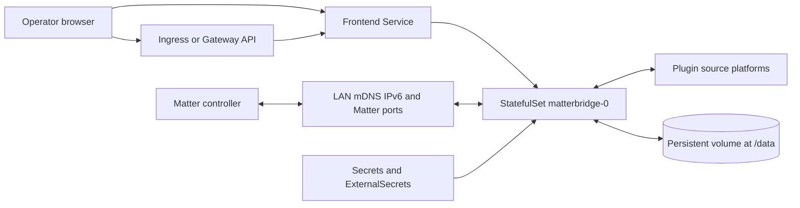

# Matterbridge chart design

## Scope

This chart packages the official standalone Matterbridge image as a hardened,
single-node Kubernetes workload. It manages the frontend, persistent Matter
identity, plugin storage, optional HTTP exposure, optional Matter port Service,
and the Kubernetes resources needed to run the application.

The chart supports two network models. The portable default uses the pod
network and is compatible with Pod Security baseline. Production deployments
that need ordinary LAN discovery can opt into host networking on a trusted
node. The chart keeps that security trade-off explicit because a healthy
frontend does not prove that mDNS, IPv6, and Matter traffic reach controllers.

## Architecture

Ingress and Gateway API routes terminate only at the management frontend. They
do not transport Matter or multicast traffic. In host-network mode, the pod
uses the node interfaces directly. In portable mode, the CNI must provide the
required multicast and IPv6 behavior, or an external network design must do so.

## Design Decisions

### Singleton StatefulSet

Matterbridge owns one fabric identity, one mDNS identity, a fixed Matter port
range, and mutable plugin state. It has no leader election or active-active
coordination. The chart therefore renders a StatefulSet with exactly one
replica, uses `OrderedReady`, and rejects every other replica count.

### Direct non-root process

The official image normally enters through a root-oriented startup script. The
chart invokes the included `matterbridge` binary directly with
`--homedir /data`. This keeps the official application distribution while
allowing UID/GID 1000, a read-only image filesystem, a private npm prefix, and
all Linux capabilities dropped.

### One durable state boundary

The complete Matterbridge home is mounted from one PVC at `/data`. Plugins,
configuration, fabric identity, certificates, logs, and the npm cache remain
together. This prevents partial backup and restore procedures from separating
cryptographic identity from the configuration that uses it. The chart-created
claim is retained by default.

### Explicit network modes

Pod networking is the safe portable default. Host networking is an opt-in
production topology for common home and building LANs where controllers require
link-local IPv6 and mDNS. The optional Matter Service is for CNIs that already
transport multicast correctly; it cannot replace UDP 5353 discovery.

### Independent frontend and Service ports

`frontend.port` changes the real Matterbridge listener through `--frontend` and
drives the named `http` container port and probes. `service.port` controls only
the Kubernetes frontend Service. The Service targets the named container port,
so operators can expose a different Service port without changing the process.

### Standalone upstream distribution

The `luligu/matterbridge` registry also contains calendar-versioned Home
Assistant add-on images. This chart pins the standalone semantic-version tag
and verifies the installed Matterbridge package at runtime. Add-on tags use a
different entrypoint and are not compatible substitutes.

## Production Boundary

The chart owns Kubernetes rendering, the singleton lifecycle, health probes,
frontend and Matter port wiring, PVC mounting, security contexts, and optional
Ingress, Gateway API, ExternalSecret, and NetworkPolicy resources.

Operators own the physical LAN topology, CNI multicast and IPv6 behavior, node
placement, plugin compatibility, controller commissioning, proxy
authentication, certificate lifecycle, NetworkPolicy destinations, capacity,
and verified backups. A production rollout is incomplete until a real Matter
controller can discover, commission, and exercise a representative device.

## Security Boundary

The default pod runs as non-root, drops all capabilities, blocks privilege
escalation, uses RuntimeDefault seccomp, keeps the image filesystem read-only,
and does not mount a Kubernetes API token. Writable paths are limited to
`/data` and `/tmp`. Secrets are consumed through existing Secrets or generic
ExternalSecret resources and are not embedded in chart defaults.

The Matterbridge frontend has no stable chart-managed authentication contract.
The default ClusterIP is private. Any Ingress or Gateway deployment must add
authentication, TLS, and client restrictions at a trusted proxy. Host
networking expands the pod's network reach and must be limited to a trusted,
dedicated LAN node with tightly controlled release permissions.

## Observability Boundary

Startup, readiness, and liveness probes use the upstream `/health` endpoint.
The runtime smoke test verifies the installed package version, listener wiring,
Service target, and a live HTTP response. Kubernetes rollout status, restart
counts, pod logs, and events are the supported operational signals.

Matterbridge has no native Prometheus endpoint. The chart does not fabricate
metrics or ship a sidecar scraper. Operators can collect Kubernetes workload
metrics and application logs, while protecting pairing codes, fabric data, and
plugin credentials from public log systems.

## Known Gaps

- Most CNIs do not carry mDNS and link-local IPv6 between the pod network and a
  physical LAN; host networking or a capable network design is usually needed.
- The official `3.10.14` standalone image does not include `ffmpeg`. The chart's
  non-root, read-only runtime intentionally prevents package installation at
  startup, so camera plugins that require `ffmpeg` are outside the default
  runtime contract.
- There is no highly available topology. Node maintenance interrupts the
  singleton and may require Matter controllers to reconnect.
- Consistent filesystem backup requires the StatefulSet to be stopped or the
  storage platform to provide an application-consistent snapshot.
- Plugin-specific ports, credentials, resource needs, and egress destinations
  cannot be inferred by the chart.

## Non-Goals

- Horizontal scaling, leader election, or active-active failover.
- Installing or updating Matterbridge plugins from Helm values.
- Compiling or installing operating-system packages during pod startup.
- Relaying mDNS or making a multicast-incapable CNI Matter-aware.
- Providing frontend authentication, a live-copy backup sidecar, or synthetic
  Prometheus metrics.
- Replacing plugin-specific documentation or Matter controller validation.

## Validation

The chart renders default, custom-port, dual-stack, External Secrets, Gateway
API, host-network, Ingress, NetworkPolicy, and Matter Service scenarios. Unit
tests cover the workload, Services, storage, exposure resources, integrations,
NOTES, and fail-fast validation. The complete HelmForge gate runs dependency
checks, strict lint, every template scenario, unit tests, kubeconform with real
CRD schemas, Artifact Hub lint, and behavioral k3d validation for every
scenario.
