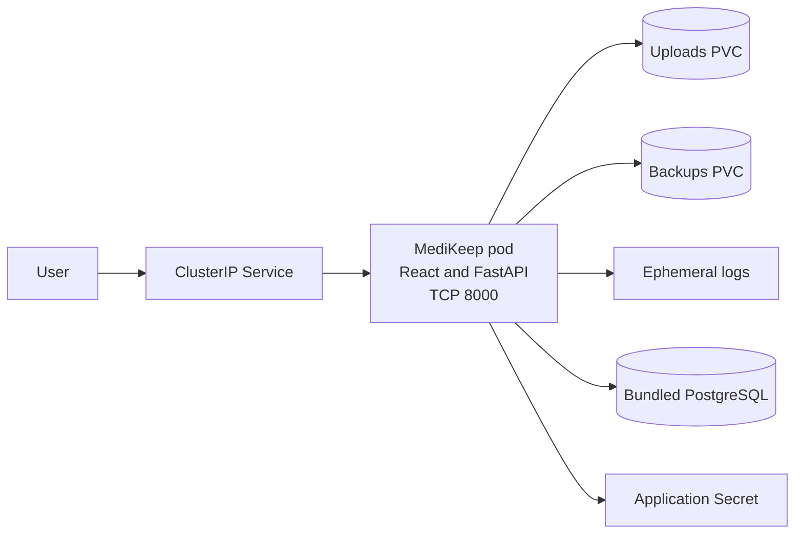
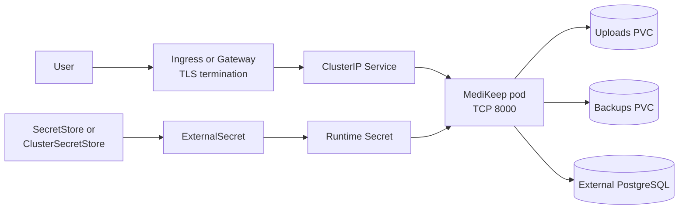

# MediKeep Chart Design

## Scope

This chart deploys the official MediKeep image as a single React and FastAPI
application backed by PostgreSQL. It owns the Kubernetes workload, Service,
application Secret, writable volumes, optional exposure resources, optional
ExternalSecret resources, and the bundled PostgreSQL dependency integration.

The chart deliberately exposes MediKeep-specific controls instead of hiding
them behind a generic workload abstraction. The supported image is
`ghcr.io/afairgiant/medikeep:v0.72.0`, which publishes Linux `amd64` and
`arm64` manifests.

## Architecture

The default topology keeps the application and database inside the release.
Uploads and generated backups are separate persistence domains.



A production deployment can terminate TLS at an Ingress or Gateway, source
credentials through External Secrets Operator, and use an externally managed
PostgreSQL service.



## Design Decisions

### Fixed application listener

The pinned upstream entrypoint executes Uvicorn with `--port 8000` in HTTP and
HTTPS modes. MediKeep does not expose a supported environment variable for
changing that listener. The Deployment therefore declares literal port `8000`
with the GR-082 fixed-port marker. `service.port` remains independently
configurable and targets the named `http` container port.

The former `app.port` value was removed because it changed only Kubernetes
metadata and could make probes and Service routing target a socket that the
process never opened. Users who previously set it must remove it; the actual
MediKeep listener remains `8000`.

### Singleton workload and rollout strategy

MediKeep writes uploads, logs, and generated backups to pod-mounted paths. The
chart rejects `replicaCount` values above one and uses `Recreate` so two pods do
not concurrently write the same `ReadWriteOnce` volumes. A PodDisruptionBudget
can protect voluntary maintenance, but it does not create high availability.

### Database choices

The default installation uses the HelmForge PostgreSQL dependency for a
self-contained deployment and deterministic validation. Operators can disable
the dependency and provide an external host plus a Secret-backed password. The
wait init container gates application startup on the selected database socket.

### Secrets and lifecycle

MediKeep requires a stable `SECRET_KEY`. When no existing Secret is supplied,
the chart generates the key at install time and reuses it through `lookup` on
upgrades. The initial administrator password and SSO client secret can use the
same Secret. External Secrets Operator can materialize that Secret without
placing credentials in Helm values.

### Persistence domains

Uploads and generated backups use distinct PVCs by default. Logs use
`emptyDir` because retaining health-related operational context should require
an explicit policy. PostgreSQL and file volumes must be backed up and restored
together to preserve attachment references.

## Production Boundary

The chart provides one MediKeep replica, optional bundled PostgreSQL,
persistence primitives, health probes, NetworkPolicy, Ingress, Gateway API,
External Secrets integration, and resource controls. Operators remain
responsible for storage classes, off-cluster backups, tested restores, database
high availability, TLS certificates, DNS, identity-provider availability,
disaster recovery, and jurisdiction-specific health-data requirements.

For a production deployment, provide a strong initial administrator password,
use stable Secret sources, protect public routes, enable NetworkPolicy, assign
appropriate resources, and implement coordinated backups for PostgreSQL,
uploads, and generated backup files.

## Security Boundary

The application runs as upstream UID/GID `999`, drops all Linux capabilities,
disallows privilege escalation, and uses the runtime-default seccomp profile.
The ServiceAccount token is not mounted by default. The root filesystem cannot
be read-only because the upstream process writes application paths outside the
three configurable data mounts; this image constraint is explicit rather than
silently weakening the pod at runtime.

Public Ingress, Gateway, NodePort, or LoadBalancer exposure is rejected unless
an existing runtime Secret or an initial administrator password is configured.
The chart also rejects an inline `admin123` password. Helm cannot inspect an
existing Secret's data, so operators must provide a strong value under
`secrets.adminDefaultPasswordKey`; a publicly exposed pod will fail to start if
that key is absent. NetworkPolicy can limit ingress and egress, but operators
must add identity-provider and integration destinations when egress isolation
is used.
Kubernetes Secrets are transport objects, not encryption or rotation systems;
cluster encryption at rest and external secret lifecycle remain operator
responsibilities.

## Observability Boundary

Startup, readiness, and liveness probes call the upstream `/health` endpoint on
the named `http` port. The runtime smoke test verifies that endpoint and the SSO
configuration contract against a Ready pod. Application logs are available
through standard container logging and may optionally be persisted.

The chart does not create metrics exporters, ServiceMonitor resources, tracing
collectors, dashboards, or alert rules because MediKeep does not publish a
stable chart-owned telemetry contract. Operators should monitor pod restarts,
probe failures, HTTP availability, PostgreSQL health, PVC capacity, backup age,
and restore-test results with their platform tooling.

## Known Gaps and Limitations

- MediKeep is intentionally limited to one replica and does not provide active
  high availability.
- The upstream listener is fixed at TCP `8000`; only the Service port is
  configurable.
- The upstream filesystem behavior prevents `readOnlyRootFilesystem: true`
  without maintaining a chart-specific writable-path overlay.
- The chart does not schedule off-cluster backups or validate restore recovery.
- NetworkPolicy cannot describe external DNS destinations portably; restricted
  environments must provide suitable CIDR or namespace peers.

## Non-Goals

- Rebuilding or patching the official MediKeep image.
- Managing PostgreSQL high availability, external database users, or database
  lifecycle outside the bundled dependency.
- Provisioning an identity provider, TLS issuer, Gateway controller, Ingress
  controller, External Secrets Operator, or SecretStore.
- Claiming regulatory compliance solely from Kubernetes configuration.
- Supporting multiple MediKeep replicas before upstream provides shared-file
  storage and concurrency guarantees.

## Validation Scope

Unit tests cover the official image, fixed listener and independent Service
port, database and Secret wiring, persistent volumes, exposure resources,
NetworkPolicy, External Secrets, security contexts, and fail-fast validation.
CI scenarios exercise the default, production, external database, SSO-only,
Ingress, Gateway API, External Secrets, dual-stack, NetworkPolicy, and
ephemeral-storage paths. The complete release gate is:

```bash
make validate-chart CHART=medikeep
```
