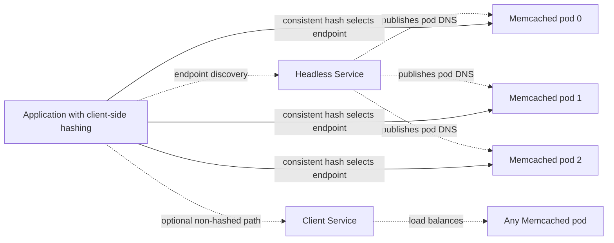
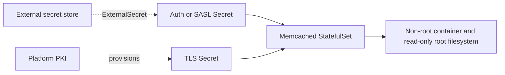
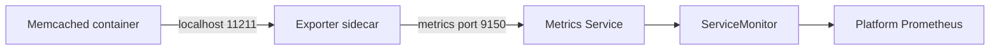

# Memcached Chart Design

## Scope

This chart deploys Memcached on Kubernetes using the official image. It focuses on predictable cache infrastructure, secure-by-option production settings,
and integration points commonly required by platform teams.

It does not turn Memcached into a replicated database or perform server-side
sharding. Cache distribution remains a client responsibility.

## Architecture

### Standalone

Standalone is intentionally small. It is appropriate for development, CI, or production cases where a single cache instance is acceptable.

### Distributed

Memcached does not replicate entries. This is the standard Memcached pool model:
run several independent servers and configure the application client to spread
keys across them. A production client should use consistent hashing or another
distribution strategy and tolerate cache misses during node replacement.

## Security Boundary

The chart can generate ASCII auth-file Secrets from values. SASL mode uses the official Memcached `-S`
startup path and therefore requires an externally prepared Secret with a SASL config file and sasldb file.
CA material is optional, and the chart does not generate certificates.

The chart hardens the pod, disables API-token mounting by default, and can
restrict cache, metrics, and egress traffic with NetworkPolicy. It does not
authorize individual cache keys, issue certificates, manage client identities,
or make Memcached safe for direct internet exposure. Memcached can verify
client certificates when `tls.caKey` and `tls.verifyMode` are configured;
operators still own network segmentation, PKI, Secret access, and identity
lifecycle.

## Observability Boundary

The exporter is optional and disabled by default. It supports TLS to Memcached, but it does not
support Memcached authentication. The chart blocks auth plus metrics to avoid a permanently failing
exporter. When TLS scraping is enabled, the exporter verifies the Memcached certificate with a
Service DNS server name by default while still connecting to the local pod address.

The chart can expose exporter metrics and create a ServiceMonitor and
PrometheusRule. Its Helm test checks connectivity for plaintext and ASCII-auth
modes; TLS and SASL modes print guidance and require a separate capable client
test. The platform owns Prometheus Operator, metrics retention, dashboards,
alert routing, log collection, and end-to-end client monitoring. A ready pod
does not prove that clients distribute keys correctly or that cache capacity is
sufficient.

## Production Boundary

The default values are designed for a disposable development cache. A production deployment should normally configure:

- `architecture=distributed` and `replicaCount>=3`
- memory sizing aligned between `memcached.memoryLimitMB` and container memory limits
- CPU and memory requests
- `memcached.disableFlushAll=true`
- explicit topology spread constraints or pod anti-affinity
- authentication, TLS, or strict NetworkPolicy depending on the trust boundary
- `networkPolicy.enabled=true` when the CNI enforces policies
- `metrics.enabled=true` with alert rules
- `pdb.enabled=true`
- `serviceAccount.automountServiceAccountToken=false`
- External Secrets Operator for production credentials

The chart owns the StatefulSet, Services, optional credentials Secret,
NetworkPolicies, HPA, PDB, monitoring resources, ExternalSecret, and extstore
PVC template. The platform owns client-side sharding, DNS outside the cluster,
storage classes, PKI, Secret stores, Prometheus Operator, scheduling capacity,
and backup policy for any externally managed Secret. Cache contents remain
disposable in every topology.

## Design Decisions

- Official image only: no vendor-specific Memcached image or Bitnami dependency.
- No `latest` tags: image tags are pinned and appVersion tracks the upstream version.
- StatefulSet over Deployment: stable pod identities and headless DNS help clients that address individual cache nodes.
- No Chart.lock: the chart has no dependencies.
- Extstore is optional: extstore can improve cache capacity but is not durable storage.
- No Gateway API: expose Memcached with a Service when an external endpoint is required.
- Secrets are explicit: production users can supply existing Secrets or External Secrets instead of committing credentials to values.
- TLS avoids TCP probes: kubelet TCP probes do not perform a TLS handshake and produce noisy Memcached accept logs.
- StatefulSet names reserve space for Kubernetes-generated pod and controller labels, so long release names are truncated before suffixed Service names are built.
- Dual-stack Services also adjust the default Memcached bind address to `0.0.0.0,::`, while preserving explicit `memcached.listenAddress` overrides.

## Known Gaps And Operational Risks

- Distributed nodes do not replicate entries; replacement causes cache misses.
- Scaling changes the server set and can remap most keys without consistent
  hashing in the client.
- HPA reacts to resource utilization, not cache hit rate or eviction pressure.
- Extstore PVCs extend cache capacity but do not provide durable application
  storage or a recovery contract.
- Authentication is a connection gate, not per-key authorization.
- The exporter cannot scrape an authenticated Memcached listener.
- TLS disables TCP probes because kubelet does not perform a TLS handshake.
- NetworkPolicy protection depends on a CNI that enforces the policy.

## Explicit Non-Goals

- replicated cache data
- automatic sharding or consistent hashing
- Memcached operator behavior
- persistent application data
- certificate generation
- installing Prometheus Operator CRDs

## Related Documents

- [README.md](README.md)
- [examples/production.yaml](examples/production.yaml)
- [values.yaml](values.yaml)
