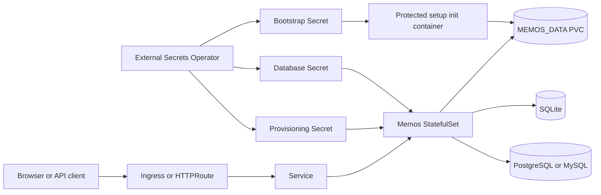

<!-- SPDX-License-Identifier: Apache-2.0 -->

# Memos Chart Design

## Scope

This chart deploys Memos 0.31 as a stateful web application using the official
`docker.io/neosmemo/memos:0.31.0` image. It owns the Kubernetes workload, durable data mount, networking, bootstrap,
deployment-configuration mount, and optional HelmForge database dependencies. It does not own application users,
memos, attachments, or settings stored through the Memos API.

## Architecture

The default topology is one StatefulSet replica with SQLite and a PersistentVolumeClaim mounted at
`/var/opt/memos`. The same directory can contain local assets even when relational state is moved to PostgreSQL or
MySQL, so external database mode does not make the data volume disposable.

## Design Decisions

### Stateful workload and storage

A StatefulSet preserves workload identity and binds generated claims predictably across upgrades. SQLite is restricted
to one replica. SQL-backed scaling requires `persistence.existingClaim` because per-ordinal claims would let uploads and
other local data diverge. A PodDisruptionBudget is optional and disabled by default because it cannot make a one-replica
SQLite deployment highly available.

### Database modes

Memos supports `sqlite`, `mysql`, and `postgres` through `MEMOS_DRIVER` and `MEMOS_DSN`. Inline complete DSNs render into
a chart-managed Secret; existing Secrets are preferred for production. Component mode keeps the password in a Secret
and uses a pinned official Node helper to assemble the native PostgreSQL URI or MySQL Go DSN in a memory volume. The
application performs its own authenticated startup and migrations. Optional PostgreSQL and MySQL dependencies are the
maintained HelmForge charts.

### Bootstrap and deployment configuration

The protected bootstrap runs the unchanged Memos binary on loopback before the public process starts. It creates the
first administrator only while the native profile reports `needsSetup`; adoption preserves existing users and
passwords.

`provisioning.existingSecret` is mounted read-only at `/etc/secrets`, the upstream scan path. Secret keys become native
Memos provisioning filenames. Supported instance groups include `ACCESS`, `GENERAL`, `STORAGE`, `MEMO_RELATED`,
`NOTIFICATION`, and `AI`; OAuth2 identity-provider files are also supported. Memos validates the complete set before
serving traffic and treats file-backed resources as authoritative for the process lifetime. A Secret update requires a
pod restart. The chart does not copy or reconcile those resources into another Secret or database row.

### Exposure and access policy

The chart supports Service, Ingress, and Gateway API HTTPRoute resources. `memos.instanceUrl` maps to the canonical
external `MEMOS_INSTANCE_URL` and is never inferred from a hostname. In Memos 0.31, public or private access is an
independent `ACCESS` instance setting. Operators manage it through the administrator UI or a
`memos-instance-setting-access.json` provisioning file. RSS was removed upstream in 0.31.

## Production Boundary

The chart configures a production-capable Kubernetes workload but does not supply a highly available platform by
itself. Operators own the StorageClass, shared-storage semantics, database resilience and backups, ingress controller,
Gateway, DNS, TLS certificates, External Secrets Operator, and NetworkPolicy-capable CNI. Multi-node replicas require a
shared filesystem suitable for the Memos data directory and an independently resilient SQL service.

Application-consistent backup and restore includes the complete data directory, the external database when selected,
and any provisioning Secret. The chart provides documented procedures and runtime recovery validation; it does not
schedule backups or choose a retention policy.

## Security Boundary

The upstream container runs as UID/GID `10001`. Defaults enforce non-root execution, a read-only root filesystem,
dropped capabilities, RuntimeDefault seccomp, no ServiceAccount token, and restricted ingress and egress. Writable
paths are explicit volumes. Bootstrap credentials and database passwords are consumed from Secrets and are not placed
in command arguments or ConfigMaps.

Provisioning JSON is sensitive plaintext. Kubernetes Secret encryption, External Secrets provider policy, RBAC,
credential rotation, and access to the backing secret store remain operator responsibilities. Private-webhook access is
disabled by default because enabling it expands the server-side request surface. NetworkPolicy only provides isolation
when the cluster CNI enforces it.

## Observability Boundary

Startup, readiness, and liveness probes use the native `/healthz` endpoint. Kubernetes events, pod logs, rollout state,
and application health are the chart's built-in operational signals. Memos 0.31 does not expose a chart-supported native
Prometheus metrics endpoint, so this chart does not create a ServiceMonitor or PrometheusRule. Operators may collect
logs and platform metrics with their existing observability stack.

The chart does not create a HorizontalPodAutoscaler. Safe scaling requires an external SQL database and shared data
storage, and the correct scaling signal depends on infrastructure outside this chart. Operators may add an HPA through
`extraManifests` only after satisfying those topology requirements.

## Known Gaps and Limitations

- Provisioning files are loaded only at process startup; Secret updates require an orderly rollout.
- The chart cannot verify that an existing claim supports safe multi-node read-write access.
- A single SQLite replica has planned and unplanned downtime during pod replacement.
- External SQL data migration is an application operation; changing `database.driver` does not migrate data.
- Pinned application and helper images still require normal vulnerability monitoring and release upgrades.
- Metrics and autoscaling are intentionally operator-managed because Memos has no supported native metrics contract.

## Non-Goals

- Building or patching the upstream Memos image.
- Reconciling users, memos, attachments, or API-managed settings.
- Compiling extensions or running package installation during pod startup.
- Provisioning ingress controllers, Gateways, certificate issuers, storage systems, or database operators.
- Claiming high availability for SQLite or per-pod local storage.

## Validation

Template and schema tests cover runtime environment variables, database modes, Secrets, invalid scaling combinations,
NetworkPolicy, PDB, dual-stack Services, Ingress TLS, Gateway API, probes, and deployment-configuration mounts.

Behavioral k3d validation exercises protected bootstrap, native administrator login, browser refresh cookies, memo and
attachment CRUD, PAT-authenticated MCP and revocation, OAuth2 code exchange, S3 storage, External Secrets, PostgreSQL,
MySQL, shared-state replicas, restart persistence, Helm upgrade, and complete SQLite recovery. The provisioning scenario
uses a nonempty canonical instance URL with file-backed `ACCESS=PRIVATE` and proves that anonymous access to a public
memo remains denied.
