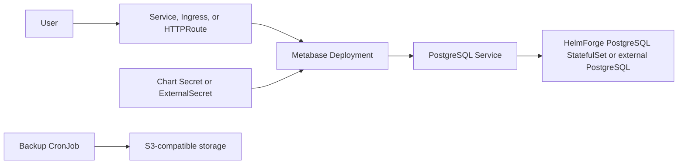

<!-- SPDX-License-Identifier: Apache-2.0 -->

# Metabase Chart Design

## Scope

This chart deploys Metabase Open Source using the official `docker.io/metabase/metabase` image and a PostgreSQL metadata
store. It targets self-hosted analytics teams that need a predictable Kubernetes deployment with optional ingress,
Gateway API, External Secrets, dual-stack Services, and S3-compatible database backups.

Supported persistence modes:

- bundled HelmForge PostgreSQL subchart
- external PostgreSQL with inline or Secret-managed credentials

## Architecture

## Main Design Choices

- Use PostgreSQL as the metadata database for every mode; H2 is intentionally not used for chart defaults.
- Use the HelmForge PostgreSQL subchart when `postgresql.enabled=true`.
- Generate or reference `MB_ENCRYPTION_SECRET_KEY` so saved database credentials stay decryptable across upgrades.
- Keep Metabase AI features disabled by default to avoid background AI work without an explicitly configured provider.
- Render Gateway API and External Secrets only when explicitly enabled.
- Provide S3-compatible metadata database backups through a chart-managed CronJob.

## Security Boundary

The chart owns the Metabase pod, its Kubernetes Secret references, and the optional bundled PostgreSQL release. The
container runs as UID/GID `2000`, drops all Linux capabilities, rejects privilege escalation, uses RuntimeDefault
seccomp, and mounts no Kubernetes API token by default. A read-only root filesystem limits writes to bounded
`emptyDir` volumes at `/plugins`, `/tmp`, and `/target`.

The generated encryption key is reused during connected Helm upgrades, but GitOps rendering cannot look up a live
Secret. Production installations should supply `metabase.existingSecret` or External Secrets and back up that key
separately from PostgreSQL. Inline passwords remain supported for evaluation but are outside the recommended boundary.

NetworkPolicy is opt-in because Metabase connects to operator-defined analytical databases, SMTP servers, webhooks,
and APIs. When enabled, ingress is restricted to declared peers. Egress isolation additionally requires the operator
to enumerate every destination; the chart can identify its bundled metadata database but cannot infer analytical
sources.

## Observability Boundary

Startup, readiness, and liveness probes use Metabase's `/api/health` endpoint. The application logs to stdout and its
bounded `/target` directory; the chart does not deploy a log collector or metrics stack. Kubernetes events, restart
counts, application logs, PostgreSQL logs, and backup Job status are the primary operational signals. Operators own
external alerting, log retention, query-performance monitoring, and synthetic dashboard checks.

## Failure Modes

- PostgreSQL unavailability holds the init container and prevents an incomplete application startup.
- First-start migrations can exceed aggressively shortened probe windows.
- Rotating the encryption key can make stored data-source credentials unreadable.
- Exhausting a runtime `emptyDir` blocks plugin extraction, temporary files, or local log writes.
- An incomplete egress policy can block metadata PostgreSQL, analytical databases, SMTP, webhooks, or external APIs.
- A single replica remains unavailable during node loss; the optional PDB only coordinates voluntary disruptions.

## Upgrade and Rollback

Database backup and encryption-key continuity are mandatory before application upgrades. Rollbacks must use a Metabase
version compatible with the already-migrated metadata schema. The PostgreSQL backup CronJob protects database content,
not the encryption Secret. Chart versioning is CI-owned; this design change does not edit `Chart.yaml` version.

## Production Boundary

For production, operators should define:

- PostgreSQL storage class, size, backup, and restore procedures
- stable `MB_ENCRYPTION_SECRET_KEY` through an existing Secret or External Secret
- `metabase.siteUrl` and TLS-enabled ingress or Gateway API routing
- resource requests and limits sized for dashboard and query load
- backup S3 endpoint, bucket, credentials, and retention workflow
- NetworkPolicy and ServiceMonitor settings when required by the platform

## Explicit Non-Goals

- provisioning analytical source databases
- managing Metabase setup wizard state or admin users
- running embedded H2 as a production metadata store
- provisioning ingress controllers, Gateway controllers, SecretStores, or object storage

## Known Gaps

- The chart does not discover NetworkPolicy destinations for analytical databases or integrations.
- It does not expose a Prometheus ServiceMonitor because the community image has no native unauthenticated metrics
  endpoint suitable for a safe default.
- The application Deployment uses one replica by default and does not provide autoscaling semantics.
- Plugin storage is ephemeral; reproducible custom JDBC drivers should be installed by an init container on every pod.
- Backup restore execution and restore verification remain operator-controlled procedures.

<!-- @AI-METADATA
type: design
title: Metabase Chart Design
description: Design document for the Metabase Helm chart architecture, database model, backups, and production boundaries

keywords: metabase, design, architecture, postgresql, backup, ingress, gateway-api, external-secrets, helm, kubernetes

purpose: Document chart architecture, operational choices, production boundaries, and non-goals
scope: Chart Design

relations:
  - charts/metabase/README.md
  - charts/metabase/docs/database.md
  - charts/metabase/docs/production.md
path: charts/metabase/DESIGN.md
version: 1.0
date: 2026-06-02
-->
