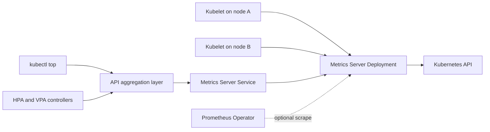

<!-- SPDX-License-Identifier: Apache-2.0 -->

# Metrics Server Chart Design

## Scope

This chart installs Metrics Server as a Kubernetes cluster add-on and provides
the aggregation resources required for `kubectl top`, Horizontal Pod Autoscaler,
and Vertical Pod Autoscaler resource-metric consumption. It owns the Deployment,
Service, ServiceAccount, RBAC bindings, optional APIService, optional
NetworkPolicy, optional ServiceMonitor, PodDisruptionBudget, and Helm readiness
test that form that contract.

The chart follows the official Metrics Server image and command-line model. It
does not replace a platform-managed Metrics API. Operators can disable the
APIService and RBAC resources when their distribution owns those cluster-scoped
objects, but ownership must remain unambiguous.

## Architecture

Metrics Server watches the Kubernetes API for nodes and pods, scrapes the
resource metrics endpoint exposed by each kubelet, keeps only an in-memory view,
and serves aggregated metrics through its HTTPS endpoint. The API aggregation
layer proxies `metrics.k8s.io/v1beta1` requests from clients and controllers to
the chart Service.

The secure serving port is controlled by `containerPort`; the process receives
the same value through `--secure-port`, and the Service targets the named
`https` port. `service.port` remains the independent cluster-facing port used by
the APIService. When `hostNetwork.enabled=true`, the API server reaches a node
address and that secure port rather than a pod IP.

## Design decisions

### Official image and compatibility

The chart pins the official
`registry.k8s.io/metrics-server/metrics-server:v0.9.0` image. The upstream
project tests Metrics Server against the last three Kubernetes minor releases;
this chart declares Kubernetes `>=1.31.0-0` for the selected release baseline.
The image tag and chart compatibility constraint must be reviewed together on
every application upgrade.

### Typed flags with an escape hatch

Frequently used flags have typed values: metric resolution, kubelet address
preference, node-status port selection, kubelet CA, kubelet timeout, and local
insecure TLS. `metricsServer.extraArgs` remains available for upstream options
that do not yet justify a first-class value. Typed flags are rendered first, so
operators should not duplicate them through `extraArgs`.

### Secure kubelet transport by default

Kubelet certificate validation stays enabled. The
`metricsServer.kubelet.insecureTLS` switch exists for local k3d/kind clusters
whose kubelet certificates lack usable address SANs, and its documentation
marks it as a testing-only compromise. Production clusters should mount a CA
bundle and use `metricsServer.kubelet.certificateAuthority` instead.

### Cluster-scoped ownership

RBAC and APIService resources are enabled by default because a normal Metrics
Server installation requires both. Rendering fails when the chart is asked to
manage the APIService without RBAC. Lookup guards avoid adopting an existing
`v1beta1.metrics.k8s.io` APIService or aggregated reader ClusterRole already
owned by the platform.

### Host-network rollouts

The default rolling update uses zero unavailable and one surge pod. With host
networking on a single node, a surge pod cannot bind the same host port. When the
operator has not customized the strategy, the chart therefore switches to one
unavailable and zero surge. Explicit strategy overrides always win.

## Production boundary

The chart supplies secure workload defaults, resource requests and limits,
availability controls, network policy primitives, and observability integration.
The platform remains responsible for enabling the API aggregation layer,
webhook authentication and authorization on kubelets, routability between the
control plane and Metrics Server, routability from Metrics Server to every
kubelet, and a container runtime that exposes resource metrics.

High availability requires at least two schedulable nodes and should pair two or
more replicas with a PDB and topology spread. To distribute aggregated API
requests across replicas, the kube-apiserver should enable aggregator routing.
The chart cannot set control-plane flags on managed Kubernetes services.

Capacity planning is also operator-owned. Default resources are a starting
point; large clusters must size CPU and memory from node and pod counts, scrape
resolution, and observed latency. No durable data volume exists because Metrics
Server stores only short-lived samples in memory.

## Security boundary

The Metrics Server container runs as a non-root UID/GID, drops all capabilities,
disables privilege escalation, uses a read-only root filesystem and
RuntimeDefault seccomp, and mounts only an `emptyDir` at `/tmp` for generated
serving certificates. The Helm test pod follows the same restricted posture and
does not mount a ServiceAccount token.

The main pod must mount its ServiceAccount token because it watches Kubernetes
objects and participates in delegated authentication. Cluster RBAC is therefore
security-sensitive and intentionally explicit. APIService
`insecureSkipTLSVerify=true` authenticates the aggregation path without verifying
the generated backend certificate; production platforms that manage a serving
CA should set `apiService.caBundle`.

NetworkPolicy is opt-in because node and control-plane CIDRs vary by cluster.
The supplied policy can constrain ingress, API-server egress, DNS, and kubelet
scrapes, but broad default CIDRs must be replaced with platform ranges before a
strict production rollout.

## Observability boundary

Liveness and readiness probes cover the process endpoints. The Helm test calls
`/readyz` through the Service and validates the serving path. Operators should
also verify the APIService `Available` condition, run `kubectl top`, watch
Metrics Server logs for scrape failures, and alert on unavailable aggregated API
requests.

An optional ServiceMonitor exposes Metrics Server process metrics to Prometheus
Operator. The chart does not create PrometheusRule alerts, dashboards, or a
Prometheus installation. Resource metrics served for autoscaling are not a
replacement for long-term application monitoring.

## Known gaps and limitations

- Metrics Server is not a historical metrics store and offers no persistence or
  retention controls.
- The chart cannot repair kubelet certificate issuance, aggregation-layer
  configuration, webhook authentication, or control-plane network routing.
- Default NetworkPolicy CIDRs are deliberately broad examples because node and
  control-plane ranges cannot be inferred portably.
- APIService discovery uses Helm `lookup`; offline rendering cannot model every
  cluster-owned resource collision.
- The chart does not configure HPA or VPA objects for applications and does not
  provide custom or external metrics APIs.
- Autoscaling can remain unavailable for one or more scrape intervals after
  installation even when the pod is healthy.

## Non-goals

- Scraping application, business, custom, or external metrics.
- Providing long-term metrics retention, dashboards, or alert routing.
- Managing kube-apiserver flags, kubelet certificate rotation, or node firewall
  rules.
- Replacing a cloud provider or Kubernetes distribution Metrics API add-on.
- Automatically discovering safe NetworkPolicy CIDRs for every CNI and topology.
- Persisting Metrics Server samples or backing them up.

## Validation coverage

CI renders and validates default, dual-stack, high-availability, host-network,
k3d insecure-TLS, NetworkPolicy, and ServiceMonitor profiles. Unit tests cover
the Deployment, Service, RBAC, APIService, ServiceAccount, PDB, NetworkPolicy,
ServiceMonitor, Helm test pod, host-network rollout behavior, application port
wiring, and invalid aggregation or kubelet address configurations. The complete
chart gate also installs every scenario on k3d, waits for workloads, verifies
Service endpoints, inspects logs and events, and removes all test resources.
