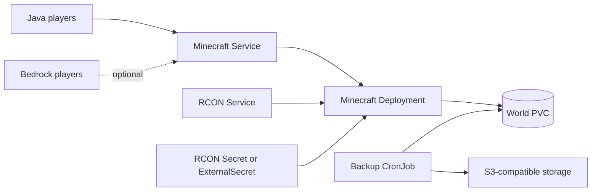

# Minecraft Chart Design

## Scope

This chart deploys Minecraft Java Edition servers using the official community-standard
`docker.io/itzg/minecraft-server` image. It supports vanilla, Paper, Forge, Fabric, Quilt, Geyser/Floodgate cross-play,
RCON operations, persistent worlds, metrics, External Secrets, and S3-compatible backups.
The 2026.10.0 runtime also exposes IPv6 stack preference, a replaceable process
runner, and layered generic packs distributed as OCI artifacts.

## Architecture

The workload intentionally uses a single replica with `Recreate` strategy because one Minecraft server process owns the
world data at a time.

## Main Design Choices

- Use `itzg/minecraft-server` because it handles server type selection, modloader bootstrap, version pinning, and startup
  automation.
- Require explicit `server.eula=true` before a server can run.
- Keep persistent world storage enabled by default.
- Expose the game service as `LoadBalancer` by default, with dual-stack service controls available.
- Keep RCON enabled for operational automation, backups, and graceful save coordination.
- Use External Secrets only when explicitly enabled and require an existing RCON secret to avoid credential drift.
- Use the same `itzg/minecraft-server` image for backup worker jobs so RCON tooling stays aligned with the server image.
- Map `server.preferIPv6` and `server.runner` directly to the upstream runtime
  contract while preserving safe defaults.
- Pass generic pack OCI references and optional registry authentication paths
  without copying credentials into Helm values.

## Production Boundary

For production, operators should define:

- `server.version`, `server.type`, and mod/plugin versions
- storage class, PVC size, and restore runbook
- service exposure, firewall rules, and optional DNS
- RCON secret management
- backup schedule, object storage credentials, and retention policy
- resource requests and memory/JVM settings appropriate for player count and modpack size
- staging validation for plugins, mods, datapacks, and resource packs before reusing production PVCs

## Security Boundary

- The server runs as UID/GID 1000 with no Linux capabilities, no privilege escalation, a read-only root filesystem,
  and the runtime-default seccomp profile.
- Only `/data` and a chart-managed `/tmp` volume are writable. Operators that replace the image must ensure it supports
  the same non-root and read-only-root contract or explicitly override the security contexts.
- The pod does not mount a Kubernetes API token by default. RCON credentials are sourced from a retained Secret or an
  operator-provided Secret, and should not be exposed outside trusted networks.
- Network policy, firewalling, SecretStore access controls, and object-store authorization remain operator boundaries.

## Observability Boundary

- Startup, readiness, and liveness probes use `mc-health` from the server image.
- Optional Prometheus metrics are exported by the `mc-monitor` sidecar; deploying and configuring Prometheus and its
  operator are outside this chart's scope.
- Application logs are emitted to container stdout/stderr. Collection, retention, dashboards, and alerting remain the
  operator's responsibility.

## Known Gaps

- The chart cannot validate third-party mods, plugins, datapacks, or their upgrade compatibility.
- It does not create NetworkPolicy resources because player, RCON, metrics, DNS, and backup egress requirements vary.
- Backup retention, restore automation, and object-store lifecycle policies must be implemented and tested externally.
- High availability requires application-level world replication that the upstream single-server runtime does not offer.

## Explicit Non-Goals

- managing Bedrock Dedicated Server as a separate product
- running multiple Minecraft server replicas against one world
- provisioning object storage or external secret stores
- validating third-party mod/plugin compatibility
- bypassing the Minecraft EULA acceptance requirement
