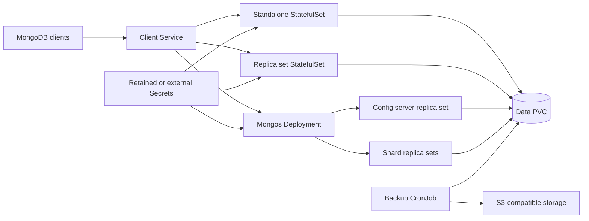

# MongoDB Chart Design

## Scope

The `mongodb` chart packages MongoDB using the official `docker.io/library/mongo`
image. It supports three topology choices from one values contract:

- `standalone` for single-instance development and small internal workloads
- `replicaset` for production high availability with MongoDB elections
- `sharded` for workloads that need mongos routers, config servers, and shard
  replica sets

The chart intentionally avoids third-party vendor images and library chart
dependencies. Operators get the standard MongoDB data path (`/data/db`), command
line behavior, and official image lifecycle.

## Architecture

Standalone and replica set modes use StatefulSets so pod identity and storage are
stable. Replica set mode adds a Helm hook Job that initializes the replica set
after members are reachable. When enabled, the arbiter runs in a separate
single-replica StatefulSet with stable DNS and ephemeral local storage. The
post-install/post-upgrade hook registers it as `arbiterOnly` and reconciles its
presence without routing client traffic to it. Sharded mode deploys config servers and shard
members as StatefulSets, mongos as a Deployment, and a hook Job that initializes
the cluster and registers shards.

## Main Design Decisions

Authentication is enabled by default for standalone and replica set deployments.
Root credentials can be generated by the chart, supplied inline for disposable
environments, or sourced from an existing Secret. Replica set mode also requires
a stable keyFile. Production operators should provide `auth.existingKeySecret`
before first install because rotating the keyFile by changing chart values is
not a safe operational flow.

The sharded topology is validated as an unauthenticated lab topology. The
official MongoDB container entrypoint initializes `MONGO_INITDB_ROOT_*` as a
standalone process, which conflicts with `--configsvr` and `--shardsvr` startup.
Production sharded authentication therefore requires an operator-managed
bootstrap flow outside this chart's automatic root-user initialization path.

## Production Boundary

MongoDB topology changes are operational migrations, not simple Helm toggles.
Moving from standalone to replica set or sharded mode requires a dump/restore or
another MongoDB-approved migration plan. Increasing replica set members should be
validated with client connection strings and election behavior. Sharded clusters
require shard key design, balancer monitoring, and capacity planning outside the
chart.

The chart never removes data-bearing replica set members automatically. An
operator must use MongoDB's member-removal procedure before lowering
`replicaSet.members`. Arbiter enablement is narrower: the hook safely reconciles
the single known arbiter hostname on install and upgrade.

The backup CronJob performs logical `mongodump` archives to S3-compatible object
storage. It is suitable for scheduled full backups and restore drills, but it is
not a point-in-time recovery system or a substitute for storage snapshots where
those are required.

## Security Boundary

The chart defaults to authentication on, namespaced Secrets, explicit probes,
and a MongoDB filesystem group (`fsGroup: 999`). It exposes no public ingress.
To preserve compatibility with images and workloads that expect the upstream
default root user, the chart ships with empty container-level `securityContext`
and configurable `podSecurityContext`/`initContainerSecurityContext`. Operators
with strict no-root policies can enable them via values: set `securityContext`
and `podSecurityContext` to run the application containers as a non-root user
(UID/GID `999`, the official image's `mongodb` user) with
`allowPrivilegeEscalation: false`, and set `initContainerSecurityContext`
(plus `auth.replicaSetKeySecretPermissions: 0440`) so the keyfile bootstrap
container also runs non-root. The chart exposes no public ingress. Network
isolation, TLS termination, storage encryption, and external credential
rotation are cluster/operator responsibilities. External Secrets support is
available for clusters that manage credentials through ESO.

Generated root credentials and replica-set keyFiles are retained across Helm
upgrades and persistent-release removal. Once MongoDB has initialized a data
directory, changing init credentials in values does not rotate the database
credential; use MongoDB's authenticated rotation procedures instead.

## Observability Boundary

- Liveness and readiness probes execute authenticated `mongosh` pings when
  authentication is enabled.
- The optional Prometheus exporter and ServiceMonitor expose MongoDB metrics;
  Prometheus installation, scraping, dashboards, and alert rules are external.
- MongoDB and hook-job logs are emitted to container stdout/stderr. Collection,
  retention, audit logging, and slow-query analysis remain operator concerns.
- Backup jobs expose Kubernetes Job status, but the operator must alert on job
  failures and periodically prove restores from stored archives.

## Known Gaps

- Authenticated sharded bootstrap is not automated because the official image's
  root-user initialization conflicts with config-server and shard-server modes.
- TLS certificates, NetworkPolicy, storage encryption, and point-in-time
  recovery are not created by the chart.
- Topology conversion and removal of data-bearing replica-set members require
  MongoDB-native operational procedures outside Helm.
- Credential rotation is not implemented by changing initialization values;
  use MongoDB commands and coordinated Secret updates.

## Explicit Non-Goals

- replacing MongoDB operational procedures for replica set or sharded migrations
- bootstrapping authenticated sharded clusters through `MONGO_INITDB_ROOT_*`
- managing cloud object storage buckets beyond optional create-on-upload behavior
- implementing point-in-time recovery
- providing a Bitnami-compatible data directory or values contract
- exposing MongoDB publicly without an operator-managed network policy
