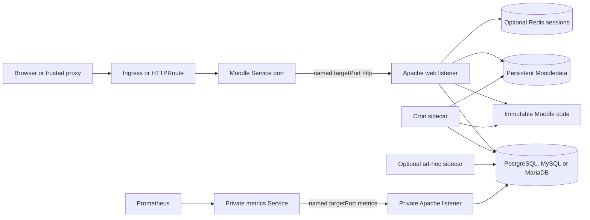

# Moodle chart design

## Scope

This chart deploys Moodle web, scheduled-task, optional ad-hoc worker and
maintenance workloads around immutable Moodle code and persistent Moodledata.
It supports PostgreSQL, MySQL or MariaDB through one selected HelmForge
dependency or an external database, plus optional Redis sessions and
authenticated application metrics.

## Architecture

The public Service port is independent from `containerPorts.http`. The chart
generates Apache `Listen` directives for the web listener and `metrics.port`,
and every Service targets a named container port. Web, cron and optional ad-hoc
workers share a pod's prepared code and Moodledata while keeping separate
resource limits and temporary directories.

## Design decisions

### Immutable code and writable state

Both the PHP/Apache runtime and Moodle source are content-pinned. Archive mode
downloads a checksum-verified Moodle release during pod preparation. Image mode
supports offline deployments and reviewed custom plugins. Application code is
mounted read-only; Moodledata remains the durable writable boundary.

### Database selection and lifecycle

PostgreSQL is the default. PostgreSQL, MySQL and MariaDB use their native Moodle
drivers and exactly one bundled dependency or external endpoint. Selecting a
different engine never converts existing data. Installation uses
connection-scoped advisory locks, normal startup rejects a code/database version
mismatch, and an explicit maintenance Job owns schema operations.

### Workload and scaling model

Cron shares each web pod so the default RWO Moodledata volume remains valid.
Moodle database locks coordinate task execution. Multiple replicas or HPA
require shared ReadWriteMany storage and Redis-backed sessions; the chart
validates that contract before rendering.

### Metrics isolation

The optional `tool_monitoring` plugin is commit-pinned and checksum-verified.
Its bearer token is Secret-mounted, the public listener denies the metrics
route, and the private listener denies ordinary application routes. A dedicated
ServiceMonitor and optional PrometheusRule integrate with an existing
Prometheus Operator installation.

## Production boundary

The chart owns Moodle workloads, prepared configuration, one Moodledata PVC,
selected bundled dependencies, Services, optional exposure resources,
NetworkPolicy and monitoring custom resources. Operators own storage classes,
external databases and Redis, ingress or Gateway controllers, Prometheus
Operator, SMTP, DNS, certificates, identity providers and backup infrastructure.

Database backups alone are not full-site backups. A recoverable Moodle site
requires coordinated database, Moodledata and configuration recovery. The chart
documents that procedure but does not claim to provide an automated site-backup
controller.

## Security boundary

Apache and PHP run as UID/GID 33 on configurable unprivileged listeners in the
1024-65535 range, with no added capabilities, no privilege escalation and
read-only root/code filesystems.
The public document root excludes `config.php`, CLI scripts and rendered values.
Application, database, Redis, SMTP and metrics credentials come from Secrets.

NetworkPolicy is opt-in because external endpoints cannot be inferred safely.
When enabled, it restricts ingress to the configured web and metrics listeners
and permits only explicit database, Redis, DNS, source-download and operator
egress. TLS termination, proxy trust, external database certificate lifecycle
and third-party plugin review remain operator responsibilities.

## Observability boundary

Startup and liveness probes verify PHP execution; readiness also validates the
database schema version and monitoring-plugin state. Runtime validation checks
real HTTP responses, administrator login, cron progress and database adapters.
When metrics are enabled, it additionally verifies authentication, listener
isolation, Prometheus discovery, a real Moodle state change and rule health.

These checks do not prove production storage or database failover, SMTP
delivery, institutional SSO, proxy correctness or arbitrary plugin behavior.
Production operators should alert on Kubernetes readiness, task health,
database capacity, Moodledata capacity and the chart's Prometheus rules.

## Non-goals

- Migrating an installed site between database engines.
- Installing cluster-scoped controllers or monitoring CRDs.
- Claiming high availability with RWO storage or local PHP sessions.
- Compiling PHP extensions or installing unreviewed plugins during startup.
- Treating database-only backups as complete Moodle recovery points.
- Guaranteeing completion of arbitrarily long tasks during pod termination.

## Lifecycle limitations

Maintenance requires drained requests and tasks plus a tested recovery point.
The chart cannot infer whether a backup is recoverable. A maintenance Job cannot
reverse schema changes; failed upgrades stay in maintenance for inspection.

Kubernetes replacement can interrupt tasks. Operators should drain cron before
planned upgrades and validate the retries and idempotency of custom tasks. The
default termination grace period is not a promise to finish a long course
backup.

## Validation boundaries

The lab verifies installed Moodle behavior, PHP execution, login, cron,
persistence, Secrets, every supported database backend, Redis sessions,
configurable web and metrics listeners, shared-volume concurrency and rendered
resources. See [validation evidence](docs/validation.md) for scenarios and
limits.

## Research

See [production research](docs/research.md) for verified upstream sources,
artifact digests and comparison rationale.
