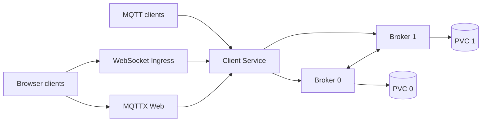

# Mosquitto Chart Design

## Scope

This chart deploys the official Eclipse Mosquitto image as a Kubernetes-native
MQTT broker. It covers standalone and explicitly federated topologies, TCP,
WebSocket and TLS listeners, password authentication, ACLs, local persistence,
and an optional MQTTX Web companion. It does not disguise broker-local state as
a shared-state cluster.

## Architecture

The broker is a StatefulSet with stable pod identity, a headless Service for
peer discovery, and one PVC per replica when persistence is enabled. In
`standalone` mode exactly one broker runs. In `federated` mode the init
container derives each pod ordinal and writes Mosquitto bridge connections to
every peer through stable StatefulSet DNS.

The client Service routes named `mqtt`, `websocket`, and `mqtts` ports to the
corresponding process listeners. Service ports and application listeners are
independent contracts. MQTTX Web is a separate Deployment and Service; its
`containerPort` is passed to the real `http-server` process rather than being
only pod metadata.

## Design Choices

- A StatefulSet is used even for one replica because persistence and stable
  identity are intrinsic broker concerns.
- Federation is opt-in and requires at least two replicas. The chart calls it
  federation, not high availability, because sessions and durable local state
  are not shared.
- Generated runtime files live on an `emptyDir`. Secrets remain Kubernetes
  Secret references, while the init container creates the Mosquitto password
  file without placing plaintext credentials in a ConfigMap.
- Mosquitto 2.1 authentication and ACL plugins are used instead of deprecated
  `password_file` and `acl_file` directives.
- TLS certificate issuance is outside the chart. Operators supply an existing
  Secret so certificate lifecycle remains owned by their platform.
- NetworkPolicies are ingress-only. This protects listeners without silently
  blocking DNS, bridge traffic, registry access, or other operator-managed
  egress paths.

## Production Boundary

The chart owns Kubernetes resources, process arguments, generated Mosquitto
configuration, probes, rollout checksums, and documented values. The operator
owns storage-class durability, backups, load-balancer and ingress-controller
behavior, DNS, certificate issuance, credential rotation, capacity planning,
and MQTT client reconnect semantics.

The default anonymous listener is intended for evaluation or a trusted
internal network. A public production broker must enable authentication, ACLs,
and TLS or mTLS and should set explicit connection, queue, and packet limits.
Federated deployments must be sized and monitored as independent brokers.

## Security Boundary

Broker and MQTTX pods disable service-account token automounting, run as
non-root numeric identities, use RuntimeDefault seccomp, prevent privilege
escalation, drop all Linux capabilities, and mount a read-only root filesystem.
Writable locations are limited to generated configuration and broker data
volumes.

The default ingress NetworkPolicies allow traffic only to declared named
listener ports. `networkPolicy.extraIngress` and
`networkPolicy.mqttxExtraIngress` are additive escape hatches; they do not
replace the default listener rule. NetworkPolicy effectiveness depends on the
cluster CNI.

Kubernetes Secrets protect credentials at the API boundary, but the chart does
not provide encryption-at-rest, an external secret controller, or automatic
credential rotation. Pods that can read a mounted Secret remain inside the
credential trust boundary.

## Observability Boundary

Mosquitto writes logs to stdout for collection by the platform. Startup,
liveness, and readiness probes validate the effective named listener. The
runtime smoke test proves an actual MQTT publish/subscribe round trip and, in
federated mode, publishes on one broker and subscribes on another.

The chart does not install a metrics exporter or alert rules. Operators should
add their preferred Mosquitto exporter or log pipeline and alert on connection
rejections, bridge disconnects, persistence failures, resource saturation, and
pod restarts.

## Known Gaps

- Federated mode does not support the chart-managed TLS listener for bridge
  connections.
- MQTTX Web environment metadata is informational because the upstream static
  application does not consume HelmForge-specific variables automatically.
- The chart does not create certificates, backups, dashboards, exporters, or
  alerts.
- NetworkPolicy support depends on a policy-enforcing CNI.
- Mosquitto 2.1 reduced its upstream default maximum packet size to 2,000,000
  bytes. Workloads requiring larger packets must set
  `broker.limits.maxPacketSize` deliberately.

## Non-Goals

- Emulating a native shared-state MQTT cluster.
- Sharing sessions or persistence databases between broker replicas.
- Managing external DNS, ingress controllers, storage snapshots, or PKI.
- Compiling plugins or extensions during pod startup.
