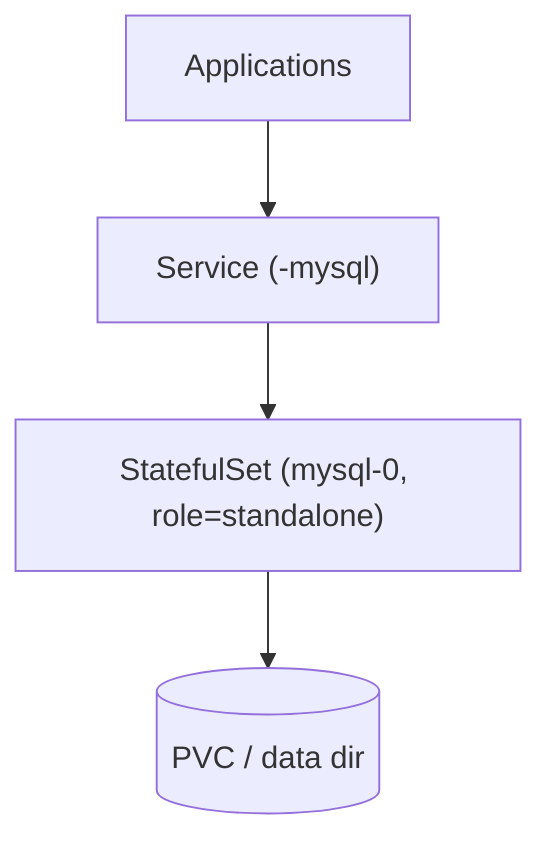
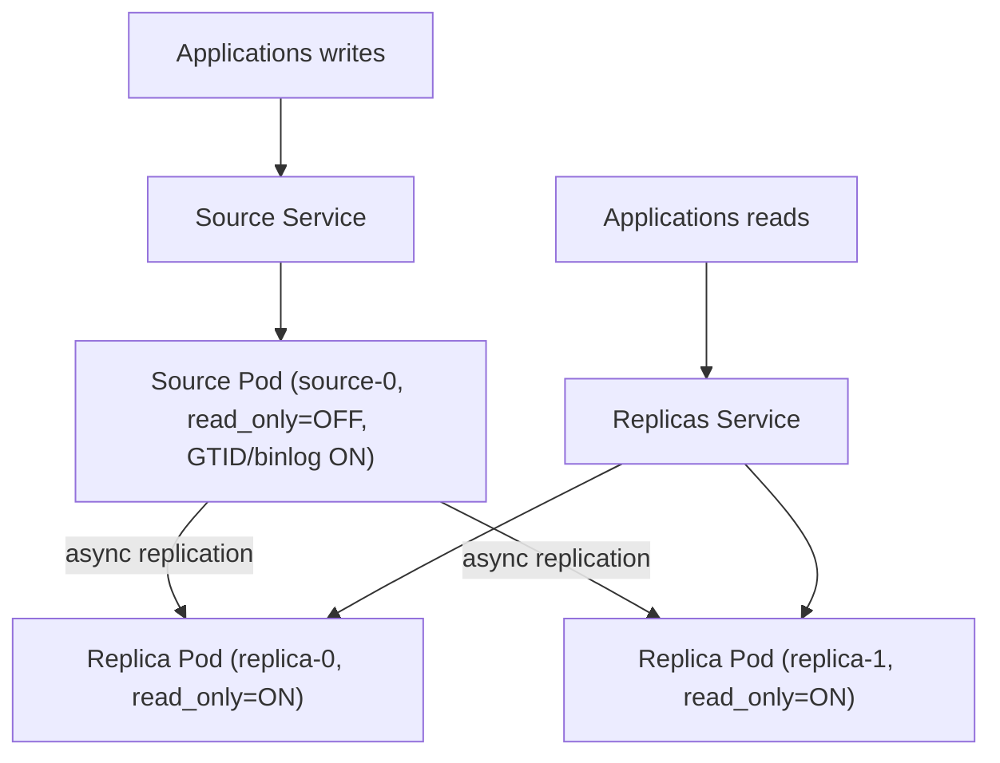
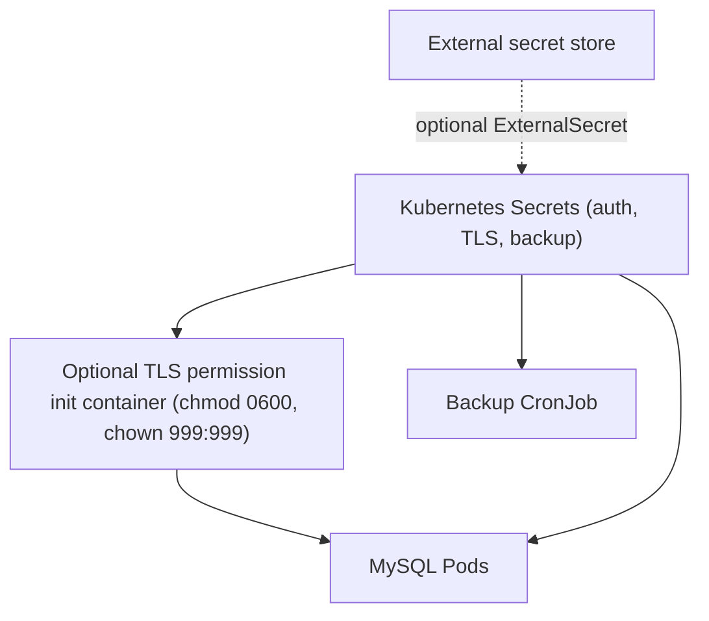

# MySQL Chart Design

## Scope

The chart provides a pragmatic MySQL deployment for Kubernetes with two explicit modes:

- `standalone`: one writable MySQL instance for development, test, and simple stateful workloads.
- `replication`: one fixed writable source plus asynchronous read replicas for read scaling and recovery assistance.

The chart uses the official `docker.io/library/mysql` image and keeps database topology management inside Helm templates. It does not attempt to become a MySQL operator.

## Architecture

### Standalone

Standalone mode is intentionally simple. It is valid for development and for production cases where a single writable instance is an accepted risk and external backup/restore processes are in place.

### Replication

Replication mode is for read scaling and operational recovery support. It does not provide automatic source election, source promotion, or transparent client failover.

### Secret and TLS Flow

The chart supports regular Kubernetes Secrets, existing Secrets, and External Secrets Operator v1. External Secrets are optional and disabled by default.

## Production Controls

Production-ready deployments are possible through values, but the default values are intentionally development-friendly. A production profile should usually enable or configure:

- externally managed auth credentials through `auth.existingSecret` or `externalSecrets.auth.enabled`.
- TLS with `tls.enabled`, `tls.requireSecureTransport`, and `tls.client.enabled`.
- `tls.volumePermissions.enabled` when projected TLS private-key modes are incompatible with the non-root MySQL process.
- persistent volumes sized for the workload and storage class.
- both `whenDeleted` and `whenScaled` set to `Retain` under the applicable standalone, source, or read-replica
  `persistence.retentionPolicy` when deleting or scaling the StatefulSet must keep the PVCs. Empty fields leave the
  cluster default.
- resource requests/limits or chart resource presets.
- `networkPolicy.enabled` and, where supported by the CNI, `networkPolicy.egress.enabled`.
- `serviceAccount.automountServiceAccountToken=false` unless an extension needs Kubernetes API access.
- metrics and alerts for availability, replica lag, connection count, disk growth, and backup failures.
- backup and restore runbooks with regular restore tests.

Kubernetes 1.26 disables the `StatefulSetAutoDeletePVC` feature gate by default. The API server and controller manager
must both enable it before a `Delete` retention policy can be relied on. Kubernetes 1.27 and later enable the feature
by default.

## Design Decisions

- Official image only: the chart does not depend on vendor-specific MySQL images.
- Fixed source replication: Helm owns a predictable source StatefulSet and replica StatefulSet.
- No raw secret material in values for production: use existing Kubernetes Secrets or External Secrets.
- TLS key permission normalization is opt-in because some clusters do not require it and it adds an init container.
- NetworkPolicy egress is opt-in because egress behavior varies by CNI and cluster policy.
- `service.ipFamilyPolicy` and `service.ipFamilies` are exposed for dual-stack clusters without changing single-stack defaults.

## Security Boundary

- Authentication credentials must be managed via existingSecret or External Secrets Operator in production.
- Default UID/GID 999 execution with dropped capabilities applies to the MySQL workload container,
  configurable via `securityContext.runAsUser` and `securityContext.runAsGroup`. When optional TLS permission
  normalization is enabled, its init container runs as UID 0 (`runAsNonRoot: false`) to chown files to the
  configured user/group, which may require an admission policy exception on strict clusters.
- TLS key permission normalization is opt-in for clusters requiring strict key ownership (chmod 0600).
- NetworkPolicy is opt-in (`networkPolicy.enabled=false` by default). When enabled, ingress traffic is restricted
  to the release namespace or configured `extraFrom` peers; disabling `allowSameNamespace` with an empty
  `extraFrom` permits all sources on the MySQL port. Egress restriction requires explicit opt-in via
  `networkPolicy.egress.enabled` to limit traffic to authorized DNS, backup and external replication targets.

## Production Boundary

- Standalone mode is a single failure domain; replication mode provides read scalability and manual recovery support.
- Production deployments must configure appropriate resource requests and limits matching workload concurrency.
- Retained PVC storage classes with volume expansion support are recommended for data persistence.
- When enabled, the chart's PodDisruptionBudget selects all release pods without role filtering.
  With `minAvailable: 1`, the source pod alone satisfies the budget; operators requiring separate source and
  replica availability guarantees should disable the chart PDB (`pdb.enabled=false`) and deploy separate,
  non-overlapping role-specific PDBs targeting `app.kubernetes.io/role: source` and `app.kubernetes.io/role: replica`.

## Observability Boundary

- Optional mysqld-exporter sidecar provides metrics on a dedicated port.
- ServiceMonitor integration connects with Prometheus Operator without bundling unmanaged CRDs.
- Error log output is captured through container logging. The slow query log is disabled by default;
  when enabled through `config.myCnf`, MySQL writes it to a file that standard Kubernetes container
  logging does not capture.

## Known Gaps

- Automated failover and source election are not provided; promotion requires manual intervention or an external operator.
- Physical backup and point-in-time recovery are external operational tasks.
- In-place major version upgrades require explicit testing and migration procedures.

## Explicit Non-Goals

- InnoDB Cluster
- Group Replication
- automatic source promotion
- operator-style topology reconciliation
- physical backup orchestration
- point-in-time recovery automation
- cross-region disaster recovery

## Related Documents

- [README.md](README.md)
- [docs/production.md](docs/production.md)
- [docs/replication.md](docs/replication.md)
- [docs/replication-operations.md](docs/replication-operations.md)
- [docs/backup-restore.md](docs/backup-restore.md)
- [docs/secret-rotation.md](docs/secret-rotation.md)
