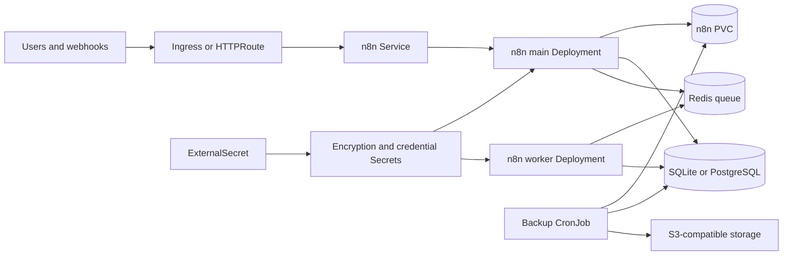

# n8n Chart Design

## Scope

This chart deploys n8n for self-hosted workflow automation. It supports the
zero-configuration SQLite path, HelmForge-managed PostgreSQL, external
databases, Redis-backed queue mode, worker replicas, persistent data, ingress,
Gateway API, External Secrets, and S3-compatible backup jobs.

## Architecture

## Main Design Choices

- Use the upstream `docker.io/n8nio/n8n` image and pin explicit release tags.
- Keep SQLite as the default so small installations can start without subcharts.
- Use HelmForge PostgreSQL and Redis subcharts when operators enable
  managed dependencies.
- Auto-detect database mode from external database settings and enabled
  subcharts, while still allowing explicit `database.mode` overrides.
- Keep the encryption key in a Kubernetes Secret and support External Secrets as
  the single source of truth when `encryptionKey.existingSecret` is set.
- Disable anonymous diagnostics by default for privacy-focused self-hosted
  clusters, while allowing operators to opt in explicitly.
- Run n8n containers as the upstream non-root node user with dropped Linux
  capabilities, RuntimeDefault seccomp, and resource requests/limits by default.
- Model queue mode as a separate worker Deployment so the main UI/webhook pod
  and background execution workers can be scaled independently.
- Use `emptyDir` for worker data by default so queue mode does not contend for a
  `ReadWriteOnce` main data PVC during scheduling.
- Make workers wait for main readiness before starting so fresh installs do not
  race n8n database migrations.
- Use external task runner mode by default with a dedicated `n8nio/runners`
  sidecar on the main pod and each queue worker. The chart generates a shared
  token and wires the broker port so Code and Python task runner execution does
  not depend on the Python runtime inside the main `n8nio/n8n` image.
- Use a single `gateway` block with Gateway API `parentRefs`, matching the
  consolidated HelmForge routing pattern and avoiding competing aliases.
- Include database-aware backup scripts for SQLite and PostgreSQL.

## Production Boundary

For production, operators should define:

- a stable `n8n.encryptionKey` or existing Secret before first workflow use
- PostgreSQL instead of SQLite for larger or multi-pod deployments
- Redis and worker sizing when queue mode is enabled
- webhook/editor URLs that match the public ingress or Gateway endpoint
- resource requests and limits for main, worker, backup, database, and Redis pods
- persistent storage classes and backup retention
- External Secrets integration for encryption, database, Redis, and S3 credentials
- staging validation for migrations before reusing production PVCs

## Security Boundary

The main, worker, and task-runner containers use the upstream non-root user,
drop all Linux capabilities, deny privilege escalation, and inherit the
RuntimeDefault seccomp profile. Kubernetes API token mounting is disabled by
default for both Deployments. Persistent workflow state and generated Secrets
remain readable to principals with access to the namespace or Helm release
metadata.

The external task-runner broker uses a shared Secret and is exposed only while
external runner mode is enabled. Operators must restrict network access to the
broker Service port when workloads outside the pod are allowed to connect.
Ingress authentication, NetworkPolicy, database TLS, Redis TLS, and secret-store
policy remain platform responsibilities.

## Observability Boundary

Startup, liveness, and readiness probes target the configured n8n HTTP
listener. The behavioral gate verifies readiness, owner authentication,
credential encryption/decryption, published JavaScript and Python workflows,
queue workers, and the listener contract for every task-runner sidecar.

The chart does not create a ServiceMonitor. Operators can enable the upstream
Prometheus endpoint with `N8N_METRICS=true`, keep it off the public route, and
scrape it with platform-managed monitoring. Pod logs, Kubernetes events, Redis
queue health, PostgreSQL metrics, backup job status, and synthetic webhook
execution are complementary production signals.

## Known Gaps

- The chart does not create NetworkPolicy or ServiceMonitor resources.
- The backup CronJob protects the database and application data archive but
  does not manage object-store retention or cross-region replication.
- SQLite uses a single main pod and cannot support queue-mode workers.
- Community nodes and arbitrary Code node dependencies remain outside the
  chart's compatibility guarantee.
- External task-runner mode exposes a broker Service port; cluster network
  policy must limit clients when the broker is used beyond same-pod sidecars.

## Explicit Non-Goals

- provisioning external databases, object storage, secret stores, or ingress
  controllers
- managing n8n Cloud features or licensing
- running Python task runners inside the base n8n application image
- guaranteeing compatibility for every third-party node package or custom node
- replacing upstream n8n migration and upgrade guidance

<!-- @AI-METADATA
type: design
title: n8n Chart Design
description: Design document for the n8n Helm chart architecture, database modes, queue mode, backups, and production boundaries

keywords: n8n, design, workflow, automation, queue, redis, postgresql, sqlite, backup, helm, kubernetes

purpose: Document chart architecture, operational choices, production boundaries, and non-goals
scope: Chart Design

relations:
  - charts/n8n/README.md
  - charts/n8n/docs/database.md
  - charts/n8n/docs/queue-mode.md
  - charts/n8n/docs/backup.md
path: charts/n8n/DESIGN.md
version: 1.0
date: 2026-06-02
-->
