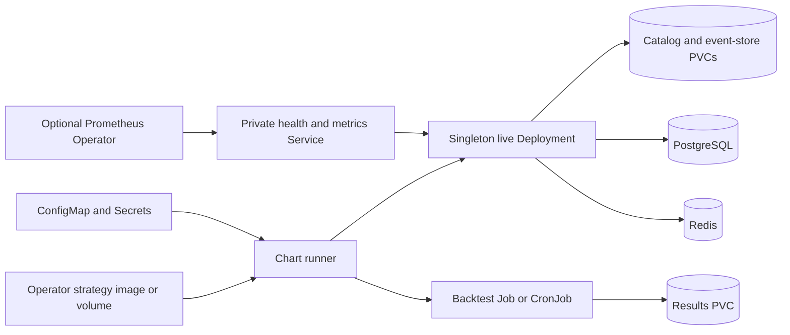

<!-- SPDX-License-Identifier: Apache-2.0 -->

# NautilusTrader Chart Design

## Scope

This chart provides a secure Kubernetes execution contract for one NautilusTrader
live node, one-shot backtests, and scheduled research. It supplies lifecycle,
health, metrics, storage, credential, and optional state-service integrations. It
does not supply trading strategies or authorize live trading by default.

## Architecture

The chart-managed Python runner is an adapter around the official package. In
`validate` mode it imports NautilusTrader and waits without venue access. In
`live` mode it loads an operator-provided `module:callable` factory and manages
run, stop, and dispose lifecycle. Jobs use the same runner contract for research.

## Design Decisions

- Pin the official floating upstream channel by immutable multi-architecture
  digest because upstream does not publish versioned OCI tags.
- Keep the safe default non-trading; an explicit factory or command is required
  before live mode can start.
- Keep every live node a singleton Deployment with `Recreate` updates. Separate
  trading nodes use separate Helm releases and independent failure boundaries.
- Model catalog, event store, and results as independent storage lifecycles.
- Treat PostgreSQL and Redis values as integration coordinates. Enabling them
  does not assert that every pinned upstream build contains every adapter.
- Expose only a private runner health/metrics Service; Ingress and Gateway API
  would imply an application HTTP surface that NautilusTrader does not have.
- Keep NetworkPolicy egress operator-defined because venues and data providers
  differ for every strategy.

## Production Boundary

The chart owns Kubernetes workload lifecycle, probes, configuration projection,
optional PVCs, dependency wiring, and Prometheus resources. Platform and trading
teams own strategy code, venue approval, risk controls, reconciliation, market
data quality, external database durability, Redis persistence, credentials,
resource sizing, and disaster-recovery objectives.

The bundled PostgreSQL and Redis topologies are intended for evaluation. Managed
or separately operated services are preferred for production. A
PodDisruptionBudget reduces voluntary disruption but does not make a singleton
live node highly available or safe to fail over automatically.

## Security Boundary

Chart-managed workloads run as UID/GID 10001, use runtime-default seccomp, deny
privilege escalation, drop all capabilities, keep the root filesystem read-only,
and disable API-token automounting. Writable temporary state is limited by a
bounded `emptyDir`. Venue and service credentials are accepted only through
Secret references or External Secrets.

These controls protect the container boundary; they do not validate strategy
behavior or trading authorization. Operators must isolate production namespaces,
restrict image and Secret writers, review all strategy artifacts, and define the
exact egress destinations needed for venues, data, storage, and telemetry.

## Observability Boundary

The runner exposes `/healthz`, `/readyz`, and `/metrics`. Probes verify process and
factory lifecycle. Optional ServiceMonitor and PrometheusRule resources provide
discovery and a basic runner-availability alert. They do not prove market-data
freshness, venue connectivity, portfolio correctness, risk-limit enforcement,
reconciliation, or order outcomes; strategy code must export those signals.

## Known Gaps and Limitations

- Upstream image freshness requires a reviewed digest refresh rather than a
  semantic image tag bump.
- Live nodes are singleton processes with no automatic active-active failover.
- The chart does not verify that a selected database or message-bus adapter is
  present in the pinned upstream build.
- Backups and restores are operator-owned; the chart does not ship a coordinated
  backup controller for PVCs and external state services.
- Secret content rotation does not restart a pod automatically unless the
  deployment contract itself changes; rotation behavior must be tested with the
  strategy and provider.
- Generic readiness cannot validate domain-specific trading correctness.

## Non-Goals

- Shipping a strategy, venue adapter, credentials, or live-trading approval
- Installing Prometheus Operator or External Secrets Operator CRDs
- Providing an ingress, public dashboard, or general-purpose trading API
- Operating managed PostgreSQL, Redis, or backup infrastructure
- Automating trading-node failover or portfolio reconciliation

## Validation

`make validate-chart CHART=nautilus-trader` is the release gate. It covers
dependency resolution, strict lint, default and CI renders, unit tests,
kubeconform, Artifact Hub lint, and behavioral k3d profiles. CI scenarios exercise
the safe runtime, backtest Job, scheduled CronJob, persistence, monitoring,
External Secrets, and dual-stack Service. Runtime smoke checks verify the pinned
package import and chart-managed health endpoints.
