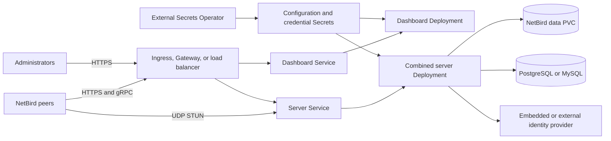

# NetBird chart design

## Scope

This chart deploys the upstream NetBird combined control plane and dashboard on Kubernetes. It owns the Kubernetes
workloads, Services, generated configuration, optional persistent volume, database selection, ingress resources,
Gateway API routes, External Secrets, NetworkPolicy, and disruption budgets. It deliberately follows the upstream
combined-server architecture rather than recreating the legacy management, signal, relay, and coturn topology.

The chart supports a self-contained PostgreSQL deployment, an operator-managed PostgreSQL or MySQL database, and a
single-replica SQLite mode for labs. It does not install NetBird agents on cluster nodes or configure networking outside
the namespace.

## Architecture

The server Deployment runs `netbirdio/netbird-server` and loads `/etc/netbird/config.yaml`. The combined process serves
management APIs, gRPC, signal, relay, embedded identity, Prometheus metrics, health, and UDP STUN. The dashboard
Deployment runs the official `netbirdio/dashboard` image and points the browser application at `server.publicUrl`.

## Design decisions

### Combined upstream server

Using the upstream combined process keeps protocol behavior, database migrations, and authentication semantics with
NetBird. The chart exposes every actual listener through `server.containerPorts`; the generated configuration uses the
same values for `listenAddress`, `stunPorts`, `metricsPort`, and `healthcheckAddress`. Service ports remain a separate
Kubernetes-facing contract and target named container ports.

The dashboard image has no environment variable for its nginx listen port. The default port therefore preserves the
upstream entrypoint unchanged. When `dashboard.containerPorts.http` differs from 80, the chart starts the same official
image through a small shell wrapper that rewrites both IPv4 and IPv6 nginx listeners before executing supervisord. The
non-default-port k3d scenario proves that this changes the running process rather than only pod metadata.

### Secret-backed configuration

Chart-managed configuration is stored in a Secret because it contains the relay authentication secret, embedded owner
credentials, database connection material, and data-store encryption key. The encryption key is generated once and
preserved through Helm's live-cluster lookup behavior. Operators that require a complete upstream configuration can set
`server.config.existingSecret`; the chart then mounts that Secret without interpreting its contents.

### Database selection

`database.mode=auto` chooses an explicit external database first, then the bundled PostgreSQL dependency, and finally
SQLite. Validation rejects ambiguous selections. PostgreSQL is the bundled production default because it supports
concurrent access and server replicas. External MySQL remains available for platforms that already operate it. SQLite
requires one server replica and is intended for disposable or small installations.

### Exposure model

HTTP, gRPC, signal, and relay traffic share the combined server HTTP listener. Ingress and HTTPRoute resources can send
paths to either the server or dashboard Service. UDP STUN cannot travel through a normal HTTP ingress and must be
published separately through a LoadBalancer, UDP-capable gateway, or infrastructure listener. TLS terminates outside
the pod by default.

## Production boundary

The chart provides Kubernetes-native lifecycle, a persistent data path, database integration, resource limits, bounded
ephemeral storage, optional probes, disruption budgets, ingress resources, and network isolation primitives. It checks
that SQLite is never scaled beyond one writer and that server listeners do not collide.

Production operators remain responsible for public DNS, certificates, a reverse proxy with HTTP/2 and gRPC support,
UDP 3478 reachability, identity-provider configuration, database capacity and availability, backups, object retention,
and disaster-recovery testing. Enabling `pdb.minAvailable: 1` for a singleton protects availability but blocks voluntary
node drain until the budget is changed or removed. High availability requires a shared database, multiple server pods,
and infrastructure capable of preserving both HTTP/gRPC and UDP paths.

## Security boundary

The server runs as UID/GID 1000 with `RuntimeDefault` seccomp, no privilege escalation, and all Linux capabilities
dropped. ServiceAccount tokens are disabled by default. The upstream dashboard image uses supervisord and nginx as root
to prepare runtime directories and then drops worker privileges; the chart limits added capabilities to `CHOWN`,
`SETGID`, and `SETUID`, applies `RuntimeDefault`, and bounds every writable nginx emptyDir.

The chart never treats inline defaults as production credentials. Operators must replace `server.authSecret`, protect
the stable encryption key, and deliver owner or database credentials through Secrets or External Secrets. NetworkPolicy
is opt-in because identity providers, GeoLite downloads, external databases, and peer infrastructure differ between
clusters. When egress rules are enabled, every required external destination must be represented explicitly.

## Observability boundary

The server exposes Prometheus metrics on the named `metrics` port and a health listener on the named `health` port.
Server probes are opt-in because GeoLite initialization can delay first readiness, and the upstream health response also
evaluates advertised relay reachability. The chart's runtime smoke test verifies API rejection, embedded OIDC discovery,
the relay WebSocket upgrade, metrics exposition, and dashboard HTML through the actual configured listeners.

The chart does not create a ServiceMonitor, alert rules, dashboards, or log pipeline. Operators should scrape the
metrics Service port, collect stdout and stderr, monitor Deployment availability and restart counts, and separately test
public relay and STUN reachability from representative peer networks.

## Storage and recovery

The server data directory is mounted at `persistence.mountPath`. A chart-managed PVC is the default; an existing PVC can
be supplied. When persistence is disabled, a bounded emptyDir is used and all local state is disposable. PostgreSQL
stores control-plane records, but `/var/lib/netbird` can still contain embedded identity and runtime assets, so both the
database and data volume belong in the same recovery plan. The config Secret must be backed up with them because its
encryption key is required to decrypt stored values.

## Known gaps and limitations

- The chart does not automate database or PVC backups; it documents the required consistency boundary.
- Ingress and HTTPRoute do not expose UDP STUN.
- NetworkPolicy cannot describe every external IdP, database, object store, or peer destination automatically.
- The dashboard's upstream startup model prevents the same non-root defaults used by the server image.
- The chart validates configuration rendering and local behavior, but it cannot prove internet-facing NAT traversal
  from the k3d lab.

## Non-goals

- Installing or enrolling NetBird agents.
- Managing public DNS, certificates, load-balancer controllers, or firewall rules.
- Operating an external identity provider or database.
- Replacing upstream NetBird configuration semantics with a HelmForge-specific API.
- Compiling custom dashboard or server images during chart startup.
- Guaranteeing peer connectivity across operator-controlled NAT, proxy, and routing infrastructure.
