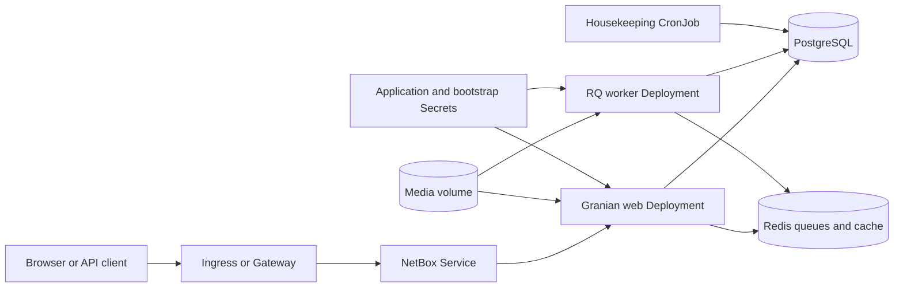

<!-- SPDX-License-Identifier: Apache-2.0 -->

# NetBox chart design

## Scope

This chart deploys NetBox as separate web, RQ worker and housekeeping
workloads. It owns their configuration, identity, Service, optional Ingress or
Gateway API routes, persistent media claim, NetworkPolicy, disruption budgets,
monitoring resources and Secret integrations. PostgreSQL and Redis can be
provided by HelmForge dependencies or external platform services.

The chart does not operate external databases, Redis clusters, object storage,
ingress controllers, Gateways, certificates, DNS, Prometheus, External Secrets
Operator or backup infrastructure. It does not download plugins or executable
Python packages into running pods.

## Architecture

NetBox uses PostgreSQL as its authoritative data store, Redis database 0 for
trusted RQ jobs and Redis database 1 for cache. The HTTP Service selects only
web pods; workers and housekeeping never receive application traffic.

The official web entrypoint applies migrations before starting Granian. Worker
init containers run `manage.py migrate --check` until the schema is current.
The nightly CronJob invokes the upstream `housekeeping` command independently
of long-running application processes.

## Design decisions

### Preserve upstream process boundaries

Web serving, background jobs and housekeeping have different availability,
resource and failure characteristics. Separate Kubernetes workloads allow them
to scale, restart and schedule independently. Component labels prevent the web
Service from selecting worker pods.

### Configure the real Granian listener

`containerPorts.http` sets Granian's `--port` command-line option and the named
`http` container port. The chart preserves the remaining arguments from the
pinned netbox-docker 5.0.2 launch script. `service.port` is an independent
client-facing port. Probes use the named target, so changing the listener
reaches the real process, Service and health checks without coupling the two
port numbers.

### Retain application identity

Django `SECRET_KEY` and the API-token pepper are long-lived application
identity. Chart-generated values use cluster lookup so ordinary upgrades retain
them. Existing Secrets are the deterministic GitOps contract. Bootstrap
passwords and optional API tokens use a separate Secret so administrators can
disable and rotate the initial account without replacing application identity.

### Treat database and media as one recovery set

PostgreSQL contains the authoritative object model, users and job records.
The media volume stores user uploads referenced by that database. A usable
recovery point therefore requires coordinated database and media backups.
Redis cache is rebuildable, while queued jobs may affect recovery sequencing.

### Require safe shared media before scaling web pods

More than one web replica requires ReadWriteMany media or an external media
backend. The chart rejects multiple web replicas with chart-managed
single-writer storage. For the default ReadWriteOnce volume, worker affinity
and a Recreate rollout keep media users on a compatible node and avoid
overlapping worker mounts.

### Keep plugins immutable

Plugins execute inside the NetBox process and participate in migrations. They
must be installed with pinned versions in a derived image and validated against
the exact NetBox release. Runtime package downloads would make startup
non-reproducible and expand the credential and supply-chain boundary.

## Production boundary

Bundled standalone PostgreSQL and Redis provide a complete default install but
do not imply database-level high availability. Production operators must define
state-service topology, capacity, upgrades, monitoring, backup and restore.
External service modes require explicit NetworkPolicy egress and Secret-backed
credentials.

Scale web and workers according to distinct load signals. Web replicas require
shared media semantics; worker replicas also require queue and plugin safety.
The chart provides PodDisruptionBudgets for replicated workloads, but those do
not protect against node failure, storage failure or dependency outage.

The first migration can take several minutes. Upgrade plans must include a
compatible NetBox/netbox-docker pair, plugin validation, coordinated backups
and an isolated restore rehearsal. A Helm rollback cannot undo an incompatible
database migration.

## Security boundary

The official container runs as UID 999 with RuntimeDefault seccomp, no added
Linux capabilities, no privilege escalation and no automatically mounted
Kubernetes API token. The pod group remains compatible with upstream image
paths and persistent media. Additional Kubernetes-native security context
fields pass through for platform policy.

Secrets can be generated, supplied as existing Kubernetes Secrets or reconciled
through the canonical External Secrets contract. The chart controls references
and mounts; it does not encrypt Secrets at rest, operate the external store or
rotate provider credentials.

NetworkPolicy is opt-in because external database, Redis, identity, webhook,
email and plugin destinations are environment-specific. Enabling ingress
isolation alone does not constrain egress. Operators must enable the egress
policy and enumerate every required private destination. Redis job databases
must never be writable by untrusted clients.

Copilot remains disabled by default to prevent implicit external AI requests.
Enabling it expands the data-processing and egress boundary and requires a
separate privacy and provider review.

## Observability boundary

Startup, liveness and readiness probes call `/login/` with an allowed Host
header, proving that Granian and database-backed Django startup are functional.
The native `/metrics` endpoint and ServiceMonitor are enabled independently so
operators cannot accidentally advertise a nonexistent scrape target.

The runtime smoke validates the exact NetBox/netbox-docker version, the actual
Granian listener, database queries, Redis cache round trips and the Helm test.
Kubernetes rollout, logs, restarts and Warning events are checked for every CI
scenario. These checks do not prove plugin behavior, queue throughput, backup
recoverability or the correctness of user-created inventory data.

## Upgrade and validation

The image tag combines exact NetBox and netbox-docker versions. Review both
release streams, verify the multi-architecture manifest, and test every plugin
before changing it. Back up PostgreSQL and media in one recovery window, then
restore them into an isolated namespace before production rollout.

`make validate-chart CHART=netbox` runs strict linting, all scenario renders,
unit tests, kubeconform with real CRD schemas, Artifact Hub linting and
behavioral k3d installations. The custom-port scenario proves that
Granian `--port` changes the real listener while the Service remains independent.

## Known gaps

- Bundled PostgreSQL and Redis use standalone topologies.
- The chart does not create database or media backup jobs.
- A Helm rollback cannot reverse an incompatible Django migration.
- Plugin compatibility and plugin-provided migrations remain operator-owned.
- ReadWriteOnce media constrains multi-node scaling.
- NetworkPolicy cannot infer every integration or validate remote identity.
- Native metrics do not replace synthetic login, API, worker and media checks.

## Non-goals

- Installing plugins or Python packages during pod startup.
- Claiming high availability for standalone state-service dependencies.
- Provisioning external databases, Redis, object storage or backup systems.
- Storing application credentials in ConfigMaps or command arguments.
- Scaling web replicas across nodes without shared media semantics.
- Treating Redis cache or queued jobs as the authoritative recovery source.

<!-- @AI-METADATA
type: design
title: NetBox chart design
description: Architecture and trade-offs for the HelmForge NetBox chart
keywords: netbox, architecture, state, scaling
purpose: Record durable chart design decisions
scope: Chart
relations:
  - charts/netbox/values.yaml
path: charts/netbox/DESIGN.md
version: 1.1
date: 2026-10-26
-->
