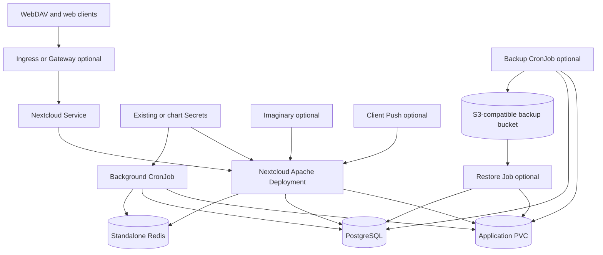

# Nextcloud Chart Design

## Scope

This chart deploys one Nextcloud Apache application Pod, a separate Kubernetes
CronJob for one-shot PHP background processing, PostgreSQL, and standalone
Redis. The official image synchronizes bundled application code and performs
native installation and sequential major-version upgrades. Recreate updates
stop the application before replacing its Pod.

The chart owns the Kubernetes resources and coordination needed for a
single-application-writer deployment. It does not own DNS, TLS issuers,
storage classes, object-store lifecycle, monitoring infrastructure, or the
lifecycle of Nextcloud applications installed from the App Store.

## Architecture

The complete `/var/www/html` volume holds native configuration and instance
secrets, installed code, custom apps, themes, and user data. PostgreSQL holds
users, file identities, shares, and application state. Redis provides PHP
sessions, distributed caching, and transactional file locking. None of these
data domains substitutes for another in disaster recovery.

## Main Design Choices

- Use one application replica and `Recreate` updates to preserve the upstream
  single-writer filesystem contract. A ReadWriteMany PVC does not enable
  horizontal application scaling.
- Run background processing as a native Kubernetes CronJob so failures,
  history, and logs remain visible to operators.
- Coordinate files and PostgreSQL during backup instead of treating either
  data domain as independently recoverable.
- Keep optional preview and push processes in the application Pod so they
  follow the same backup and restore availability boundary.
- Support bundled or external PostgreSQL and Redis while keeping the
  application contract identical for both paths.

### Native image and filesystem

Apache runs as UID/GID 33 on port 8080, with dropped capabilities,
runtime-default seccomp, and a read-only root filesystem. An init container
copies the image's PHP extension configuration into a writable volume because
the upstream entrypoint generates Redis session settings there. Writable
Apache runtime directories and temporary files have separate `emptyDir`
mounts.

Image-owned `*.config.php` snippets are refreshed on rollout. Native
`config.php` is retained. A chart-owned final snippet reconciles trusted hosts,
proxy settings, and the current database connection. This avoids stale
configuration after a restore or change to an existing Secret reference.
Changes to Secret contents used as environment variables require an
application rollout.

Apache does not load the upstream broad private-network RemoteIP trust rule.
Nextcloud receives the real peer address and trusts forwarded headers only
from explicitly configured proxies. The chart keeps the PHP handler,
`.htaccess` processing, WebDAV methods, and protected data/configuration
directories.

### Background jobs

Cron uses the official application image and the same unprivileged identity.
Each Job mounts the application PVC, takes a shared lock on the upstream
initialization lock, selects native cron mode, and invokes `cron.php` directly
through PHP CLI. Uninitialized, maintenance-mode, or upgrade-pending instances
do not run cron. The Job exits on execution failure, retains Kubernetes
status/log evidence, and never overlaps another scheduled run. A PVC-backed
exclusive lock also serializes manually instantiated Jobs, which are outside
the Kubernetes CronJob controller's concurrency policy.

Default required Pod affinity keeps the Job on the application node for RWO
volumes. `ReadWriteOncePod` is incompatible while cron or backup is enabled
because each Job mounts the application claim from a separate Pod. For a
platform-managed PVC, `persistence.existingClaimAccessModes` must explicitly
declare the claim's real modes before either multi-Pod path can render; local
Helm rendering cannot reliably inspect cluster objects.

### Backup and restore coordination

The backup CronJob checks object storage, acquires the volume lock, records and
suspends background scheduling, waits for active cron Jobs, scales the
application to zero, dumps PostgreSQL, archives files, resumes the application,
restores the recorded cron suspension state, and uploads the backup set. A
directory created atomically on the application volume serializes manual and
scheduled jobs. Application initialization refuses to start while this lock
exists, including during an unsolicited concurrent rollout.

The Apache supervisor records evidence only after the upstream Apache process
finishes a graceful stop. The coordinator requires that record for the exact
application Pod UID. It separately waits for every listed cron Job to report a
`Complete` or `Failed` condition; a Job object removed before a terminal
condition is observed is no longer listed and is treated as settled. An OOM,
forced application kill, or exceeded termination deadline therefore fails
closed instead of treating application Pod disappearance as a consistent
checkpoint.

Restore mode holds the application at zero replicas. A Job downloads a
completed set, verifies checksums and application version, requires an empty
application PVC, extracts files, and restores the SQL dump transactionally
into an empty database. Operators retain the original bootstrap administrator
credentials and external-provider Secrets. Disable restore mode only after the
Job succeeds.

### Optional preview and push services

Imaginary and the Client Push daemon share the application Pod lifecycle and
stop during backup and restore. Neither mounts the application PVC. Imaginary
uses loopback; Apache proxies push HTTP and WebSocket traffic. The push daemon
reads only a memory-backed export of database and Redis settings, regenerated
on rollout. The Client Push application remains operator-managed. See the
[integration contracts](docs/integrations.md).

## Production Boundary

Production operation requires durable storage compatible with UID/GID 33,
explicit resource requests and limits, managed credentials, TLS at the route,
tested backup restoration, and maintenance windows for upgrades and backups.
The chart supports one application replica only; it does not provide an HPA or
a horizontal-scaling switch.

Bundled PostgreSQL and Redis are suitable when their lifecycle, availability,
and storage are intentionally managed with the release. Production operators
may disable them and supply private external endpoints. External database,
Redis, bucket, DNS, certificate, and storage availability remain the
operator's responsibility.

Failure during quiescence, SQL dump, or archive deliberately retains the lock
and stopped application. This is visible and requires operator recovery.
Upload failure occurs after service resumes and produces no completed backup
marker. Object-store encryption, retention, replication, and lifecycle
policies belong to the bucket administrator.

## Security Boundary

- Application and cron processes run as UID/GID 33 with `runAsNonRoot`, no
  privilege escalation, all capabilities dropped, `RuntimeDefault` seccomp,
  and read-only root filesystems.
- The application receives no Kubernetes API token. Only backup coordinator
  stages receive a projected token, with RBAC limited to the named Deployment
  scale subresource, the cron CronJob, and namespace Pod and Job discovery.
- SQL stages receive database credentials and S3 stages receive object-store
  credentials. Use existing Secrets or External Secrets in production and
  rotate credentials through the owning system.
- NetworkPolicy can restrict ingress and dependency egress, but transport
  encryption and authentication for external PostgreSQL, Redis, and object
  storage remain operator-owned contracts.
- Trusted hosts and trusted proxy addresses are explicit. Route TLS,
  certificate issuance, WAF policy, and Internet exposure remain outside the
  chart's security boundary.

## Observability Boundary

The application exposes Kubernetes startup, readiness, and liveness probes;
cron, backup, and restore use native Job status and container logs. Backup
completion is represented by checksummed objects and a final completion marker,
while retained locks and stopped replicas make fail-closed states visible.

Application, Apache, PHP, and helper logs go to container stdout/stderr. The
chart does not install a metrics collector, ServiceMonitor, alerting rules,
dashboards, or a log backend. Operators must monitor Pod restarts, failed Jobs,
probe failures, PVC capacity, database and Redis health, backup age, and restore
drills through their platform tooling.

## Current Gaps and Improvement Candidates

- Add a supported metrics contract only when Nextcloud, Apache, PostgreSQL,
  Redis, and backup signals can be represented without implying complete
  application health.
- Evaluate highly available database and Redis topologies as explicit external
  service contracts; the bundled defaults remain standalone.
- Add primary S3 object-storage support only with a design that covers its
  additional consistency and recovery boundary.
- Expand optional integration coverage as reproducible upstream components
  become available with pinned official images.

## Explicit Non-Goals

- horizontal Nextcloud application scaling or HPA support
- MySQL or MariaDB provisioning and database-engine conversion
- Redis Sentinel or Redis Cluster discovery
- office suites, Talk media relays, and full-text search services
- primary S3 object storage; integrated S3 support is for backups only
- automatic installation or lifecycle management of Nextcloud applications
- DNS, certificate issuer, object-store lifecycle, or monitoring-stack
  provisioning
