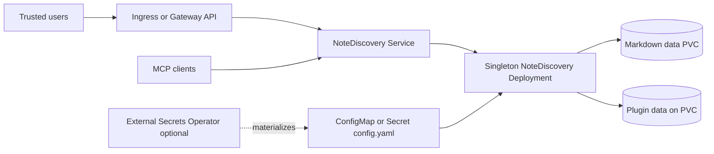

# NoteDiscovery Chart Design

This chart deploys NoteDiscovery as a self-hosted knowledge base using the
official `ghcr.io/gamosoft/notediscovery:0.32.1` image.

## Architecture

One application process serves the browser UI, API and MCP endpoint. A
`Recreate` Deployment keeps the default single-writer topology from overlapping
during rollouts, while a persistent claim holds notes and copied plugin data.

## Design Decisions

- Use the official pinned image and its native `/app/data` contract.
- Default to one replica and `Recreate` because upstream stores mutable Markdown
  and related state on one filesystem without distributed coordination.
- Preserve upstream's file-based configuration model by rendering one complete
  `config.yaml` in either a ConfigMap or Secret.
- Copy bundled plugins into `notediscovery.pluginsDir` without replacing plugins
  already managed by the user. The default path is under `persistence.mountPath`.
  A custom path must also be under `persistence.mountPath`; otherwise the copied
  plugins are neither persisted nor mounted into the application container.
- Keep Ingress, Gateway API and External Secrets as optional integrations rather
  than installing their controllers.

## Product Model

NoteDiscovery serves the UI and API from one Python process and stores durable
Markdown notes and related data in a local data directory. The upstream Docker
workflow mounts `/app/data` and exposes HTTP on port `8000`.

The chart therefore treats the application as a single-writer workload by
default. It uses a Deployment with `Recreate` strategy and a chart-managed
PersistentVolumeClaim. `Recreate` avoids overlapping writes during rollouts for
the default single-replica topology.

## Runtime Configuration

Upstream NoteDiscovery reads `config.yaml`. The chart renders that file in two modes:

- unauthenticated installs use a ConfigMap
- authenticated installs use a Secret

`auth.existingSecret` points at a Secret containing a complete `config.yaml`.
The chart does not split individual auth keys into separate environment
variables because the upstream contract is file-based. Keeping the full file
together avoids partially duplicated configuration paths.

Generated configuration places plugins under the writable data volume. An init
container copies the upstream bundled plugins there before application startup,
preserving plugin configuration without running the application as root or
hiding the official plugin bundle. `PLUGINS_DIR` is set to the same effective
path for generated and externally supplied config files, and bootstrap never
overwrites a plugin already present on the volume.

## Default Topology

Defaults target a production-style single instance:

- `replicaCount: 1`
- `persistence.enabled: true`
- data mounted at `/app/data`
- generated unauthenticated config for local bootstrap
- non-root UID/GID `1000`
- ServiceAccount token automount disabled

Authentication remains opt-in because the upstream app is often first configured
locally. Documentation and examples show Secret-backed auth for shared
deployments.

## Scaling

The chart blocks `replicaCount > 1` unless `persistence.existingClaim` is set.
Generated PVCs are single workload claims and do not prove that a storage
backend is safe for multiple writers.

Operators that scale NoteDiscovery must provide their own claim and choose
storage semantics appropriate for the workload, typically ReadWriteMany storage.
The chart keeps the default topology single-replica because note files are
durable local state.

## Exposure

The chart supports:

- ClusterIP, NodePort, or LoadBalancer Service
- Kubernetes Ingress with `ingressClassName`
- Gateway API HTTPRoute
- dual-stack Service fields

`notediscovery.allowedOrigins` should be restricted to the public HTTPS origin
when exposing the app through a reverse proxy.

## External Secrets

External Secrets support renders `ExternalSecret` resources that can materialize
the complete `config.yaml` Secret. The expected production pattern is:

- `auth.existingSecret` names the target Secret
- `externalSecrets.items[].spec.target.name` materializes the same Secret
- `externalSecrets.items[].spec.data[].secretKey` is `config.yaml`

This keeps sensitive configuration outside the chart values while preserving the upstream config-file contract.

## Security Boundary

The chart uses a non-root security context, drops Linux capabilities, disables
ServiceAccount token automount, and supports NetworkPolicy.
`readOnlyRootFilesystem` remains false because the upstream Python application
and image may need write access outside the mounted note directory during
startup.

Authentication protects the application boundary but does not provide tenant
isolation inside one release. Notes, uploaded content, the complete config file
and plugin code share one trust domain. Operators own TLS termination, credential
rotation, public-origin restrictions, controller security and access to backups
or storage snapshots.

## Production Boundary

The chart owns Kubernetes resources, generated configuration, probes, rollout
strategy and optional exposure integrations. Operators own StorageClass
durability, capacity monitoring, backups, restore tests, public DNS and TLS,
identity policy, plugin provenance and maintenance downtime for the singleton
writer. Multi-replica deployments additionally require an operator-provided
claim whose storage semantics are safe for concurrent writers.

## Observability Boundary

The chart exposes startup, liveness and readiness results through Kubernetes and
leaves application logs on standard output for the cluster logging stack. It
does not install a metrics collector, ServiceMonitor, alert rules or log backend.
Probe success confirms HTTP availability, not search correctness, note durability,
MCP authorization or remaining PVC capacity.

## Known Gaps

- the default singleton has downtime during upgrades, drains and rescheduling
- upstream requires a writable root filesystem beyond the mounted data path
- the chart does not provide application-native metrics or backup automation
- multi-writer safety depends on storage and upstream behavior outside the chart
- External Secrets, Gateway API and Ingress behavior depends on installed controllers

## Non-Goals

- horizontal scaling or transparent high availability on the generated claim
- multi-tenant isolation within one NoteDiscovery release
- installing or managing ingress, Gateway API or External Secrets controllers
- automatic backup, restore, credential rotation or certificate issuance
- validating third-party plugin safety or MCP client authorization policy

## Validation Scope

The chart has template tests for:

- official pinned image
- generated ConfigMap and Secret config
- existing config Secret references
- invalid scaling and auth combinations
- ExternalSecret rendering
- Gateway API HTTPRoute
- NetworkPolicy
- dual-stack Service fields
- Ingress TLS rendering

Behavioral validation uses the default single-replica topology because it can
run in an isolated k3d cluster without external secret manager dependencies.
