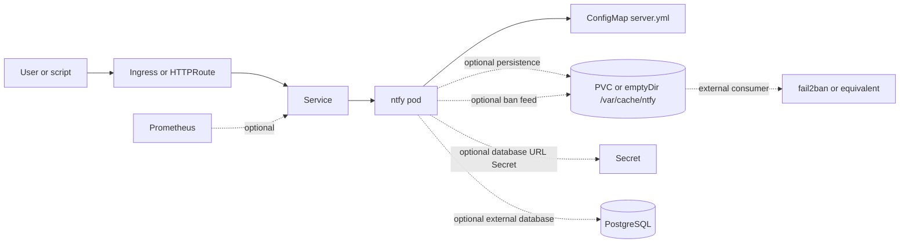

<!-- SPDX-License-Identifier: Apache-2.0 -->

# ntfy Chart Design

## Scope

This chart deploys ntfy, a self-hosted HTTP pub-sub notification service.

Supported use cases:

- personal or team notification endpoints
- script-driven push notifications
- single-instance deployments backed by persistent SQLite or external PostgreSQL
- ingress or Gateway API exposure for public HTTPS access
- optional Prometheus scraping through the ntfy metrics endpoint

## Architecture

## Design Choices

- Use the upstream `binwiederhier/ntfy` image.
- Keep the workload single-replica because ntfy stores cache and auth data in local SQLite files.
- Allow PostgreSQL to replace all SQLite stores without placing its connection URL in the ConfigMap.
- Consume the PostgreSQL URL from a Kubernetes Secret and optionally reconcile it with External Secrets Operator.
- Keep persistence enabled by default so message cache, attachments, and auth data survive restarts.
- Render Gateway API HTTPRoutes as an opt-in exposure path alongside Ingress.
- Keep Service dual-stack fields opt-in so clusters without dual-stack support use their defaults.
- Provide one-time initial administrator bootstrap while keeping ongoing user lifecycle out of the chart (managed with upstream CLI).
- Keep the 2.26.3 abuse ban-feed opt-in, persist its default file on the existing data volume, and leave firewall enforcement to an external consumer.

## Production Boundary

Recommended production controls:

- set `ntfy.baseUrl` to the public HTTPS URL clients will use
- enable authentication and set `ntfy.authDefaultAccess: deny-all` for private deployments
- enable `ntfy.admin.enabled: true` for one-time initial bootstrap
- keep persistence enabled with a durable storage class
- use a provider-managed Secret for PostgreSQL credentials
- back up the PVC before upgrades
- expose the service only through trusted ingress or Gateway policy
- tune the default resource requests and limits from observed production usage
- rotate the ban-feed with copy-truncate semantics when it is enabled

## Security Boundary

- The application and backup containers run as UID/GID 1000, use
  `RuntimeDefault` seccomp, drop all capabilities, deny privilege escalation,
  and use read-only root filesystems by default.
- `/etc/ntfy` is a read-only ConfigMap mount. `/var/cache/ntfy` and `/tmp` are
  the only chart-managed writable paths, and ephemeral variants are bounded.
- Kubernetes API token automounting is disabled by default for application and
  backup pods.
- Database, OIDC, SMTP, and S3 credentials are sourced from Secrets. Inline
  credentials remain in Helm release state and are intended only for
  development.
- NetworkPolicy is opt-in because allowed edge controllers and external
  services are cluster-specific. Operators own explicit egress for SMTP, OIDC,
  web push, S3, and external PostgreSQL.

## Observability Boundary

- Startup, readiness, and liveness probes use ntfy's `/v1/health` endpoint on
  the named HTTP port.
- Application logs are emitted to the container stream and are not retained by
  the chart.
- The optional metrics endpoint and ServiceMonitor require ntfy metrics and
  Prometheus Operator CRDs respectively.
- The chart does not install dashboards, alerts, log collectors, or a tracing
  backend.

## Known Gaps and Limitations

- The Deployment is intentionally single-replica. PostgreSQL does not provide
  shared attachment storage or make ntfy horizontally scalable.
- The PodDisruptionBudget can protect the singleton from voluntary eviction,
  but cannot preserve availability during node loss or application rollout.
- The backup CronJob covers `/var/cache/ntfy`; it does not perform a native
  PostgreSQL dump for an external or bundled PostgreSQL database.
- NetworkPolicy cannot infer the addresses of external integrations; egress
  isolation requires operator-provided rules.
- Secret rotation requires a Deployment rollout because credentials are
  injected as environment variables.

## Non-Goals

- multi-replica SQLite coordination
- automatic multi-replica or shared-attachment configuration for PostgreSQL deployments
- ongoing user account reconciliation (the chart provides bootstrap creation only; credential rotation and additional users are managed via upstream CLI)
- installing Gateway API CRDs or controllers
- installing Prometheus Operator CRDs
- installing fail2ban or changing node firewall rules

## Validation

The chart is expected to pass:

- Helm lint and strict lint
- Helm template rendering for default and CI values
- helm-unittest coverage for deployment, service, persistence, ingress, Gateway API, and metrics
- kubeconform validation for Kubernetes-native default manifests
- local k3d deployment smoke tests with pod logs and namespace events checked
- an opt-in k3d scenario that renders and starts with the upstream ban-feed settings

<!-- @AI-METADATA
type: design
title: ntfy Chart Design
description: Design document for the ntfy Helm chart covering single-instance SQLite storage, exposure paths, metrics, and validation.
keywords: ntfy, notifications, helm, sqlite, gateway-api, prometheus
purpose: Document chart architecture, boundaries, and operational decisions.
scope: Chart Design
relations:
  - charts/ntfy/README.md
  - charts/ntfy/docs/configuration.md
path: charts/ntfy/DESIGN.md
version: 1.0
date: 2026-06-10
-->
