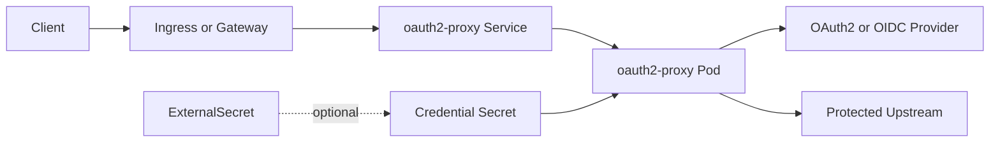

# OAuth2 Proxy Chart Design

## Scope

- Deploy the official OAuth2 Proxy image with secure Kubernetes defaults.
- Keep credentials flexible through chart-managed Secrets, existing Secrets, or ExternalSecret.
- Support both Ingress and Gateway API with a single HelmForge-standard `gateway` values block.
- Make reverse-proxy deployments safer by disabling proxy header trust by
  default and requiring explicit `trustedProxyIps` configuration when enabled.
- Validate rendered configuration before the workload starts by running `oauth2-proxy --config-test`.

## Architecture

## Security Defaults

- Pods run as non-root with dropped Linux capabilities and runtime default seccomp.
- The ServiceAccount token is not mounted by default.
- Cookies are secure by default; local examples explicitly disable this only for HTTP testing.
- `reverse_proxy` is disabled by default so direct deployments do not trust
  forwarded headers. When enabled, `trusted_proxy_ips` must contain at least one
  trusted edge proxy CIDR.
- The init container validates the final OAuth2 Proxy configuration and uses the same image, args, env, mounts, and security context as the runtime container.

## Networking

- Ingress uses `ingress.ingressClassName`, matching HelmForge chart conventions.
- Gateway API support uses only the standard `gateway` values block.
- Services expose `ipFamilyPolicy` and `ipFamilies` for dual-stack clusters.

## Design Decisions

- Listener values are chart-owned. The official `--http-address` and
  `--metrics-address` flags are passed to config validation and runtime because
  command-line options have the highest upstream precedence.
- `service.port` remains separate from `containerPorts.http`; the Service uses
  the named target port so cluster-facing and process-facing ports can differ.
- Alpha listener fields are normalized to the same chart values, preventing
  probes and Services from diverging from an alpha payload.
- Reverse-proxy header trust is off by default and requires explicit proxy CIDRs.
- Cookie sessions remain the default; Redis lifecycle is deliberately external.

## Production Boundary

Production operators must provide real provider credentials, a stable cookie
Secret, explicit callback and upstream URLs, HTTPS at the edge, trusted proxy
CIDRs when forwarded headers are enabled, and, when NetworkPolicy is enabled,
destinations for the identity provider and upstreams. HPA requires an
upstream/session design that is safe across replicas.

## Security Boundary

By default, the chart runs the official image as non-root with a read-only root
filesystem, dropped capabilities, RuntimeDefault seccomp, and no ServiceAccount
token. Operators can override these defaults through `podSecurityContext`,
`securityContext`, and `serviceAccount.automountServiceAccountToken`. The chart
validates configuration before starting and consumes credentials from Secrets.
Identity-provider policy, upstream authorization, external Secret-store access,
TLS termination, cookie-domain selection, and edge-header sanitization remain
outside the chart boundary.

## Observability Boundary

Startup and liveness probes use `/ping`; readiness uses `/ready`. Metrics are
served on a dedicated listener and may be discovered with ServiceMonitor. The
chart-owned runtime smoke verifies the real readiness endpoint through the
Service. Alert rules, dashboards, provider audit events, and upstream tracing
remain operator responsibilities.

## Explicit Non-Goals

- This chart does not deploy an identity provider. Pair it with Keycloak, Authelia, Dex, or an external OAuth2/OIDC provider.
- This chart does not deploy Redis session storage by default; use OAuth2 Proxy extra args/env with a HelmForge Redis release when that mode is required.

## Known Gaps

- The default NetworkPolicy is opt-in because provider and upstream destinations
  vary by deployment; operators must define precise egress rules.
- The chart does not rotate provider or cookie credentials automatically.
- Alpha configuration remains an upstream-evolving API; the chart validates it
  with the pinned image but cannot guarantee compatibility with arbitrary tags.
- No identity-provider availability or end-to-end browser login is simulated by
  the local runtime smoke; it validates the proxy readiness boundary.
