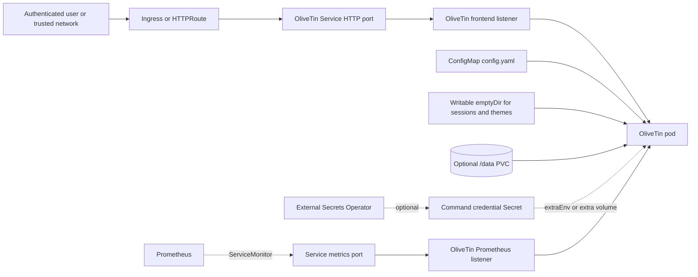

# OliveTin Chart Design

## Scope

This chart deploys one OliveTin instance as a browser-based command panel for
explicitly configured operational actions. It supports chart-managed or custom
OliveTin YAML, an optional data PVC, Prometheus scraping, Ingress, Gateway API,
and External Secrets resources.

Supported use cases include internal runbook panels, household automation, and
platform self-service actions. OliveTin executes commands with the permissions
of its container and any mounted credentials; the chart does not turn arbitrary
shell commands into a safe multi-tenant interface.

## Architecture

The frontend listener is configured by `olivetin.port` through upstream's
`PORT` environment variable. The Service can expose a different
`service.port`, but always targets the named `http` container port. Prometheus
uses a separate listener because upstream does not derive internal ports from
`PORT`.

## Configuration Contract

The chart parses `config` as YAML before storing it in the ConfigMap.
`configTpl.enabled` applies Helm templating first; it remains disabled by
default so quoted OliveTin runtime expressions remain literal.

The chart owns the `prometheus` block. When `metrics.enabled=true`, it also
sets `listenAddressPrometheus` to `0.0.0.0:<metrics.port>`, exposes the named
`metrics` container and Service ports, and optionally creates a ServiceMonitor.
This makes metrics behavior consistent for both the starter config and custom
configs.

The ConfigMap file is mounted read-only. A bootstrap init container prepares a
writable `/config` directory for OliveTin session and theme files, while the
optional PVC is mounted separately at `/data` for actions that explicitly use
that path.

## Design Choices

- Use the official pinned `jamesread/olivetin` image and its supported `PORT`
  contract.
- Keep one replica and a `Recreate` strategy because runtime session files are
  pod-local.
- Keep the Service port independent from the real application listener through
  named target ports.
- Preserve OliveTin runtime templates unless the operator explicitly enables
  Helm `tpl`.
- Make metrics opt-in and use a distinct listener and Service port.
- Keep ServiceAccount token mounting disabled unless an operator deliberately
  grants Kubernetes API access to actions.
- Keep ExternalSecret definitions generic because command credentials are
  application-specific.
- Keep Service dual-stack fields optional for compatibility with single-stack
  clusters.

## Production Boundary

The chart provides a hardened single pod, deterministic configuration,
exposure resources, optional metrics, and optional storage primitives.
Operators remain responsible for:

- authentication and authorization in OliveTin or at a trusted reverse proxy;
- reviewing every action, argument type, executable, and privilege boundary;
- creating least-privilege RBAC when actions call the Kubernetes API;
- supplying credential Secrets and external secret stores;
- TLS, DNS, ingress or Gateway policy, and network segmentation;
- storage classes, backup and restore for action-generated data;
- capacity planning, disruption handling, and disaster recovery.

The optional `/data` PVC does not persist `/config/sessions.yaml`, custom
themes, or application logs. Actions must write durable outputs to `/data` or
another explicitly mounted volume.

## Security Boundary

OliveTin runs operator-defined shell commands, so public unauthenticated
exposure is unsafe. Production deployments must configure upstream
authentication and ACLs or place OliveTin behind an authenticated reverse
proxy. Trusted-header authentication is safe only when untrusted clients cannot
bypass the proxy.

The default pod runs as non-root, drops all capabilities, disallows privilege
escalation, uses runtime-default seccomp, and mounts no ServiceAccount token.
The writable paths are explicit. Enabling token mounting, broad RBAC,
host-mounted sockets, host paths, privileged commands, or elevated container
security contexts moves those risks to the operator.

External Secrets can materialize command credentials, but the chart does not
inspect how actions use them or rotate them. Never embed credentials directly
in `config` because it is stored in a ConfigMap.

## Observability Boundary

Startup, liveness, and readiness probes verify that the frontend TCP listener
accepts connections. The runtime smoke test additionally verifies the HTML UI
through the Service.

When metrics are enabled, OliveTin binds its Prometheus listener on
`metrics.port`; the Service exposes the named `metrics` port and the
ServiceMonitor scrapes `/metrics`. The metrics k3d scenario verifies the live
endpoint. OliveTin application and action logs remain available through
standard container logging and the upstream UI.

The chart does not create dashboards, alert rules, log collectors, tracing
resources, or long-term audit storage.

## Known Gaps

- The chart is single-replica and does not coordinate session state.
- Probes are TCP-based and do not validate application authorization or action
  execution.
- No NetworkPolicy is generated because action destinations are
  workload-specific; operators should apply policy that matches their commands.
- No PodDisruptionBudget or autoscaler is created for the single-instance
  workload.
- Session files, themes, and application logs under `/config` are ephemeral.
- The chart does not validate the semantics or safety of custom OliveTin YAML.

## Non-Goals

- defining or approving production shell actions;
- installing Gateway API CRDs, controllers, Prometheus Operator, or External
  Secrets Operator;
- creating broad Kubernetes RBAC for actions;
- providing multi-replica session coordination or high availability;
- backing up action output, configuration, or credentials;
- managing authentication providers outside OliveTin configuration.

## Validation

The release gate covers Helm lint, every CI render, unit tests, kubeconform,
Artifact Hub lint, and isolated k3d deployments. Runtime validation verifies
the UI, the authoritative `PORT` listener, the dedicated Prometheus endpoint
when enabled, workload stability, logs, events, and blocking cleanup.
