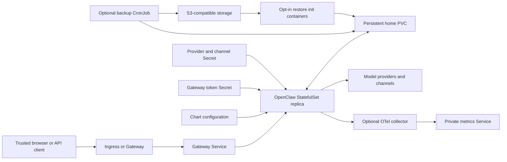

# OpenClaw design

## Scope

The chart packages the official OpenClaw gateway as one persistent StatefulSet
replica. The gateway owns SQLite state, agent directories, device identities,
sessions, and workspaces. Kubernetes replaces the existing Pod before admitting
its successor. This is a single-writer deployment with planned downtime, not an
HA service or a tenant-isolation boundary. If storage permits multi-node
attachment, never force-delete a Pod on an unreachable node until the old
writer is confirmed stopped or fenced; otherwise, the replacement and old Pod
can write concurrently.

The chart owns the StatefulSet, Services, configuration, generated or referenced
gateway-token Secret, optional routing and telemetry resources, persistent
claim, and backup or restore workloads. Operators own provider and channel
credentials, edge controllers, TLS, S3 storage, monitoring infrastructure, and
the trust policy for clients and agent tools.

## Architecture

The headless Service provides a stable StatefulSet identity. The public Service,
Ingress, and Gateway API resources all route to the same authenticated gateway.
The backup uploader sees only the staging volume and S3 credentials, never the
live agent home.

## Key Decisions

### Preserve the official process and single-writer state

The official image and its real tini entrypoint are preserved. One replica and
one writable home avoid concurrent SQLite writers. UID/GID 1000, a read-only
root filesystem, dropped capabilities, RuntimeDefault seccomp, and a disabled
service-account token reduce container privileges while retaining the writable
home and temporary storage required by OpenClaw.

### Make configuration ownership explicit

Managed mode reconciles declared files at Pod initialization. Seed mode writes
missing files and preserves subsequent operator changes. Updates to bootstrap
scripts or chart-managed configuration trigger rollout by checksum. Changes to
referenced external Secrets require an explicit rollout.

### Retain gateway identity across lifecycle operations

Gateway token authentication remains enabled, and Control UI device
authentication is never bypassed. A generated token is recovered through Helm
`lookup`; when persistence retention is enabled, both the token Secret and PVC
carry `helm.sh/resource-policy: keep`. Upgrades therefore retain gateway
identity, paired devices, sessions, and agent state.

Offline renders such as `helm template` cannot query the cluster and generate a
new token on each render. Applying that output can replace the live token and
disconnect existing clients. Render-only or GitOps deployments must configure
`auth.existingSecret` instead of relying on a generated token.

### Keep remote access explicit

The default minimal tool profile exposes only session status. Providers and
channel tokens come from Secrets. The optional OpenAI-compatible endpoints
grant operator-level authority and must remain private to trusted clients.
Ingress and Gateway API require explicit network-policy sources. TLS,
WebSocket upgrades, and timeout policy belong to the selected edge controller.

### Use native, verified recovery artifacts

Backups use the same OpenClaw version and its native verified archive API.
Native SQLite online snapshots capture WAL commits and sanitize transient
ownership and delivery state. The uploader reads the archive back, verifies its
hash, and publishes a completion manifest. Restore verifies the manifest,
archive hash, and native archive before activating into an empty home volume.

## Production Boundary

The chart provides resource limits, scheduling controls, network policies,
persistent storage, verified off-cluster backups, and recovery automation. A
single replica is intentional: OpenClaw's local databases and mutable home are
not a multi-writer store. Production operators must plan a short outage for Pod
replacement, size the PVC and backup staging volume, monitor capacity, and test
restore procedures against an isolated release.

Separate releases and claims are required for independent trust domains. The
chart does not turn one gateway into a multi-tenant service. Remote execution
also requires an explicitly configured supported upstream backend.

## Security Boundary

Tools execute with the agent's credentials and permissions; enabling shell or
filesystem tools does not create a sandbox. Provider keys, channel tokens, the
gateway token, and S3 credentials must remain in Kubernetes Secrets. The
unauthenticated UI shell is not proof of an authenticated session, and device
pairing must be approved only for the intended client.

The workload runs without privilege escalation, Linux capabilities, or a
service-account token. NetworkPolicy limits inbound gateway and metrics access,
but provider and channel communication requires outbound Internet access by
default. Operators remain responsible for namespace isolation, Secret access,
edge authentication, TLS, and any stronger runtime sandbox.

## Observability Boundary

The release bundles `diagnostics-otel`. A pinned official collector receives
metrics on loopback and exposes a private Prometheus Service. This avoids
runtime plugin downloads and avoids giving Prometheus a gateway operator token.
Traces, logs, and model-content export are disabled by the chart integration.

Kubernetes readiness checks the gateway's unauthenticated `/startupz` health
response. It does not prove client authentication, provider reachability,
channel delivery, model quality, or cost accuracy. Provider usage metrics are
operational signals, not a financial accounting guarantee.

## Upgrade and Recovery

Normal upgrades preserve the retained PVC and generated token Secret. With
`--reset-values`, the new chart defaults apply while the live resources retain
identity and state. With `--reuse-values`, Helm intentionally retains the
installed image tag until an explicit tag override is supplied. Operators must
back up custom values and every referenced Secret before either path.

`--reset-values` resets all custom values. Reapply every non-default value that
identifies a resource or Secret field, including `nameOverride`,
`fullnameOverride`, and `auth.key` when configured. Reapply
`persistence.existingClaim` and `auth.existingSecret` when using existing
resources so the StatefulSet continues to use the intended PVC and Secret.

Recovery activates only into an empty home volume. Interrupted activation fails
closed and requires inspection rather than overwriting existing state. Native
SQLite snapshots do not provide global atomicity across every database and
workspace file, so a completed remote manifest and a restore drill remain the
authoritative recovery evidence.

## Known Gaps

- Pod replacement causes planned downtime because the gateway is single-writer.
- The current gateway bind implementation is IPv4-only; IPv6 and dual-stack
  Service requests are rejected.
- External Secret updates do not automatically restart the StatefulSet.
- Native backup is not globally atomic across all databases and workspace files.
- Provider or channel reachability is not part of Kubernetes readiness.
- Provider usage telemetry is not a billing reconciliation system.

## Non-Goals

- Providing high availability or concurrent writers for OpenClaw state.
- Treating one release as a multi-tenant authorization boundary.
- Installing ingress, Gateway, External Secrets, S3, or monitoring controllers.
- Sandboxing tools solely by enabling a chart value.
- Bypassing gateway token authentication or Control UI device pairing.
- Guaranteeing provider availability, response quality, delivery, or billing.

## Test Strategy

Unit tests cover security, configuration, integrations, retained identity, and
upgrade or recovery contracts. CI renders default, seed, agent, backup,
External Secrets, Gateway API, and observability scenarios. Behavioral k3d
validation runs the actual gateway with a deterministic local model service,
exercises device pairing and authenticated sessions, and validates native
backup and recovery without paid providers or real messaging accounts.
