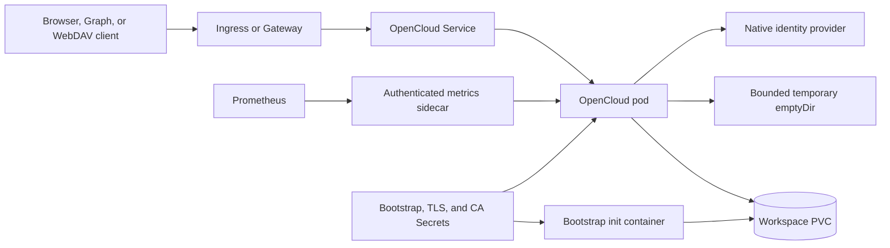

<!-- SPDX-License-Identifier: Apache-2.0 -->

# OpenCloud design

## Scope

This chart deploys the official OpenCloud monolithic server for file collaboration, native browser identity, Graph and
WebDAV access. It owns one Deployment, one persistent workspace, bootstrap and retained TLS Secrets, Services, optional
Ingress or Gateway API routes, NetworkPolicies, External Secrets, and authenticated Prometheus integration.

The supported contract is intentionally a single replica. OpenCloud configuration, identity keys, metadata, file data
and extended attributes form one recovery unit. The chart validates that unit and avoids presenting horizontal scaling
as high availability.

## Architecture

The init container and application use the same official image, UID/GID 1000 and persistent workspace. The initializer
creates native configuration before the server starts. The workspace root is mounted by init and later exposed through
separate `config` and `data` subpaths. A Recreate strategy prevents concurrent writers during upgrades.

## Design decisions

The official `opencloudeu/opencloud` image and native `opencloud init` command remain authoritative. The chart does not
replace upstream identity initialization or synthesize application databases. Managed environment variables prevent
values from bypassing TLS verification, changing storage paths, enabling demo identities or exposing the debug listener.

One PVC stores configuration and data because restoring either half independently can invalidate identities, encryption
keys or file metadata. The bootstrap script verifies user extended attributes on the actual data mount before startup.
This proves the selected filesystem can support PosixFS basics; it does not prove backup fidelity or distributed locking.

The debug endpoint stays on loopback. Optional metrics use an official Node sidecar that exposes only an authenticated
`GET /metrics` path and never mounts the identity workspace or bearer Secret. Gateway backend TLS is explicit through
BackendTLSPolicy rather than an insecure certificate flag.

## Production boundary

Production operators own a stable public HTTPS hostname, DNS, trusted certificate lifecycle, ingress or Gateway
controllers, storage-class behavior, capacity, backups, restore drills and external integration egress. Use an existing
TLS Secret and bootstrap Secret. The chart-generated private certificate is retained for evaluation, expires after one
year and is not an automatic certificate-management system.

Upgrades use Recreate and cause downtime. Before changing application versions, take an application-consistent backup
of configuration and data with xattrs, ownership and modes preserved. Helm rollback changes manifests but cannot reverse
an upstream data migration. Recovery acceptance requires a fresh volume, successful login, Graph discovery and exact
WebDAV file-content validation.

## Security boundary

Containers run as UID/GID 1000 with RuntimeDefault seccomp, a read-only root filesystem, dropped capabilities, disabled
privilege escalation and no Kubernetes API token. Writable locations are limited to the workspace and bounded temporary
volume. Native OIDC certificate verification remains enabled. Private issuers require an explicit trusted CA Secret;
browser and in-pod clients must resolve and trust the same canonical HTTPS origin.

Bootstrap credentials are read from a Secret-backed file and are not emitted into command arguments. Changing that
Secret after initialization is not password rotation. NetworkPolicy is enabled by default, but protection depends on an
enforcing CNI and complete ingress and egress peer configuration. External Secrets require an installed controller and
an operator-owned SecretStore or ClusterSecretStore.

## Observability boundary

Startup, readiness and liveness probes call the private debug health endpoints from inside the container. They prove
process availability, not login, WebDAV correctness, identity consistency, xattr preservation or restore readiness.
The optional metrics sidecar, ServiceMonitor and PrometheusRule provide authenticated operational signals without
publishing the full debug API.

Platform monitoring must additionally cover Deployment readiness, restarts, PVC usage and latency, certificate expiry,
failed login rates, WebDAV errors, backup age and restore-drill results. Alert thresholds depend on workload and service
objectives, so the chart provides extension points rather than prescribing a universal policy.

## Known gaps and limitations

- Only one monolithic replica is supported; upgrades and node disruption cause downtime.
- The chart does not renew retained private certificates or rotate application identities.
- Filesystem xattr admission does not prove that a backup tool preserves xattrs.
- Public Ingress and Gateway behavior depends on installed controllers and external DNS.
- NetworkPolicy has no effect without a compatible enforcing CNI.
- ServiceMonitor, PrometheusRule, Gateway API and ExternalSecret resources require their CRDs before enablement.
- A public issuer reachable only outside the cluster requires deliberate DNS, CA trust and egress configuration.

## Non-goals

The chart does not implement distributed OpenCloud HA, install ingress/Gateway/monitoring/External Secrets controllers,
manage public DNS, issue production certificates, create users after bootstrap, rotate passwords, migrate storage
classes, schedule backups or claim zero-downtime upgrades. It does not weaken TLS verification or overwrite existing
native identity configuration to make a deployment appear healthy.

## Behavioral acceptance

The runtime fixture verifies native OIDC with PS256 signatures and S256 verifiers, Graph identity and personal-drive
discovery, authenticated WebDAV upload/download/deletion, wrong-password denial and anonymous-access denial. Persistence
acceptance covers retained identity and files across replacement and upgrade, plus a fresh-volume restore preserving
xattrs. Monitoring acceptance proves an authenticated Prometheus scrape and loaded rule rather than only rendering YAML.
