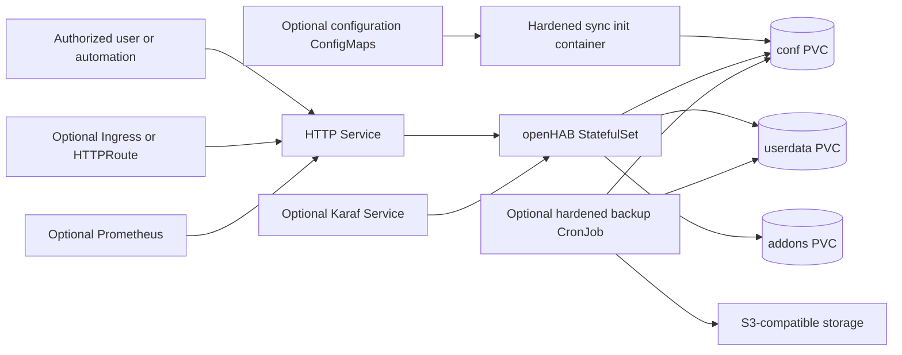

# openHAB Chart Design

## Scope

The `openhab` chart deploys the official openHAB home automation platform as a
single Kubernetes workload with durable application directories, optional
GitOps-managed configuration, optional Prometheus discovery, and optional
S3-compatible backups. openHAB is stateful and does not support clustering, so
the chart enforces one replica instead of presenting horizontal scaling as a
production capability.

## Architecture

The StatefulSet supplies stable Pod identity and PVC attachment. The main
Service exposes the UI and REST API on port 8080 by default. Karaf SSH is a
separate, disabled-by-default administrative path. Ingress and Gateway API
resources route only to the HTTP Service.

## Main Design Choices

### Singleton enforcement

The rendered StatefulSet always uses one replica. `replicaCount` remains in the
values contract so invalid requests fail with a clear message before multiple
instances can write to the same openHAB directories.

### Storage separation

The chart creates independent PVCs for `/openhab/userdata`, `/openhab/conf`, and
`/openhab/addons`. Each area can instead reference an existing claim and an
optional subpath, including the supported pattern where several logical areas
share one pre-provisioned PVC without rendering duplicate volume declarations.

### Writable configuration synchronization

GitOps configuration for sitemaps, things, and items is copied from ConfigMaps
into the writable `conf` PVC by an init container. Direct ConfigMap mounts are
not used because they are read-only and conflict with the official entrypoint's
ownership reconciliation. A checksum annotation rolls the Pod when managed
configuration changes.

### Native first-boot administration

The chart does not attempt to inject the first administrator. openHAB creates
that account through its setup wizard and persists it under `userdata`. The
optional admin Secret is an operational reference only and does not configure
the application.

## Production Boundary

The chart owns Kubernetes resources, storage attachment, probes, configuration
sync, and optional backup execution. Operators own StorageClass durability,
PVC snapshots, S3 retention and restore drills, ingress TLS, DNS, binding
configuration, device-network reachability, and application-level upgrades.

StatefulSet identity reduces attachment ambiguity but does not provide openHAB
high availability. Pod replacement and chart upgrades interrupt the singleton
while it restarts and reloads OSGi bundles. The three data areas should remain
durable. The chart backup covers `userdata` and `conf`; operators must protect
the `/openhab/addons` data area separately when it contains artifacts that
cannot be reproduced from another source. For a shared claim, snapshot the
entire PVC or use a path-aware archive that includes the configured addons
subpath.

## Security Boundary

The official image starts as root so its entrypoint can reconcile UID/GID 9001,
adjust mounted-directory ownership, and then drop privileges through `gosu`.
The main container therefore cannot force `runAsUser`, `runAsGroup`, a read-only
root filesystem, or removal of every Linux capability without breaking startup.
It still disables privilege escalation and uses the Pod's `RuntimeDefault`
seccomp profile.

Chart-owned helper containers do not share that exception. Config sync,
subpath preparation, backup, and upload helpers drop all capabilities, disable
privilege escalation, use read-only root filesystems, and run as non-root
UID/GID 9001. Every chart-owned Pod disables ServiceAccount token automount by
default.

The chart does not generate a generic NetworkPolicy because openHAB bindings can
require different LAN devices, brokers, discovery protocols, and cloud APIs.
Operators must define site-specific ingress and egress policy after inventorying
those paths. Karaf should remain a ClusterIP service accessed through a trusted
administrative path.

## Observability Boundary

Startup, readiness, and liveness probes use `/rest/uuid`, which becomes
available without authentication when the REST API is ready. The startup window
allows slow first boot and OSGi bundle initialization. Metrics discovery is
optional because the openHAB Metrics addon must first be installed inside the
application; the chart can then add scrape annotations or a ServiceMonitor.

The chart verifies workload readiness and clean container behavior. Operators
remain responsible for alerting on application semantics, binding failures,
device availability, rule execution, backup freshness, PVC capacity, and S3
retention.

## Known Gaps

- The singleton has planned downtime during Pod replacement and upgrade.
- The chart cannot bootstrap the first administrator through supported native
  openHAB configuration.
- Backups are full archives; scheduling does not provide point-in-time recovery
  or automatically test restores.
- Generic network policy cannot safely predict every home-automation binding's
  LAN, multicast, broker, and cloud requirements.
- Metrics require an application addon that Helm cannot install reliably before
  first boot.

## Explicit Non-Goals

- Running more than one openHAB replica or providing application clustering.
- Managing physical devices, bindings, rules, or the first-boot setup wizard.
- Acting as a certificate authority, ingress controller, Gateway controller,
  Prometheus Operator, External Secrets Operator, or S3 lifecycle manager.
- Claiming high availability from StatefulSet identity or persistent storage.
- Replacing storage snapshots, off-cluster backup retention, and restore drills.

## Validation Expectations

The chart must pass `make validate-chart CHART=openhab` end to end. Runtime
coverage includes default installation plus ConfigMaps, Ingress, Gateway API,
External Secrets, monitoring, backup, namespace override, shared PVCs, Karaf,
full values, and dual-stack scenarios. The External Secrets scenario uses the
HelmForge fake store in the k3d lab.
