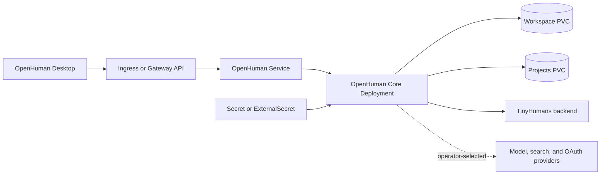

# OpenHuman chart design

<!-- markdownlint-disable MD013 -->

## Scope

This chart deploys the official OpenHuman Core as one persistent, authenticated
agent runtime. It owns the Kubernetes workload, service, credentials contract,
state volumes, optional ingress or HTTPRoutes, and network policy. Desktop
clients, model providers, search services, OAuth applications, and backup
infrastructure remain external.

## Architecture

One Deployment runs the headless Core and one Service exposes its authenticated JSON-RPC endpoint. Two retained PVCs preserve the application workspace and projects/action directory. The chart does not deploy the desktop UI or optional external model and search services.

## Main Design Decisions

### Singleton and lifecycle

OpenHuman stores local SQLite and workspace state without a documented coordination protocol. The chart fixes the workload at one replica and uses Recreate so two writers never overlap. Application-managed self-update is disabled; image rollout belongs to Kubernetes.

### Identity and storage

The container runs as the upstream UID/GID 10001. `fsGroup` makes newly provisioned volumes writable while avoiding the upstream Docker entrypoint's root path and CHOWN, SETUID and SETGID capabilities. A read-only root filesystem is paired with writable workspace, projects and `/tmp` mounts.

## Security Boundary

The RPC token is generated into a retained Secret unless an existing Secret is selected. The optional keyring master key is projected as a read-only file. ExternalSecret items use the HelmForge canonical free-form contract. The health endpoint is intentionally unauthenticated upstream; every other client connection must protect the bearer in transit.

The default container runs as UID/GID 10001 with a read-only root filesystem,
all Linux capabilities dropped, `RuntimeDefault` seccomp, privilege escalation
disabled, and no Kubernetes API token. The chart protects the transport and
runtime boundary; it does not constrain what an authenticated agent can do
through configured tools or external provider credentials.

## Networking

ClusterIP, default-deny ingress and same-namespace callers are the defaults. Public HTTPS egress remains available because providers are operator-selected and dynamic; private endpoints are declared with extra egress rules. Ingress requires both a class and TLS. Gateway API parents are operator-managed and must terminate TLS.

`containerPorts.http` changes the real OpenHuman Core listener through
`OPENHUMAN_CORE_PORT`. `service.port` remains independently configurable and
targets the named `http` port.

## Production Boundary

Production operators must provide a backup and restore process for both PVCs,
manage RPC token and keyring rotation, constrain NetworkPolicy peers, terminate
TLS before non-loopback access, and validate provider credentials. The chart
keeps a single writer and retained state but does not provide storage snapshots,
external secret rotation rollouts, provider availability, or disaster recovery.

## Observability Boundary

The chart exposes startup, readiness, and liveness probes on `/health` and
preserves application logs through the Kubernetes logging path. It does not
ship a metrics exporter, ServiceMonitor, dashboards, tracing, or alert rules.
Operators should monitor Pod readiness and restarts, PVC capacity, RPC latency,
provider failures, and backup outcomes in their platform stack.

## Known Gaps and Limitations

- The official image is currently amd64-only.
- Workspace state is single-writer and cannot be scaled horizontally.
- Upstream does not document downgrade-safe migrations.
- Secret changes do not restart the Pod without an external reloader or manual
  rollout.
- The unauthenticated `/health` endpoint proves process health, not provider
  login, model inference, search, or agent tool execution.

## Non-Goals

There is no HPA, multi-replica mode, ServiceMonitor, bundled database, bundled inference service, arm64 scheduling or in-container updater. Upstream does not provide contracts that would make those features truthful and safe.
