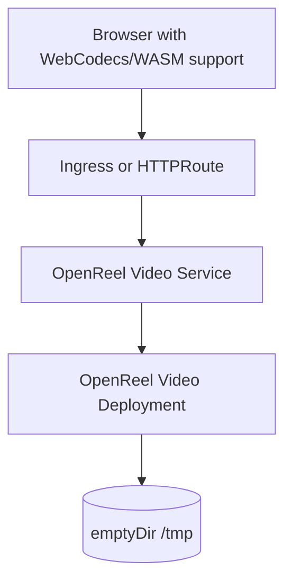

# OpenReel Video Chart Design

## Scope

This chart deploys OpenReel Video as a static browser application served by the
HelmForge-maintained image.

Supported exposure modes:

- ClusterIP Service with port-forward access
- Ingress with `ingress.ingressClassName`
- Gateway API HTTPRoute through the single `gateway` values block
- ExternalName Service when a platform needs a compatibility Service record

## Architecture

The workload is intentionally stateless. User media processing happens in the
browser and the chart does not deploy background workers, databases, object
storage, or queues.

## Main Design Choices

- Use the HelmForge-maintained `docker.io/helmforge/openreel-video` image.
- Keep the runtime non-root and read-only, with a small `/tmp` emptyDir for
  NGINX temporary files.
- Use one Gateway API values block named `gateway`, matching other HelmForge
  application charts.
- Use `ingress.ingressClassName`, matching the consolidated HelmForge values
  convention.
- Keep COOP/COEP behavior in the image so browser APIs such as
  SharedArrayBuffer, WebCodecs, and WASM workflows work behind common
  Kubernetes routing layers.

The pinned `v0.5.0` image contract was verified for both supported
architectures: it declares user `101`, exposes port `8080`, starts unprivileged
NGINX, and provides `/healthz`. The chart intentionally models that fixed
runtime instead of inventing an application port that the image cannot change.

## Production Boundary

The chart owns the Deployment, Service, optional exposure resources,
availability controls, NetworkPolicy, and Helm test. Cluster operators own DNS,
TLS issuers and certificates, Ingress or Gateway controllers, browser support,
edge caching, and capacity planning. Scaling improves static asset availability
but does not add server-side video processing because editing remains in the
browser.

ExternalName mode changes only the Service into a DNS alias; the chart still
renders its local Deployment and Helm test. The local pods are not selected by
the Service in this mode. Helm test requests follow the alias to the external
target and require its `/healthz`, landing page, and COEP header to match the
OpenReel image contract. The chart does not deploy or apply its local security
and availability controls to that external target.

## Security Boundary

The default workload uses the image's UID/GID `101`, RuntimeDefault seccomp, a
read-only root filesystem, no privilege escalation, no Linux capabilities, and
no ServiceAccount token. A bounded emptyDir supplies the NGINX `/tmp` paths.
These controls protect the Kubernetes runtime; they do not validate media files
processed by the browser or configure security headers at an external proxy.

COOP and COEP headers originate in the image. Operators must ensure that an
Ingress, Gateway, CDN, or reverse proxy does not remove or replace them.
NetworkPolicy is disabled by default because controller selectors are
cluster-specific. Enabling it denies egress unless explicit rules are added.

## Observability Boundary

Readiness, liveness, and Helm tests use the image's `/healthz` endpoint. The
Helm test also checks the landing page and the Cross-Origin-Embedder-Policy
header. NGINX access and error logs are written to stdout and stderr for the
cluster log collector. The chart does not create a metrics endpoint,
ServiceMonitor, dashboard, alert, or distributed trace pipeline.

## Known Gaps

- `/healthz` proves that NGINX serves content, not that a particular browser
  supports WebCodecs, WASM, or SharedArrayBuffer.
- The Helm test verifies one isolation header; edge proxies still require an
  end-to-end browser or HTTP check.
- `service.targetPort` remains in the values contract for upgrade compatibility,
  but the current image listener is fixed at `8080`.
- HPA metrics cover NGINX resource use and do not represent client-side editor
  workload or media complexity.
- There is no server-side persistence, authentication, collaboration, or
  encoding service to monitor or back up.

## Explicit Non-Goals

- server-side rendering
- user authentication
- persistent media storage
- background encoding workers
- database, cache, queue, or object-storage subcharts
- installing Ingress controllers or Gateway API CRDs

<!-- @AI-METADATA
type: design
title: OpenReel Video Chart Design
description: Design document for the OpenReel Video Helm chart architecture and scope
keywords: openreel-video, design, static-site, webcodecs, gateway-api
purpose: Document chart design choices and non-goals
scope: Chart Design
relations:
  - charts/openreel-video/README.md
  - charts/openreel-video/docs/production.md
path: charts/openreel-video/DESIGN.md
version: 1.0
date: 2026-05-29
-->
