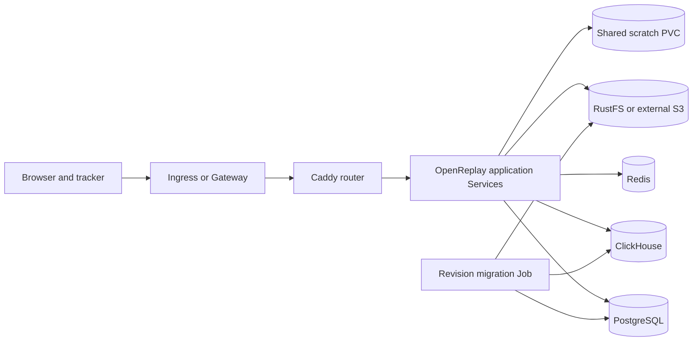

<!-- SPDX-License-Identifier: Apache-2.0 -->

# OpenReplay chart design

## Scope

This chart deploys the complete OpenReplay 1.28 open-source application topology on Kubernetes. It owns the fifteen
OpenReplay application Deployments and Services, an internal Caddy router, the schema migration workflow, shared scratch
storage, credentials, and optional RustFS object storage. HelmForge PostgreSQL, Redis, and ClickHouse subcharts provide a
self-contained default installation while preserving explicit external-service contracts.

The chart targets Kubernetes 1.31 or newer and upstream's published `linux/amd64` application images. It is designed for
repeatable installation, controlled upgrades, portable north-south exposure, and a clear path from the bundled baseline
to operator-managed production dependencies.

## Architecture

The public Service selects only Caddy router pods. Caddy provides OpenReplay-specific prefix handling, WebSocket routing,
tracker delivery, object paths, and SPA fallback, then proxies to named internal component Services. Ingress and Gateway
API therefore need only portable prefix routes and never controller-specific rewrite snippets.

PostgreSQL stores relational metadata, ClickHouse stores events and analytical data, Redis coordinates transient work,
and S3-compatible storage holds recordings, session assets, sourcemaps, and spots. Selected workers share `/mnt/efs` for
in-flight pipeline files. The migration Job fetches the exact schema revision corresponding to `Chart.appVersion` and
runs pinned upstream database and object-storage migration clients.

## Design decisions

### Controller-neutral routing

The chart uses an internal Caddy Deployment instead of bundling an Ingress controller. This keeps routing behavior stable
across Ingress and Gateway API implementations, avoids cluster-scoped controller ownership, and makes the public Service
the single exposure boundary. `router.containerPorts.http` configures Caddy's actual listener; `service.port` remains an
independent Kubernetes Service concern.

### Explicit multi-service topology

OpenReplay is not modeled as one generic container. Each official component has its own image pin, listener, metrics port,
replica count, Deployment, and Service. Component tags intentionally differ because upstream publishes hotfix revisions
independently. A shared defaults block centralizes resource and security settings without hiding those image identities.

### Replaceable data services

Bundled PostgreSQL, Redis, and ClickHouse are conditions in `Chart.yaml`. RustFS is rendered directly because OpenReplay
requires S3-compatible storage and the chart must support a self-contained baseline. Every dependency can be disabled in
favor of an explicit endpoint. All components and bundled services consume one credential Secret contract, which can be
generated, supplied directly, or reconciled through External Secrets Operator.

### Reproducible upgrades

Application and support images are pinned by tag and digest. The migration Job is revision-scoped and a persisted version
ConfigMap rejects downgrades unless the operator makes an explicit override. Helm rollback is not presented as a database
rollback: operators must restore compatible data when reverting application versions.

### End-to-end listener configuration

Listener values must alter the process, not only Kubernetes metadata. The router value rewrites the Caddy bind address and
container port. RustFS container-port values populate `RUSTFS_ADDRESS` and `RUSTFS_CONSOLE_ADDRESS`; separate Service-port
values feed the in-cluster endpoint helper. Services keep named target ports so changing a Service port cannot silently
disconnect it from the process.

## Production boundary

The chart provides production-oriented controls but does not turn singleton dependencies into a highly available system.
The bundled data services and RustFS are convenient baselines. A resilient deployment uses external HA PostgreSQL,
ClickHouse, Redis, and S3 services; a tested RWX CSI implementation; multiple router replicas with a PodDisruptionBudget;
capacity-specific resource settings; and topology rules appropriate for the cluster.

Application services may be scaled independently only after their request-affinity and shared-storage behavior is tested.
Assist remains one replica by default because portable Gateway API does not express the upstream `peerId` affinity policy.
The default `ReadWriteOnce` scratch claim is a single-node baseline. Multi-node scheduling requires `ReadWriteMany` and a
storage backend whose failure and recovery behavior has been exercised.

The chart does not install an Ingress controller, Gateway, GatewayClass, certificate controller, Prometheus Operator,
External Secrets Operator, CSI driver, or backup system. Operators own those cluster capabilities and their lifecycle.

## Security boundary

Service-account token automounting is disabled. Workloads use RuntimeDefault seccomp, non-root identities, and dropped
capabilities. Read-only root filesystems are applied where verified against the real upstream image; other components keep
only their required writable runtime surface until component-specific validation proves a stricter configuration.

Credentials never enter ConfigMaps or command-line arguments. The generated Secret uses lookup-based preservation across
upgrades, while an existing Secret or ExternalSecret target is preferred for production. Credential contract checksums
restart application and RustFS pods when Secret key mappings change. Rotation of shared JWT, API, database, and object-store
credentials remains an operator-coordinated maintenance event.

NetworkPolicy is opt-in because external endpoints and namespaces are deployment-specific. Enabling restricted egress
without complete PostgreSQL, Redis, ClickHouse, S3, DNS, HTTPS, and tracker dependencies can make a healthy-looking rollout
nonfunctional. The chart supplies defaults for bundled services and extensible peer/rule contracts, but operators must
verify their actual network topology.

## Observability boundary

Every long-running component has startup, readiness, and liveness behavior appropriate to its upstream listener. Caddy and
RustFS expose dedicated health paths. Optional ServiceMonitors select component metrics Services when Prometheus Operator
CRDs are already installed. Kubernetes events, restart counts, readiness, migration logs, ingestion errors, queue delay,
database health, scratch usage, and object-store capacity form the minimum operational signal set.

The chart does not create alert rules, dashboards, log storage, traces, or an observability backend. Metrics availability
does not prove end-to-end recording. Operators should continuously test tracker ingestion, session replay, API access, and
Assist/WebSocket behavior from outside the cluster.

## Known gaps and limitations

- Upstream application images are `linux/amd64`; the architecture override does not manufacture ARM-compatible images.
- Several upstream containers still require writable root filesystem paths that have not been safely isolated.
- Bundled data services and RustFS are singleton defaults, not a disaster-recovery architecture.
- Gateway API has no portable equivalent for every controller-specific session-affinity feature.
- NetworkPolicy cannot infer external endpoints, CIDRs, namespaces, or S3 destinations.
- The migration Job changes durable stores and cannot be reversed by Helm `--atomic`.
- Official images are digest-pinned, but upstream does not provide a complete signed SBOM and Cosign verification chain for
  every component.
- Horizontal autoscaling is not exposed because component-specific scaling signals and state behavior are not uniform.

## Non-goals

- Installing or managing ingress controllers, Gateways, certificate issuers, CSI drivers, ESO, or Prometheus Operator.
- Deploying enterprise-only connector, Kafka, Vault, or licensed OpenReplay workloads.
- Claiming high availability from increased replica counts alone.
- Automating destructive restore, downgrade, or credential-rotation workflows.
- Compiling or rebuilding upstream images inside the chart lifecycle.
- Hiding unsupported architectures or unverified runtime behavior behind permissive defaults.

## Validation profile

Static validation covers every template scenario with strict lint, schema validation, unit tests, kubeconform, Artifact Hub
lint, and security policy scanning. Behavioral validation installs the real pinned frontend, Caddy router, and relevant
support services on k3d. Dedicated scenarios exercise Ingress, Gateway API, dual-stack Services, External Secrets, and
overridden Caddy/RustFS process listeners. Each scenario must reach readiness, expose Service endpoints, keep zero restarts,
produce clean logs and events, and remove its namespace during cleanup.
