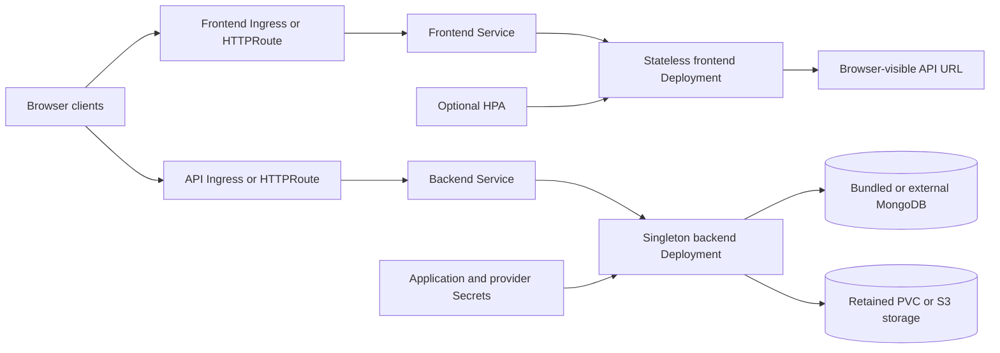

<!-- SPDX-License-Identifier: Apache-2.0 -->

# OpenSign chart design

## Scope

The chart deploys the official OpenSign frontend and Parse Server backend with
either the maintained HelmForge MongoDB dependency or an external MongoDB
service. It owns the Kubernetes workloads, Services, application listener
configuration, document storage attachment, credentials, optional
Ingress/HTTPRoute resources, frontend availability controls, and component
NetworkPolicies.

Database operations, object-storage provisioning, certificate issuance,
external secret stores, email infrastructure, backups, monitoring backends,
and disaster recovery remain operator responsibilities.

## Architecture

The workloads intentionally use separate Services and public hosts. The
frontend is stateless after copying the image-owned build into a bounded
writable volume and can scale independently. The backend owns migrations,
signing, email, MongoDB access, and document storage.

## Main Design Decisions

### Workload and upgrade topology

The frontend starts with two replicas, rolling updates, a
PodDisruptionBudget, and optional HPA. The backend remains one replica with
`Recreate` updates because upstream migrations execute during process startup
and local document storage has single-writer semantics. The chart does not
claim backend high availability.

### Listener and Service contract

`containerPorts.frontend` and `containerPorts.backend` configure the real
Node.js listeners through the upstream `PORT` environment variable. Services,
probes, and NetworkPolicies target the named `http` ports.
`service.frontendPort` and `service.backendPort` remain independent
client-facing ports. Runtime validation discovers the configured listeners and
proves both non-default ports. The listener schema rejects ports below 1024
because the workloads run non-root with all Linux capabilities dropped.

The chart rejects `frontend.extraEnv` or `backend.extraEnv` entries that
override managed variables. This prevents an extra environment entry from
silently breaking the rendered listener, identity, database, signing, storage,
or public URL contract.

### Filesystem and identity

Both official containers run as UID/GID 1000 with all Linux capabilities
dropped and RuntimeDefault seccomp. The frontend uses a read-only root
filesystem and a bounded writable build volume. The backend is a documented
chart-specific exception: upstream writes randomly named PFX work files in the
application working directory, so its root filesystem remains writable. The
chart still mounts bounded document and `/tmp` volumes and avoids copying the
643 MiB `node_modules` tree into every Pod, which keeps startup deterministic.

The generated Secret uses Helm `lookup` to retain the Parse master key across
upgrades and carries the Helm keep policy. Existing Secret and External Secrets
paths support GitOps ownership and independent recovery.

### Data services and recovery unit

The default database is HelmForge MongoDB with authentication enabled. External
MongoDB accepts a complete URI from a Secret or bootstrap value, and validation
prevents bundled and external modes from running together.

Local documents use a retained PVC. S3 mode uses a bounded ephemeral work
directory and requires a bucket, endpoint, public base URL, region, and
credentials. MongoDB, documents, the Parse master key, signing certificate, and
integration credentials form one recovery unit and must be backed up
consistently.

### Exposure and network isolation

The frontend and API receive distinct Ingresses or HTTPRoutes. Separate hosts
avoid controller-specific path rewriting because Parse exposes root routes in
addition to `/app`. Ingress and Gateway API are mutually exclusive.

NetworkPolicy isolates both components, permits DNS, allows required MongoDB
traffic, and exposes controlled extensions for SMTP and private infrastructure.
Application ingress uses named ports so listener overrides cannot drift from
policy enforcement.

## Security Boundary

The chart protects Kubernetes workload identity, process privileges, Secret
references, and pod-level network isolation. Sensitive defaults are generated
or loaded from Secrets; they are never written to ConfigMaps. API tokens are
not mounted. The writable backend root is limited by non-root execution,
dropped capabilities, RuntimeDefault seccomp, and NetworkPolicy; use the pinned
official digest because the image filesystem is part of this trust boundary.

Operators must terminate TLS, provision trusted certificates, scope MongoDB,
SMTP, and S3 credentials, restrict public routes, and define precise
NetworkPolicy peers for private endpoints. The chart cannot validate the
contents or expiry of a supplied PKCS#12 certificate or the policies of an
external object store.

## Production Boundary

Production requires stable external URLs, a recoverable application Secret,
durable MongoDB, durable document storage, tested backups, resource sizing,
failure-domain scheduling, and an upgrade window for the singleton backend.
Scaling the backend, changing the Parse application ID, changing storage modes,
or rotating the master key requires an application-aware migration plan.

The frontend disruption budget and HPA improve web availability only. They do
not make the signing API, database, or document store highly available.

## Observability Boundary

Startup, readiness, and liveness probes verify HTTP process responses. The k3d
gate additionally checks both workloads through their actual configured
listeners, confirms UID 1000, verifies retained master-key presence, and
rejects restarts, crash logs, and unexplained critical events.

OpenSign does not expose a documented Prometheus endpoint, so the chart does
not create a misleading ServiceMonitor. Operators should collect logs and
monitor frontend/API availability, migration failures, MongoDB health, upload
and signing errors, storage capacity, SMTP delivery, and backup restoration.

## Known Gaps and Limitations

- Upstream publishes the deployment images through mutable channels; HelmForge
  pins release-associated immutable digests.
- The backend remains a singleton and has a brief interruption during upgrades.
- Local `ReadWriteOnce` document storage cannot support multiple backend Pods.
- HTTP probes do not prove a complete upload, signature, email, or restore
  workflow.
- Private external-service destinations require operator-supplied NetworkPolicy
  peers or egress rules.

## Non-Goals

The chart does not provide certificate issuance, signing-key custody, external
database or bucket provisioning, email service management, backend
active-active operation, automated storage migration, document-retention
policy, legal/compliance attestation, a monitoring stack, or a backup
controller.

## Validation Design

Unit tests cover workload structure, immutable images, real listener
configuration, managed environment protection, Secrets, local and S3 storage,
External Secrets, routing, dual-stack Services, HPA/PDB behavior, NetworkPolicy,
and invalid combinations. CI scenarios exercise defaults, non-default
listeners, Ingress, Gateway API, dual stack, External Secrets, and production
configuration.

The behavioral gate installs every scenario on local k3d with the maintained
MongoDB dependency. The chart is complete only after
`make validate-chart CHART=opensign`, standards, dependencies, attribution,
documentation lint, site sync, CI, and review-thread checks pass.
