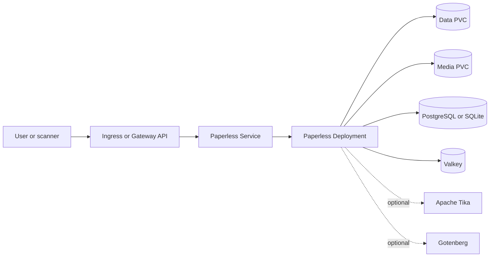

# Paperless-ngx Chart Design

## Scope

This chart packages Paperless-ngx as a single application Deployment backed by
Valkey, PostgreSQL or SQLite, and persistent volumes for data and documents.
Apache Tika and Gotenberg can be deployed alongside it for office documents and
emails. The chart owns Kubernetes wiring and safe defaults, not application
data lifecycle automation.

## Architecture

## Design Decisions

- The official image runs the web server, Celery worker, scheduler, and file
  consumer under s6-overlay in one container. The scheduler and consumer must
  run once, so `replicaCount` is limited to `0` or `1` and the default update
  strategy is `Recreate`.
- Default installs use the HelmForge PostgreSQL `2.1.1` and Valkey `2.0.5`
  subcharts. `database.mode=sqlite` keeps the upstream SQLite default for small
  installs; the database file lives in the data volume.
- The container runs rootless as UID/GID `1000` with `fsGroup`, which upstream
  supports since 3.x. Installing extra OCR languages through
  `PAPERLESS_OCR_LANGUAGES` requires root and is not exposed as a first-class
  value.
- Volumes are made writable through `fsGroup: 1000` rather than a root
  `chown` init container. Paperless-ngx logs a "not owned by current user"
  warning for its directories because the owner stays root; writes work.
- The startup probe starts after 60 seconds. Paperless-ngx spends about 40
  seconds in its s6 init before it listens, and earlier probes only create
  `Unhealthy` events.
- Probes send `Host: localhost`. Paperless-ngx always allows `localhost`,
  while the pod IP is rejected once `PAPERLESS_ALLOWED_HOSTS` is restricted.
- `PAPERLESS_URL` is derived from the first ingress host or gateway hostname
  when `paperless.url` is empty, so CSRF and allowed hosts work out of the box.
- The secret key and superuser password are generated once and reused on
  connected upgrades through `lookup`. Existing Secrets are supported for
  GitOps renderers where `lookup` is unavailable.
- Tika and Gotenberg are separate Deployments with their own component labels,
  so the web Service never selects them. They must be enabled together because
  Paperless-ngx needs both. Their Service ports and process listeners are wired
  from `tika.containerPorts.http` and `gotenberg.containerPorts.http`.
- `containerPorts.http` configures the real Paperless listener through
  `PAPERLESS_PORT`; the Service continues to use its independent public port
  and the named `http` target port.
- PVCs carry `helm.sh/resource-policy: keep` so documents survive
  `helm uninstall`.
- External Secrets Operator support follows the HelmForge pattern for the
  external database password and requires `database.external.existingSecret`
  to avoid drift.

## Production Boundary

The chart supports one application replica, durable data and media PVCs,
bundled or external PostgreSQL and Valkey, and optional conversion services.
Operators own storage classes, database and media backups, restore testing,
external service availability, ingress controllers, Gateway implementations,
TLS certificates, and capacity planning.

## Security Boundary

The workloads run without service account tokens, without privilege escalation,
and with all Linux capabilities dropped. Secrets may be generated, supplied by
existing Secrets, or synchronized through External Secrets. NetworkPolicy is
not rendered, so namespace isolation and traffic policy remain an operator
responsibility. Gotenberg disables JavaScript and restricts local file access
by default.

## Observability Boundary

Startup, readiness, and liveness probes cover the application and optional
conversion services. Kubernetes events and container logs are the primary
signals. The chart does not deploy a ServiceMonitor, dashboards, alerts, or a
log pipeline; platform observability must collect these signals externally.

## Known Gaps

- No scheduled backup or restore workflow is included.
- No NetworkPolicy or monitoring resource is rendered.
- Horizontal scaling is unsupported because the scheduler and consumer share
  the application process and persistent state.

## Non-Goals

- A scheduled backup CronJob. A database dump alone does not include the
  documents in the media volume; a follow-up should run the upstream
  `document_exporter` against the export volume.
- MariaDB. Upstream supports it with caveats; PostgreSQL is recommended.
- Compiling OCR languages or other packages during pod startup.
- Managing an ingress controller, Gateway implementation, certificates,
  database service, storage backend, or observability stack outside resources
  explicitly enabled by this chart.

<!-- @AI-METADATA
type: chart-design
title: Paperless-ngx Chart Design
description: Architecture and design decisions for the Paperless-ngx Helm chart

keywords: paperless-ngx, design, architecture, postgresql, valkey, sqlite, tika, gotenberg, rootless

purpose: Record the deployment model and design trade-offs of the Paperless-ngx chart
scope: Chart

relations:
  - charts/paperless-ngx/README.md
  - charts/paperless-ngx/docs/architecture.md
path: charts/paperless-ngx/DESIGN.md
version: 1.0
date: 2026-10-18
-->
