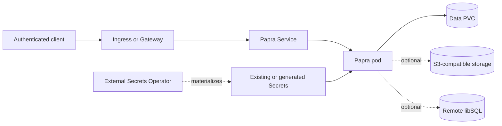

# Papra design

## Scope

This chart deploys one production-oriented Papra web and worker process using
the official rootless image. It owns Kubernetes resources, native bootstrap,
local persistence, optional S3/libSQL connections, credential references, and
network isolation. Papra remains responsible for migrations, authentication,
document processing, extraction, search, and application authorization.

## Architecture

With the default `persistence.enabled=true`, the PVC holds the local application
database, filesystem originals, and the separate native task queue. When
persistence is disabled for disposable tests, the `emptyDir` workspace and all
of that local state are lost on pod replacement. S3 can replace filesystem
document storage, and libSQL can replace the application database, but neither
removes every local durability requirement.

## Key Design Decisions

- One `Recreate` writer avoids unsafe concurrency across native migrations,
  jobs, local document state, and SQLite even when the application database is
  remote.
- The native libSQL queue uses `db/tasks.sqlite`, so whole-state archives retain
  pending extraction work. The chart does not claim retries or stale-processing
  recovery absent from the pinned upstream queue library.
- The bootstrap init container starts the native server on loopback, performs
  strict migrations, checks the real user count, creates only the first account,
  verifies administrator permissions, and stops before the public process.
- Session signing, local database encryption, document key rings, S3 access,
  and bootstrap credentials remain separate Secrets because their lifecycles
  and recovery consequences differ.
- Explicit chart-managed environment fields take precedence over `envFrom` so
  advanced imports cannot silently replace storage, database, or auth policy.
- The official rootless image receives writable PVC, temporary, and home
  mounts; the root filesystem remains read-only and requires no ownership init.

## Production Boundary

The chart provisions neither S3 buckets nor remote libSQL databases. Operators
must provide their availability, backups, credentials, TLS, capacity, and
retention. Ingress/Gateway controllers, DNS, certificates, identity providers,
mail delivery, and edge upload limits are also external responsibilities.

Changing `storage.driver`, database encryption, or document encryption does not
migrate existing state. Recreate upgrades deliberately include downtime. Helm
rollback restores manifests and values but cannot reverse upstream data-format
migrations.

## Security Boundary

The pod runs as UID/GID 1000 with RuntimeDefault seccomp, no privilege
escalation, a read-only root filesystem, all Linux capabilities dropped, and no
service-account token. NetworkPolicy is enabled by default, but enforcement
depends on the cluster CNI and operator-supplied peers for public and external
traffic.

Document encryption protects original objects, not extracted text or metadata
in the database. The task queue is also plaintext. Existing Secret or External
Secret references are recommended for production; the chart never treats
session or encryption keys as disposable startup data.

## Observability Boundary

Startup and readiness call `/api/health`, which includes native database
health. Liveness calls `/api/ping`. Kubernetes events, pod logs, workload
availability, PVC capacity, edge errors, task failures, and queue growth must be
monitored by the platform. No verified native Prometheus endpoint exists in the
pinned release, so the chart does not create a misleading ServiceMonitor.

## Known Gaps

- The pinned queue has no lease/reaper for interrupted `processing` jobs,
  extraction retries default to zero, and completed jobs are retained.
- Secret refresh does not restart environment-based consumers automatically.
- A remote database does not make native jobs or document processing safe for
  multiple replicas.
- Storage-driver changes and replacement or removal of existing encryption keys
  require an operator-run migration and recovery plan. Adding a document key-ring
  version affects only new documents and does not rewrap existing ones.

## Non-Goals

- Provisioning or administering S3, libSQL, mail, OAuth, ingress, or Gateway
  infrastructure.
- Supporting PostgreSQL, MySQL, Redis, multiple writers, or zero-downtime pod
  replacement.
- Inventing application metrics, queue recovery semantics, credential rotation,
  or automatic data/key migration that upstream Papra does not provide.
- Backing up or restoring application state on the operator's behalf.
