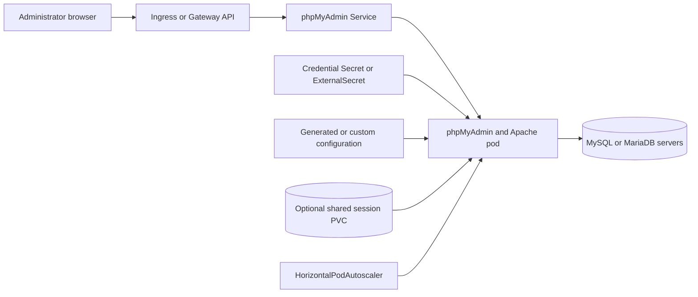

# phpMyAdmin Chart Design

## Scope

This chart deploys the official phpMyAdmin image as a stateless Kubernetes web
application. It supports a fixed MySQL or MariaDB endpoint, a curated list of
servers, or an operator-selected arbitrary server. The chart owns the
Deployment, Service, optional Ingress or Gateway API HTTPRoute, configuration
and credential Secrets, optional session PVC, NetworkPolicy,
PodDisruptionBudget, HorizontalPodAutoscaler, ServiceAccount, ExternalSecret,
and Helm test resources.

The release supplies the container and Kubernetes integration around
phpMyAdmin. It does not own the target databases. Database lifecycle,
authentication policy, TLS certificates, grants, backups, auditing, and
availability remain the responsibility of the database operators.

## Architecture

The public Service uses a named target port, so its stable `service.port` is
independent from the Apache process listener. `containerPorts.http` is passed
to the official image as `APACHE_PORT` and is also used by the container port,
probes, and NetworkPolicy. Ingress and HTTPRoute resources always target the
Service rather than individual pods.

Database traffic leaves the pod directly. A single-server configuration uses
`PMA_HOST` and `PMA_PORT`; a curated multi-server configuration uses the
parallel `PMA_HOSTS`, `PMA_PORTS`, and optional `PMA_VERBOSES` lists. Arbitrary
server mode deliberately transfers endpoint selection to the authenticated
user and therefore requires stricter network controls.

## Design Decisions

The official phpMyAdmin image is pinned and configured only through supported
image environment variables and mounted configuration. The Apache listener is
not merely declared in the pod: the chart sets `APACHE_PORT`, ensuring a port
override changes the real process. Service routing uses the `http` port name to
avoid coupling Service and container port numbers.

Cookie authentication is the default because it avoids placing database user
credentials in the browser URL or forcing a shared database identity. Optional
automatic login exists for controlled environments, but username, password,
control-user password, and blowfish secret can be read from an existing Secret
or External Secrets Operator. Unsupported image variables are intentionally
not invented by the chart.

phpMyAdmin is stateless unless shared sessions are enabled. One replica is the
safe default. Multiple replicas require either a session strategy that remains
valid across pods or acceptance that a user may need to authenticate again.
The optional session PVC provides shared filesystem state, but its access mode
and storage implementation must support the chosen replica topology.

Generated configuration covers ordinary chart values. `config.customConfig`
is an explicit escape hatch for phpMyAdmin settings that are not modeled by the
chart. Because it is executable PHP configuration, it is treated as trusted
operator input and included in the Deployment checksum so changes roll pods.

## Production Boundary

The chart does not create MySQL or MariaDB, database accounts, schemas,
certificates, DNS records, ingress controllers, Gateway controllers, External
Secrets Operator, shared storage, or monitoring infrastructure. It cannot
verify that a database endpoint is authoritative, that credentials have least
privilege, or that a server permits the intended administrative operations.

Production operators must choose the exposure model, authenticate users before
they reach phpMyAdmin where appropriate, restrict database egress, provide TLS
to both browser and database paths, rotate credentials, audit administrative
activity, and test database recovery independently. Public internet exposure is
not a default or recommended topology. An internal route behind identity-aware
access controls is the usual production boundary.

Gateway API support creates an HTTPRoute and references an existing Gateway.
Listener configuration, certificates, allowed routes, cross-namespace grants,
and controller lifecycle remain external. Ingress support likewise assumes an
existing controller and certificate workflow.

## Security Boundary

The pod runs with a restricted security context, no privilege escalation,
dropped Linux capabilities, runtime-default seccomp, and no automatically
mounted ServiceAccount token. The exact filesystem policy follows the official
image requirements. Secrets are referenced instead of copied into ConfigMaps,
and External Secrets integration can reconcile them from an external provider.

NetworkPolicy can constrain browser ingress and database, DNS, and HTTPS
egress. Enforcement depends on the cluster CNI. Arbitrary server mode is
especially sensitive because a user-controlled hostname can otherwise turn the
pod into a network pivot. Operators should restrict destinations to approved
database networks and avoid broad HTTPS egress unless it is required for a
specific integration.

phpMyAdmin is an administrative interface with intentionally powerful database
capabilities. The chart cannot compensate for weak database grants, shared
administrator accounts, missing multi-factor authentication at the access
layer, unsafe custom PHP configuration, or credentials committed to values
files. Database TLS verification and stable cookie secrets are production
requirements when their threat models apply.

## Observability Boundary

Kubernetes startup, readiness, and liveness probes verify that Apache can serve
the phpMyAdmin endpoint on the configured listener. Standard output and error
streams provide application and web-server logs. Deployment status, pod
restarts, Kubernetes events, HPA state, PVC health, route status, and the Helm
test provide infrastructure-level evidence.

The chart does not install metrics exporters, dashboards, tracing, log
collection, or alerts. Operators should monitor HTTP availability and latency,
authentication failures, server errors, pod restarts, probe failures, session
storage capacity, HPA saturation, rejected route attachments, database
connection failures, TLS failures, and denied NetworkPolicy traffic. A healthy
HTTP response does not prove that every configured database is reachable or
that a user has valid grants.

## Known Gaps and Limitations

- phpMyAdmin has no bundled database; a successful deployment can still show a
  connection error until an approved endpoint and credentials are available.
- Multi-server host, port, TLS, and display-name lists must remain aligned.
- Arbitrary server mode expands the egress threat surface and cannot be made
  safe by UI configuration alone.
- Shared filesystem sessions depend on a storage class whose access modes fit
  the requested replica count and scheduling topology.
- The chart does not provide database activity auditing or an identity-aware
  proxy in front of phpMyAdmin.
- Custom PHP configuration can override behavior beyond what the values schema
  and templates can validate.
- Helm tests validate web reachability, not login, database grants, queries,
  imports, exports, or failover between database servers.

## Explicit Non-Goals

- Provisioning or upgrading MySQL and MariaDB servers
- Creating database users, grants, schemas, or backups
- Exposing phpMyAdmin publicly by default
- Embedding an ingress, Gateway, certificate, or identity provider controller
- Guessing credentials or generating database administrator accounts
- Validating arbitrary PHP configuration semantics
- Providing a database proxy, connection pooler, or SQL audit platform
