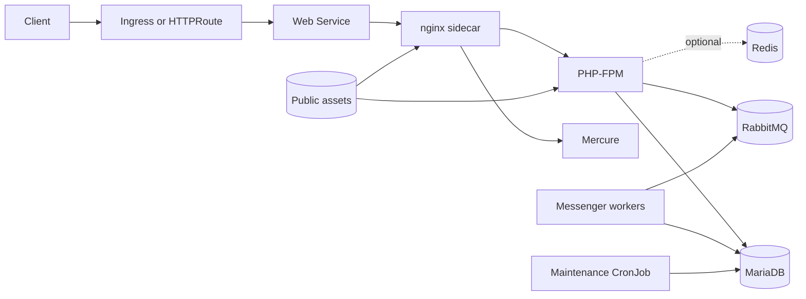

# Pimcore Chart Design

## Scope

The chart deploys Pimcore's real runtime topology while keeping application
project ownership explicit. It supports a pinned skeleton bootstrap for
evaluation and immutable project images for production.

## Architecture

## Design decisions

- The chart never claims that `pimcore/pimcore` contains an application.
- Bootstrap is pinned to skeleton `2026.2.0` and guarded by project
  persistence; production uses an immutable project image.
- Registration values stay in Secrets and are mandatory for the installer.
- nginx and PHP-FPM share one pod and a prepared project volume, matching their
  tight file-system coupling.
- Workers and maintenance use the same project image and environment contract.
- MariaDB uses the exact upstream collation requirement.
- RabbitMQ is a first-class dependency because Pimcore Studio and scheduled
  operations rely on Messenger transports.
- Redis is optional because the skeleton does not consume it by default.
- Mercure is internal and proxied through `/hub`.
- OpenSearch stays external and project-controlled.
- Health endpoints distinguish runtime health from application installation.

## Production boundary

The chart does not build application code, register Pimcore, provision
OpenSearch, configure project bundles, or create external databases/object
stores. These are application or infrastructure lifecycle concerns. Platform
operators own DNS, certificates, route controllers, storage classes, backups,
dependency availability, capacity, and image promotion. Application teams own
Composer locks, Pimcore bundles, data models, migrations, generated classes,
and compatibility testing against the pinned runtime.

The bundled dependencies are useful for a self-contained release, but they do
not turn a single Helm release into a complete disaster-recovery design.
Production environments must choose replication, backup retention, restore
testing, and failure domains for MariaDB, RabbitMQ, Redis, assets, and project
state according to their recovery objectives.

## Storage

Bootstrap project persistence and public assets are separate. The project PVC
is a convenience for evaluation, not an HA source-code distribution system.
Production definitions and generated classes should be versioned and baked
into the image. Public assets need RWX or external storage before scaling.

## Failure handling

- Init containers wait for MariaDB and RabbitMQ.
- The project preparation step is idempotent.
- Messenger workers recycle on upstream memory/time limits.
- Maintenance uses `Forbid` concurrency.
- Installer jobs have explicit deadlines and do not retry indefinitely.
- Template validation rejects unsafe or incomplete configurations early.

## Security boundary

By default, workloads run without ServiceAccount tokens, privilege escalation,
or Linux capabilities. Operators can change these defaults through
`serviceAccount.automountServiceAccountToken`, `securityContext`, and
`nginxSecurityContext`; every override changes the security posture and must be
reviewed. Database and RabbitMQ DSNs are assembled inside the container from
Secret-backed variables. `pimcore.opensearchDSN` is rendered directly and must
not contain credentials. The nginx sidecar uses a read-only root filesystem,
while the PHP runtime remains writable only because the upstream image and
common Pimcore workflows require runtime paths that are not fully relocatable.
Immutable production images should minimize those writable paths and be
scanned independently.

The chart writes inline registration values, administrator credentials,
application secrets, encryption keys, dependency passwords, and Mercure JWT
material to `Secret.stringData`. Those values can appear in rendered manifests
and Helm release storage. Production deployments should use `existingSecret`
or External Secrets instead of inline sensitive values. The chart cannot
determine whether an existing Secret is rotated or whether the identity and
authorization model configured by the Pimcore project is safe. NetworkPolicy
is opt-in because enforcement depends on the cluster CNI. When egress
enforcement is enabled, operators must explicitly allow external databases,
identity systems, object stores, OpenSearch, package repositories used during
evaluation bootstrap, and any project-specific integrations.

## Observability boundary

The chart exposes separate nginx liveness and PHP-FPM readiness semantics. Pod
status, workload events, and standard-output logs provide the first diagnostic
layer. Messenger worker exits and maintenance Job results expose background
processing health, while dependency charts provide their own probes and logs.
Mercure health is observed through its workload probes and the `/hub` route.

The chart does not install a metrics stack, tracing backend, log collector,
dashboard, or alert rules. Operators should monitor request latency and error
rates, PHP-FPM saturation, worker backlog and recycling, failed maintenance or
installer Jobs, database connections, RabbitMQ queue depth, Redis availability,
PVC capacity, certificate expiry, Mercure delivery, and pod restarts. A green
`/healthz` response proves nginx is alive; it does not prove that Pimcore is
installed, registered, connected to every dependency, or able to serve a full
application request.

## Known gaps and limitations

- Evaluation bootstrap downloads project code at runtime and therefore needs
  outbound HTTPS, a writable project volume, and a single-writer topology.
- The chart validates registration inputs but cannot register a Pimcore product
  key or verify its association with an instance identifier.
- The default PVC topology is not suitable for horizontally scaled web pods;
  use RWX-capable or external storage and an immutable project image.
- OpenSearch remains external because its sizing, version, and lifecycle depend
  on installed project bundles and data-index requirements.
- Generic project extensions may require additional environment variables,
  egress destinations, workers, scheduled commands, or writable paths.
- The Helm test and health endpoints do not exercise administrator login,
  migrations, asset transformations, queue consumption, or Mercure delivery.

## Explicit non-goals

- Automatic product-key registration
- Runtime Composer installation in production
- Managing Pimcore data models or content
- Bundling OpenSearch
- Pretending a health endpoint means the database has been installed
