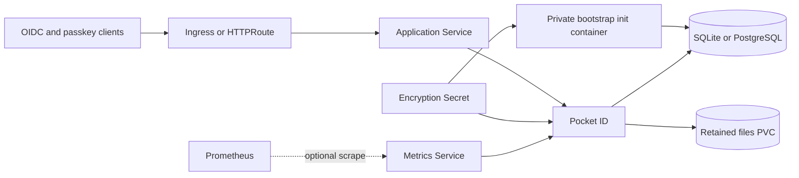

# Pocket ID chart design

## Scope

This chart deploys one Pocket ID identity provider from the official pinned
image. It owns private first-administrator initialization, HTTP exposure,
application identity, persistent files, optional PostgreSQL integration,
native Prometheus export, and the Kubernetes security controls required around
those components. It supports SQLite for the default singleton topology and a
HelmForge PostgreSQL subchart or prepared external PostgreSQL service.

## Architecture

The Deployment uses init containers to copy the exact upstream binary, verify
database admission, run native migrations when PostgreSQL is selected, and
complete first-user setup on loopback before the public application container
starts. The Service exposes only the application listener. The actor listener
stays on loopback, and the optional native metrics listener uses a separate
Service and NetworkPolicy ingress rule.

## Design decisions

- Private bootstrap binds the native HTTP and actor listeners to loopback,
  creates the first administrator through the upstream API, verifies its role
  and the closed setup response, then terminates before public traffic starts.
- The upstream binary and entrypoint remain unchanged; the helper orchestrates
  native interfaces instead of patching application code.
- One replica and `Recreate` upgrades are deliberate. Upstream HA is unfinished
  and is not exposed as a supported environment flag.
- The encryption key is generated once with Helm lookup or supplied through an
  existing Secret. It must remain stable across upgrades and recovery.
- PostgreSQL connection components are encoded into a mode-0600 memory-backed
  file, avoiding credentials in process arguments and rendered URLs.
- Application HTTP, actor, and metrics listeners have separate trust and
  exposure boundaries.

## Production boundary

The chart manages Kubernetes resources and the optional HelmForge PostgreSQL
dependency. Operators own DNS, trusted HTTPS certificates, ingress or Gateway
controllers, passkey relying-party origin stability, external database
availability, backup storage, capacity, and disaster-recovery execution.
External PostgreSQL must already provide `citext`, `pgcrypto`, schema
permissions, and a clean migration state. A PostgreSQL backend does not turn
the application into a supported high-availability deployment.

## Security boundary

The Pod runs as UID/GID 1000 with a read-only root filesystem, RuntimeDefault
seccomp, all capabilities dropped, no privilege escalation, and no mounted
service-account token. NetworkPolicy restricts ingress and makes application
egress explicit. The initialization listener is never exposed by a Service.
The chart prevents overrides of managed environment variables that protect
bootstrap, callback, logging, downgrade, analytics, and telemetry behavior.

The retained encryption key protects sensitive native fields and signing
material; it does not encrypt the entire SQLite database or PVC. Operators
must protect backups, one-time login URLs, database credentials, and external
Secret access separately.

## Observability boundary

Startup, readiness, and liveness probes use the native `/healthz` endpoint on
the named HTTP port. Optional OpenTelemetry Prometheus export listens on its
own port and can render a ServiceMonitor and PrometheusRule when the operator
CRDs are installed. The private bootstrap disables metric export. Kubernetes
events, init-container logs, application logs, and target availability remain
the primary troubleshooting signals; missing discovery requires platform-level
alerts outside this chart.

## Upgrade and recovery

Back up the complete data directory and the original encryption Secret as one
recovery set. PostgreSQL deployments also require a database-consistent backup.
Restore the same chart and application version on a fresh volume, validate the
native operator login, passkey authentication, OIDC authorization-code flow,
uploads, and metrics, then upgrade. Never repair a dirty migration flag or
force a schema version without an upstream-supported recovery plan.

## Known gaps and limitations

- Only one application replica is supported, with planned upgrade downtime.
- The actor process is embedded and cannot be scaled independently.
- Passkeys remain coupled to the configured HTTPS relying-party origin.
- ServiceMonitor and PrometheusRule require separately installed operator CRDs.
- External database preparation and managed-service recovery are operator work.

## Non-goals

The chart does not provision DNS, TLS certificates, external PostgreSQL,
Prometheus Operator, backup infrastructure, or passkeys. It does not expose the
private actor listener, generate an initial password, claim upstream HA, rotate
the encryption identity, or automatically repair database migration state.

## Validation plan

Release validation covers private first-user setup, native one-time token
exchange and replay rejection, retained identity, fresh-volume restore, browser
passkey enrollment and login, OIDC authorization code with PKCE, bundled and
external PostgreSQL, and real Prometheus scraping. Runtime fixtures must create
new credentials; seeded private keys and test-only upstream APIs do not prove
production passkey behavior.
