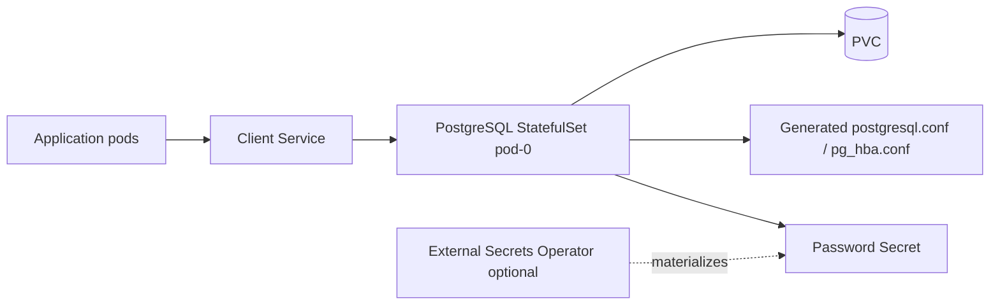
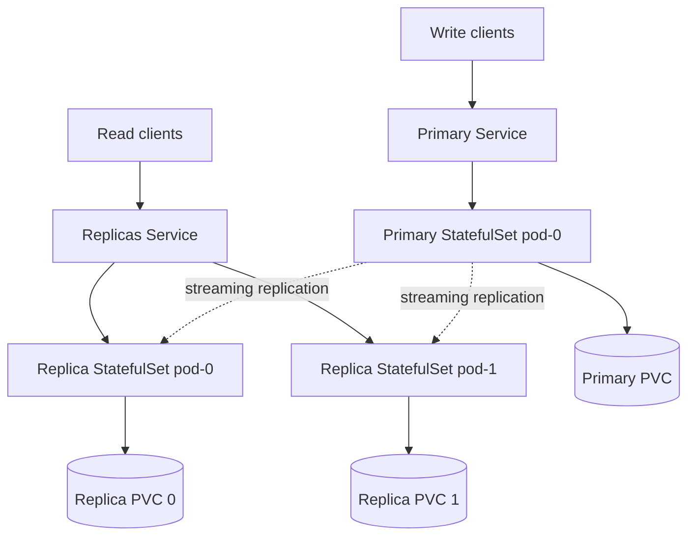
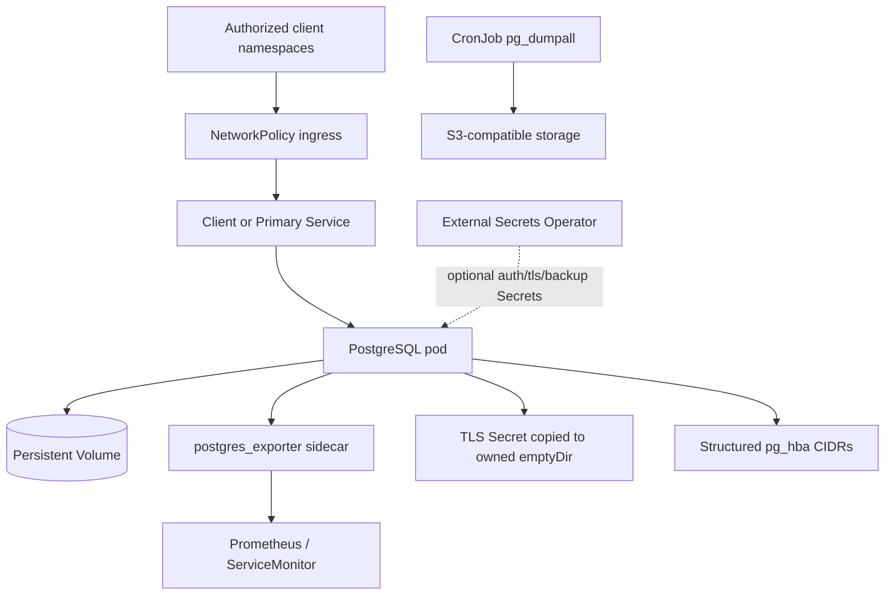

# PostgreSQL Chart Design

## Scope

This chart provides a Helm-native PostgreSQL deployment for development, simple production, and fixed-primary replication use cases.

Supported architectures:

- `standalone`: one writable PostgreSQL pod backed by one PVC
- `replication`: one fixed writable primary plus asynchronous read replicas

The chart intentionally keeps defaults lightweight with the `small` resource
presets. Production users should apply explicit values for credentials,
persistence, workload sizing, network boundaries, backup, metrics, and
scheduling.

## Architecture: Standalone

Standalone mode is appropriate for development, test, internal tooling, and production workloads where restore-based recovery is acceptable.

## Architecture: Fixed-Primary Replication

Replication mode is read scaling and recovery assistance, not automatic HA. The primary is fixed. Promotion, fencing, failover, and reconciliation remain operational workflows outside this chart.

## Architecture: Production Hardening

Production hardening uses opt-in controls:

- `auth.existingSecret`
- `externalSecrets.auth.enabled`
- `config.allowedClientCIDRs`
- `config.allowedReplicationCIDRs`
- `tls.volumePermissions.enabled`
- `replication.slots.enabled`
- `replication.wal.maxSlotWalKeepSize`
- `networkPolicy.egress.enabled`
- `serviceAccount.automountServiceAccountToken=false`

## Main Design Choices

- Use the official `postgres` image as the database runtime.
- Use StatefulSets and PVCs for stable pod identity and storage.
- Keep StatefulSet PVC retention explicit and independently configurable for standalone, primary, and replica data.
- Render `postgresql.conf` and `pg_hba.conf` from structured values first, with raw escape hatches for advanced cases.
- Bootstrap replicas with `pg_basebackup -R`.
- Keep replication slots optional because they improve WAL safety for lagging replicas but can retain disk indefinitely without limits and monitoring.
- Keep PgBouncer/Pgpool out of scope. Pooling belongs in a separate chart or application/platform layer.
- Render External Secrets Operator resources only when requested. The chart does not install the operator or own provider-side secret stores.
- Isolate S3 workload identity on a dedicated backup ServiceAccount; static credentials remain available through Secret or ExternalSecret.
- Keep HA automation out of scope. Use a PostgreSQL operator for automated failover and lifecycle reconciliation.

## Explicit Non-Goals

- automatic failover
- primary election
- fencing
- Patroni, repmgr, or operator-like orchestration
- bundled PgBouncer or Pgpool
- major version migration automation
- PITR controller logic
- backup controller logic inside the chart

## Production Boundary

This chart can be used in production when the operator accepts fixed-primary semantics and provides runbooks for backup, restore, scaling, failover decisions, and incident response.

Use an operator when requirements include:

- automated failover
- switchover workflows
- continuous physical backup and PITR reconciliation
- declarative replica lifecycle management
- synchronous replication policies with failover awareness

## Security Boundary

The chart configures the main StatefulSet containers to run as non-root and drop Linux capabilities, disables
service-account token automount by default, and can render TLS, structured `pg_hba.conf` rules, ExternalSecret
resources, and ingress and egress NetworkPolicies. The official PostgreSQL image needs writable runtime and data paths,
so the main container does not claim a read-only root filesystem. TLS certificate issuance, SecretStore configuration,
credential rotation, and encryption of backup objects remain operator responsibilities.

NetworkPolicy enforcement depends on a compatible cluster network plugin. The default client and replication CIDRs
preserve broad connectivity and must be restricted for production. Server TLS protects PostgreSQL connections when
enabled, but the chart does not terminate TLS for the optional metrics endpoint or create a certificate authority.

## Observability Boundary

Optional `postgres_exporter` sidecars and Services expose PostgreSQL metrics, and an optional ServiceMonitor integrates
with an existing Prometheus Operator installation. PostgreSQL logs, Kubernetes events, replication views, backup Job
status, PVC capacity, and exporter scrape health remain the primary operational signals.

The chart does not install Prometheus, a log collector, dashboards, tracing, or opinionated alert rules. Operators must
define service-level objectives and alerts for connection saturation, replication lag, WAL retention, storage growth,
backup freshness, restore testing, and certificate or credential expiry.

## Known Gaps

- replication uses a fixed primary and does not automate promotion, fencing, failback, or split-brain prevention
- the built-in backup CronJob creates logical dumps but does not provide continuous archiving or point-in-time recovery
- replication slots can retain WAL until storage is exhausted unless operators configure limits and alerts
- major PostgreSQL upgrades and storage-class migrations require an external migration plan
- TLS certificates and database credentials are not issued or rotated automatically by this chart
- connection pooling and automatic read/write routing require separate platform components
