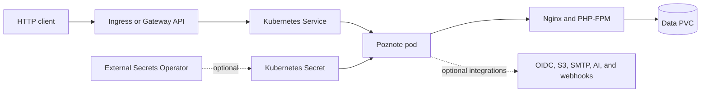

<!-- SPDX-License-Identifier: Apache-2.0 -->

# Poznote Chart Design

## Scope

This chart operates one Poznote web application backed by the SQLite database,
notes, attachments, and application configuration stored under
`/var/www/html/data`. It targets personal and small-team installations that can
accept a single writable application pod.

The chart uses the official
`ghcr.io/timothepoznanski/poznote:6.121.0` image. The optional upstream MCP
server is a separate product image and is outside this chart's workload scope.

## Architecture



The Service always targets the named `http` container port. Changing
`containerPorts.http` also changes `POZNOTE_LISTEN_PORT`, which makes the
upstream startup script rewrite the Nginx listener. Probes and NetworkPolicy use
the same named port. `service.port` is independent and controls only the
client-facing Service port.

## Design Decisions

- Use one Deployment with the `Recreate` strategy. Two active writers must not
  share the SQLite database and local attachment tree.
- Reject `replicaCount > 1` instead of rendering a topology that appears highly
  available but can corrupt or diverge application state.
- Persist the entire upstream data directory in one PVC because the database,
  attachments, notes, generated application secret, and configuration form one
  recovery unit.
- Keep the standard upstream image as the default. Its init process starts as
  root to repair data ownership before Nginx and PHP-FPM run as `www-data`.
- Keep the rootless image out of the default contract because it requires the
  mounted data directory to be pre-owned by UID/GID 1000; a generic chart cannot
  guarantee that condition for new or existing volumes without a privileged
  migration.
- Support both Ingress and Gateway API without installing their controllers or
  CRDs. TLS terminates at the selected edge component.
- Treat OIDC credentials as optional Secret inputs. Inline values remain
  available for evaluation, while existing Secrets or External Secrets are the
  production path.

## Production Boundary

The chart owns Kubernetes resource rendering, the application listener, health
probes, one data volume mount, and optional exposure and policy resources.
Platform operators own:

- the StorageClass, volume availability, capacity monitoring, snapshots, and
  retention policy;
- application-consistent backup scheduling and restore exercises;
- TLS certificates, DNS, ingress or Gateway controllers, and edge authentication;
- OIDC, S3, SMTP, AI, transcription, Git, and webhook endpoints and credentials;
- NetworkPolicy peers and egress rules for every enabled external integration;
- maintenance windows for upgrades and the unavoidable single-pod downtime.

A complete system backup is the entire data volume. Per-user exports are useful
for portability, but they do not replace a full instance recovery set. Restore
testing must use a separate release or namespace before production promotion.

## Security Boundary

The pod disables service account token mounting, privilege escalation, and all
capabilities except those required by the upstream ownership and privilege-drop
sequence. RuntimeDefault seccomp is enabled. The writable root filesystem and
initial root process are upstream image constraints and are not presented as a
restricted-policy workload.

The chart cannot determine which external destinations are trusted. When
NetworkPolicy egress is enabled, operators must explicitly allow the configured
OIDC, S3, SMTP, AI, transcription, Git, webhook, or other integration endpoints.
Secrets should be supplied through an existing Secret or External Secrets
Operator and must not be committed in values files.

Fresh installations contain upstream default administrator credentials. The
operator must change them immediately and verify OIDC before disabling local
login. TLS should terminate at the cluster edge for every non-local deployment.

## Observability Boundary

Startup, readiness, and liveness probes call `/api/health` through the named
listener port. The runtime smoke test additionally verifies the pinned
application version, the effective Nginx listener, Service targeting, and a live
HTTP 200 response from the product health endpoint.

The chart does not deploy metrics exporters, dashboards, alerting rules, or log
collectors. Platform monitoring should cover pod restarts, probe failures,
volume capacity, backup results, HTTP availability, certificate expiry, and
errors from external integrations.

## Known Gaps

- Poznote remains a single-replica SQLite workload with upgrade and disruption
  downtime.
- The standard image requires an initial root process and a writable root
  filesystem.
- Backup creation, retention, restore automation, and recovery verification are
  not scheduled by the chart.
- The chart does not expose native Prometheus metrics.
- NetworkPolicy cannot infer destinations configured later through the Poznote UI.
- The separate Poznote MCP server is not deployed or lifecycle-managed here.

## Non-Goals

- Multi-replica SQLite access or application-level leader election
- Converting Poznote to an external relational database
- Installing ingress, Gateway API, cert-manager, or External Secrets controllers
- Managing identity-provider, object-storage, SMTP, AI, or webhook services
- Deploying the optional MCP server as a sidecar or companion workload
- Automating destructive restores or credential rotation

## Validation

Unit tests cover the listener contract, named Service target, persistence,
security settings, exposure resources, Secrets, and fail-fast validation.
Runtime scenarios exercise defaults, a non-default listener and Service port,
Ingress, Gateway API, External Secrets, NetworkPolicy, persistence-disabled,
sharing, and production profiles.

The required end-to-end gate is:

```bash
make validate-chart CHART=poznote
```
