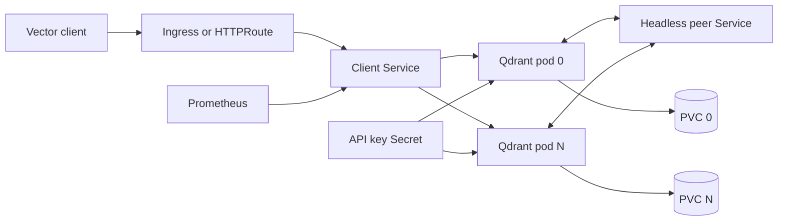

<!-- SPDX-License-Identifier: Apache-2.0 -->

# Qdrant chart design

## Scope

This chart deploys the official Qdrant image as a persistent Kubernetes StatefulSet. It supports a single-node vector
database by default and an explicitly enabled distributed topology with stable peer identities. The chart owns client
and headless Services, per-pod storage claims, API-key Secrets, optional configuration, ingress resources, network
policy, PodDisruptionBudget and ServiceMonitor resources.

The supported contract covers Qdrant HTTP, gRPC and peer listeners, collection data, WAL data, snapshots, health probes,
and the configuration inputs exposed in `values.yaml`. Storage classes, ingress and Gateway controllers, Prometheus
Operator, backup scheduling, certificate management and disaster-recovery orchestration remain platform concerns.

## Architecture

The client Service exposes named `http` and `grpc` ports. Ingress and Gateway API route only HTTP traffic. The headless
Service gives StatefulSet pods stable DNS names and carries the internal p2p listener. Each replica receives its own
`data` volume claim; a shared existing claim is accepted only for the single-node topology.

The chart translates its stable values contract into `QDRANT__...` environment variables. Optional `config.localYaml`
is mounted as `/qdrant/config/local.yaml`. Environment overrides remain useful for narrow changes, while the mounted
file is preferred for structured upstream configuration.

## Design decisions

StatefulSet identity is required because collection segments, write-ahead logs and snapshots live on local persistent
storage. The generated claim name and mount path remain stable across chart upgrades. The chart does not automatically
delete claims or copy data between them; operators retain control of destructive storage operations.

Distributed mode is not a replica toggle. It requires at least two replicas, persistent generated claims and no shared
`persistence.existingClaim`. Pod zero starts with its stable URI and subsequent ordinals join it through `--bootstrap`.
The chart owns that startup command only in distributed mode and continues to append user-supplied `app.args`.

The official image declares root, but Qdrant 1.19.2 was validated with UID/GID 1000, an fsGroup-owned existing volume,
RuntimeDefault seccomp and a read-only root filesystem. When security context values are empty, the template applies
that verified profile. Any non-empty user context is rendered exactly as supplied instead of merging new defaults into
an older custom policy. This preserves intentional UID, GID and filesystem choices during upgrades.

## Production boundary

The chart supplies Kubernetes resources and guarded defaults; it does not make a single Qdrant process highly
available. A single-node upgrade causes a restart. Distributed mode can tolerate selected failures only when collection
shard and replication settings, node count, disruption policy and storage placement are designed together. Enabling
three pods does not retroactively replicate existing collections.

Production operators must provide durable storage, topology-aware scheduling, capacity monitoring, API-key rotation,
TLS at the edge and tested snapshots. PVC snapshots are not automatically application-consistent. Use the Qdrant
snapshot API, store copies outside the source volume and rehearse restoration into an isolated target before relying on
them for recovery.

Normal upgrades and `--reuse-values` upgrades from the published chart are validation gates. Resource names, StatefulSet
identity, PVCs and API keys must remain stable. An application upgrade may still include upstream data-format changes;
Helm rollback restores manifests and cannot reverse on-disk migrations.

## Security boundary

API-key authentication is disabled by default so a fresh internal installation remains accessible for bootstrap. Never
publish an unauthenticated Service. Production values should reference an existing Secret with write and optional
read-only keys. Ingress or Gateway exposure requires TLS, trusted source controls and intentional authentication.

With effective storage, snapshot, temporary and initialization paths under the persistent data path, the built-in
workload profile runs as UID/GID 1000, uses fsGroup 1000 with recursive permission repair, disables privilege
escalation, drops every Linux capability, applies RuntimeDefault seccomp, mounts no Kubernetes API token and keeps the
image filesystem read-only. The initialization marker is redirected to the persistent mount. A path override outside
that mount preserves the image's root identity and writable filesystem for upgrade compatibility while retaining
capability and privilege-escalation restrictions. Operators overriding either security context take responsibility for
preserving Qdrant access to existing volume ownership.

NetworkPolicy is opt-in because enforcement depends on the cluster CNI and existing installations may rely on broad
connectivity. Client peers are explicit only when `networkPolicy.ingressFrom` is set; when it is empty, HTTP and gRPC
remain accessible from all namespaces. Distributed p2p traffic is kept between Qdrant pods. Adding egress isolation
preserves DNS, cluster peer traffic and HTTPS to every IPv4 and IPv6 destination. Additional egress rules cannot narrow
that HTTPS rule; operators requiring destination restrictions must replace the chart-generated NetworkPolicy.

## Observability boundary

Startup, readiness and liveness probes test the HTTP listener. They establish process availability, not collection
health, replication durability or query correctness. The optional ServiceMonitor scrapes Qdrant's native `/metrics`
endpoint and is rendered only when operators confirm the Prometheus Operator CRDs exist. It sends no authentication
credentials, so it cannot scrape a protected endpoint when an API key is configured; that setup requires a separately
managed authenticated ServiceMonitor.

Platform monitoring must additionally cover StatefulSet readiness, restarts, PVC capacity and latency, snapshot age,
peer count, collection replication state and failed operations. Alerts and dashboards are intentionally not embedded
because thresholds depend on workload dimensions, shard layout and service objectives.

## Known gaps and limitations

- Single-node upgrades and voluntary disruptions cause downtime.
- The chart does not create collections, shards or replication policies.
- Existing claims are supported only for a single replica and are never cloned automatically.
- Snapshot creation, export, retention and restore orchestration are external procedures.
- NetworkPolicy cannot protect traffic unless the selected CNI enforces it.
- The generated ServiceMonitor requires compatible Prometheus Operator CRDs and an unauthenticated metrics endpoint.
- TLS is terminated by an external edge; Qdrant's internal Services remain plain HTTP/gRPC by default.

## Non-goals

The chart does not replace Qdrant Private Cloud, manage collections as Kubernetes custom resources, automate cross-node
snapshot recovery, choose shard or replication factors, install storage/edge/monitoring controllers, or promise
zero-downtime application upgrades. It also does not silently rewrite explicit user security contexts. These boundaries
keep the supported behavior deterministic and testable on local k3d with real vector writes, queries and distributed
peer formation.
