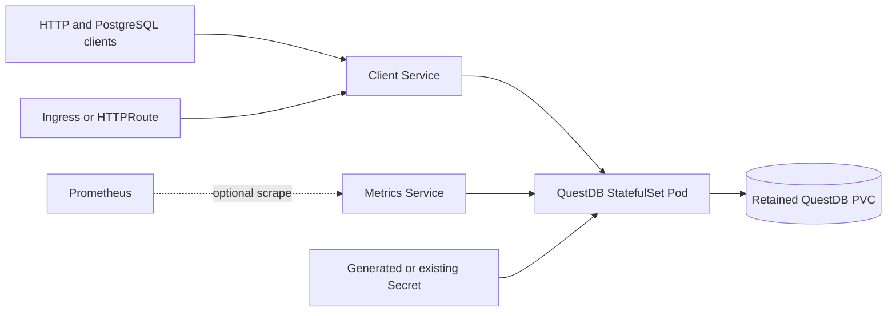

# QuestDB chart design

## Scope

The chart owns one QuestDB OSS instance, its stable Kubernetes identity,
protocol Services, credentials, persistent root, health probes, and optional
exposure, policy, and monitoring resources. It does not operate a QuestDB
cluster, provision external storage, or manage client applications.

## Architecture

QuestDB OSS is single-node software. The chart therefore deploys a fixed
one-replica StatefulSet. A headless Service provides stable identity while the
client Service exposes only the selected protocols.

## Design decisions

### Workload model

Replica and HPA controls are deliberately absent because increasing replicas
would create independent databases rather than a replicated cluster. The
StatefulSet uses an in-place rolling update so the stable PVC and network
identity survive chart upgrades.

### State and lifecycle

The entire `/var/lib/questdb` tree is mounted from one PVC. Chart-created PVCs
are retained by default. An existing claim can be selected for recovery. An
ephemeral volume is allowed only for evaluation and loses all database state.

StatefulSet updates replace the singleton in place. Before upgrades, operators
must create and verify a checkpoint-coordinated backup. A PodDisruptionBudget is
off by default because setting `minAvailable: 1` deliberately blocks voluntary
drains for a singleton.

### Authentication and configuration

QuestDB's upstream `admin`/`quest` PostgreSQL default is not used. Helm creates
and retains random PostgreSQL and HTTP passwords unless `questdb.existingSecret`
selects an operator-owned Secret. Both values are projected as files and passed
through `QDB_PG_PASSWORD_FILE` and `QDB_HTTP_PASSWORD_FILE`.

`questdb.serverConfig` maps documented properties to their `QDB_` environment
form. Direct secret values must not be placed there or in ordinary environment values. Additional
Secret projections are available for advanced cases such as the ILP TCP auth
database.

### Network and observability

HTTP 9000 and PostgreSQL 8812 are published by default. Legacy ILP TCP 9009 is
opt-in because ILP over HTTP is preferred. Health and metrics 9003 use a
separate Service only when metrics are enabled. NetworkPolicy applies distinct
peer lists to each interface and allows only DNS egress by default.

Ingress and Gateway API route only HTTP 9000 and require TLS configuration or a
TLS-terminating parent Gateway. PostgreSQL, ILP TCP and QWP traffic need a
trusted network or service mesh when encryption is required.

## Production boundary

The production boundary is one QuestDB process and one persistent volume.
Availability, backup scheduling, restore rehearsal, storage snapshots, external
TLS, capacity planning, and disaster recovery remain operator responsibilities.
Fast block storage is required; NFS and distributed filesystems are outside the
supported database-storage boundary.

## Security boundary

The pod runs directly as UID/GID 10001 with `DO_CHOWN=false`, seccomp
RuntimeDefault, no privilege escalation, no capabilities, no API token and a
read-only root filesystem. The data PVC and `/tmp` are the only default writable
locations. Storage classes that do not honor `fsGroup` must be pre-provisioned
with ownership 10001 rather than weakening the workload security context.

The chart protects generated credentials with a retained Secret and accepts an
operator-owned Secret or ExternalSecret. It does not encrypt native PostgreSQL
wire or ILP TCP traffic. Those protocols must stay on a trusted network or use a
service mesh or another operator-managed TLS boundary.

## Observability boundary

Startup, readiness, and liveness checks use QuestDB's minimal HTTP `/status`
endpoint on port 9003. When metrics are enabled, the same internal interface
serves `/metrics`; an optional ServiceMonitor provides discovery only. The chart
does not install Prometheus, alert rules, dashboards, log aggregation, or a
retention policy.

## Known gaps and limitations

- QuestDB OSS has no chart-managed replication, automated failover, or online
  horizontal scaling.
- A singleton upgrade causes a short availability interruption.
- Native protocol TLS is not provided by QuestDB OSS.
- The chart cannot prove that an arbitrary storage snapshot is application
  consistent; use the documented checkpoint procedure.
- ServiceMonitor support requires Prometheus Operator CRDs in the cluster.

## Non-goals

- Converting QuestDB OSS into a multi-node or highly available database.
- Provisioning cloud disks, DNS, certificates, ingress controllers, gateways,
  service meshes, Prometheus, or External Secrets Operator.
- Automating checkpoint schedules, snapshot transport, or disaster recovery.
- Managing database schemas, tables, ingestion pipelines, or client credentials
  beyond the server authentication Secret.
