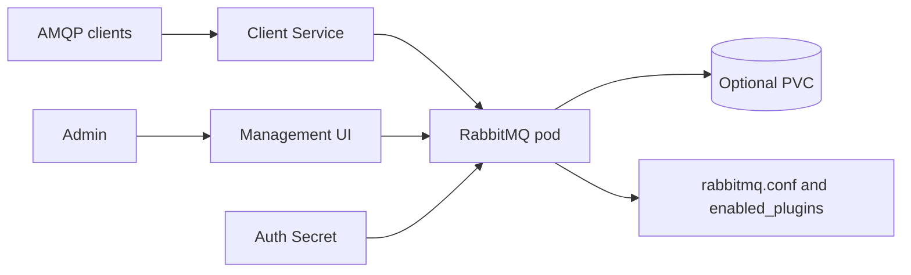
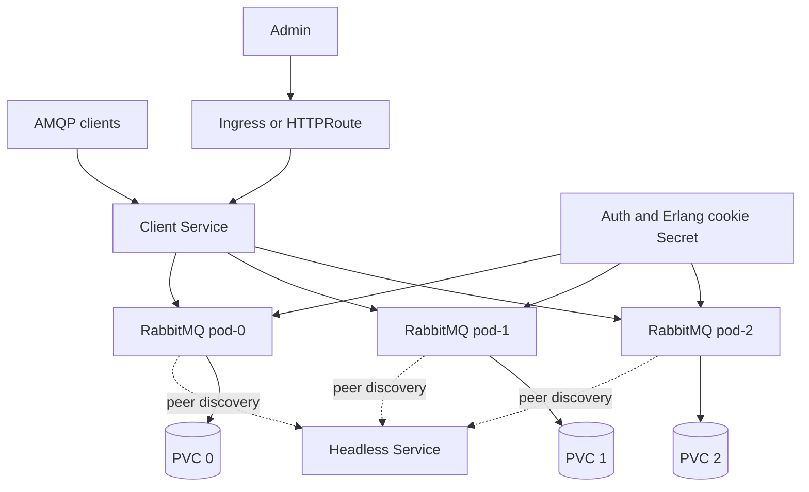

# RabbitMQ Chart Design

## Scope

This chart deploys RabbitMQ with explicit `single-node` and `cluster` architectures.

Supported use cases:

- single broker for development, staging, and simple internal workloads
- replicated RabbitMQ cluster for production messaging with quorum queues
- Management UI exposure through Ingress or Gateway API
- credential management through chart-managed Secrets, existing Secrets, or External Secrets Operator
- metrics through the native RabbitMQ Prometheus plugin and optional ServiceMonitor

## Architecture: Single Node

Single-node mode is operationally simple and intentionally does not claim broker failover.

## Architecture: Cluster

Cluster mode uses `rabbitmq_peer_discovery_k8s` and stable StatefulSet pod identities. It provides broker redundancy, but applications still need correct queue declarations and client reconnect behavior.

## Design Choices

- Use the official `rabbitmq` Alpine image and let chart values control enabled plugins.
- Keep `architecture` explicit instead of inferring topology from replica count.
- Use quorum queues by default because they are RabbitMQ's production direction for replicated queues.
- Disable Erlang scheduler busy-wait by default to keep idle CPU low in containerized environments.
- Use TCP probes against the active AMQP listener by default to avoid recurring `rabbitmq-diagnostics` VM startup cost.
- Keep generated `rabbitmq.conf` readable and allow controlled appends through `config.extra`.
- Require a stable Erlang cookie for clustering and upgrades.
- Require `auth.existingSecret` when `externalSecrets.enabled=true` to avoid drift between chart-generated and operator-reconciled credentials.
- Keep Gateway API focused on the Management UI. AMQP exposure remains Service-based because HTTPRoute is not the right protocol surface for AMQP.
- Do not switch image tags based on `management.enabled`; the default Alpine image already contains the management plugin, and `enabled_plugins` is the authoritative plugin surface.
- Keep dual-stack Service fields opt-in.

## Production Boundary

Recommended production baseline:

- `architecture=cluster`
- `cluster.replicaCount >= 3`
- persistence enabled for every broker
- stable credentials from `auth.existingSecret` or External Secrets Operator
- `queueDefaults.type=quorum`
- `metrics.enabled=true`
- `pdb.enabled=true`
- pod distribution with affinity or topology spread constraints
- TLS for clients outside trusted internal networks

## Security Boundary

The default pod runs with the numeric identity used by the official image
(`100:101`), RuntimeDefault seccomp, no privilege escalation, no Linux
capabilities, and a read-only root filesystem. Only `/var/lib/rabbitmq` and
`/tmp` are writable through explicit volumes. A non-root init container restores
the Erlang cookie to owner-only mode after Kubernetes applies the volume
filesystem group; this preserves compatibility with PVCs created by earlier
chart versions. The ServiceAccount token is not
mounted: RabbitMQ 4.1 and later Kubernetes peer discovery derives the seed node
from StatefulSet ordinals and does not query the Kubernetes API.

The supported in-place path from earlier public chart versions uses the official
image identity `100:101`. Custom images with a different historical PVC owner
must keep `podSecurityContext` aligned with that numeric identity or perform an
explicit, one-time ownership migration before enabling these defaults. The
chart does not silently introduce a root volume-permissions container.

The chart protects the generated username, password, and Erlang cookie from
rotation during Helm upgrades by reusing the existing managed Secret. Operators
must rotate live credentials with RabbitMQ tooling because environment variables
only seed users when the broker database is first created. TLS is optional, so
deployments without it must keep AMQP and the Management UI on trusted networks.

## Observability Boundary

TCP startup, readiness, and liveness probes verify listener availability. The
optional Prometheus plugin and ServiceMonitor expose broker metrics, but the
chart does not install a monitoring stack, alerts, dashboards, or log collector.
Operators remain responsible for alerts covering unavailable replicas, queue
growth, unacknowledged messages, disk and memory alarms, and certificate expiry.

## Known Gaps

- NetworkPolicy is not managed because permitted client, DNS, federation, and
  monitoring flows are deployment-specific.
- Backup and restore automation is outside the chart; durable data still needs
  storage-level protection and tested recovery procedures.
- Credential rotation is not automated and must be coordinated through
  RabbitMQ before any externally managed Secret is updated.
- The chart does not create RabbitMQ users, virtual hosts, policies, exchanges,
  queues, federation links, or shovels after initial bootstrap.

## Non-Goals

- operator-like day-2 lifecycle automation
- automatic policy, federation, shovel, or topology orchestration
- backup or restore automation
- AMQP Gateway API routes
- hiding RabbitMQ queue design and client reconnect requirements

## Validation

The chart is expected to pass:

- Helm lint and strict lint
- Helm template rendering for default and CI values
- helm-unittest coverage for services, secrets, StatefulSet, PDB, Gateway API, and ExternalSecret
- kubeconform validation for Kubernetes-native default manifests
- local k3d deployment smoke tests with broker diagnostics, Management API, pod logs, and namespace events checked

<!-- @AI-METADATA
type: design
title: RabbitMQ Chart Design
description: Design document for the RabbitMQ Helm chart covering single-node, cluster, Gateway API, External Secrets, and operational boundaries.
keywords: rabbitmq, design, architecture, cluster, quorum, gateway-api, external-secrets
purpose: Document chart architecture, production boundary, and non-goals.
scope: Chart Design
relations:
  - charts/rabbitmq/README.md
  - charts/rabbitmq/docs/single-node.md
  - charts/rabbitmq/docs/cluster.md
path: charts/rabbitmq/DESIGN.md
version: 1.1
date: 2026-06-02
-->
