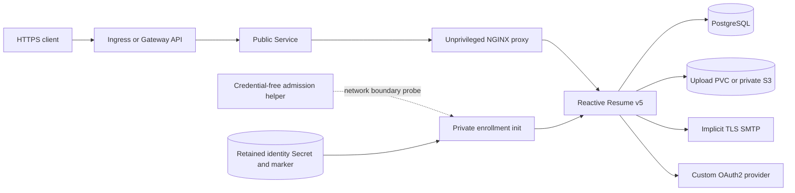

# Reactive Resume architecture

## Scope

The chart deploys Reactive Resume v5 as a single, stateful application instance
with native PDF generation, an unprivileged reverse proxy, mandatory PostgreSQL,
private first-user enrollment and coordinated identity retention. PostgreSQL may
come from the bundled HelmForge dependency or an external TLS endpoint. Uploads
may use the local PVC or a private S3-compatible bucket.

## Architecture

One `Recreate` Pod contains the serialized native bootstrap, the Node server and
the unprivileged NGINX proxy. The official image generates PDFs natively, so v5
does not need Browserless or a privileged browser container. Local uploads and
the retained identity marker share one PVC; S3 changes only the upload backend.

## Design decisions

- Keep one application replica so migrations and ownership of local state are
  serialized.
- Run the unchanged native server privately for first-user enrollment, then keep
  public signup disabled behind the proxy.
- Pin the official image by tag and digest because the upstream `v5.3.0` tag was
  rebuilt after its Git release.
- Use authenticated implicit TLS SMTP. When SMTP is disabled, block native routes
  that can otherwise emit token-bearing links only to logs.
- Use the native custom OAuth2 flow and native account linking instead of writing
  provider identities directly into PostgreSQL.
- Combine optional private CA bundles before Node starts, preserving certificate
  and hostname verification for all native integrations.

## Production boundary

The chart owns the application Pod, proxy, private bootstrap, admission helper,
Services, policies, retained Secrets and optional bundled PostgreSQL dependency.
Operators own public TLS, DNS, backup scheduling, external database availability,
S3 lifecycle, SMTP and OAuth provider configuration, and enforcement by the
cluster NetworkPolicy implementation.

The recovery profile quiesces the application and restores a database dump and
complete upload archive into fresh destinations, including the hidden identity
marker. PostgreSQL, uploads, `AUTH_SECRET`, `ENCRYPTION_SECRET` and that marker
form one recovery set.

## Security boundary

Application and helper workloads use UID/GID 1000, read-only root filesystems,
dropped capabilities, bounded writable volumes and tokenless ServiceAccounts.
Native enrollment requires an enforcing CNI and trusted namespace policy
ownership. A credential-free helper probes only its caller's fixed native and
control ports before any signup-enabled listener starts.

These checks reduce policy timing uncertainty; they cannot prove global denial
against additive policies, privileged workloads, node traffic or administrators.
Private CA support augments trust and never disables TLS verification. See
[the onboarding contract](docs/onboarding.md).

## Observability boundary

Startup and readiness use the native health endpoint to include database and
storage health. Liveness checks only the native listener so a dependency outage
does not create a restart loop. Kubernetes probes are not Prometheus metrics;
the chart does not create a ServiceMonitor for a nonexistent metrics endpoint.
Runtime validation exercises real API mutations, PDF text and retained state.

## Known gaps

- One replica and `Recreate` imply planned downtime during upgrades.
- Native PDF rendering requires controlled public HTTPS egress for fallback fonts
  unless operators provide an equivalent offline path.
- Standard NetworkPolicy cannot express CDN hostname allowlists.
- S3 disaster recovery requires an external consistent bucket recovery point.
- The pinned application has no supported loopback-only enrollment listener.

## Non-goals

- Horizontal application scaling or concurrent migration execution.
- Browserless, a privileged PDF renderer or patched upstream application code.
- Automatic provisioning of databases, S3 buckets, SMTP servers or OAuth clients.
- Redis-backed AI agent queues, paid AI providers or private AI attachments.
- Treating Kubernetes health probes as application metrics.

## Validation focus

Behavioral acceptance covers ordinary-user enrollment, closed signup, private
resume CRUD, real PDF text, Pod replacement, SMTP recovery, private S3, external
PostgreSQL TLS, OAuth linking, browser HTTPS, existing Secrets/ESO and recovery
into fresh database and PVC destinations. The complete chart gate remains the
release authority.
