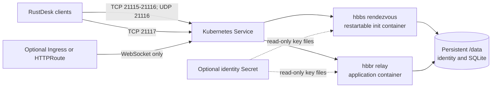

# RustDesk Server design

## Scope and upstream contract

This chart runs RustDesk Server OSS 1.1.16: hbbs handles peer registration and
rendezvous; hbbr forwards paired remote desktop sessions. The official image is
`docker.io/rustdesk/rustdesk-server:1.1.16`, published for amd64, arm64 and arm/v7.
The image is based on scratch and contains no shell or file-copy utilities.
The upstream application is AGPL-3.0; the chart is Apache-2.0.

The OSS server has no Pro console, account management API on port 21114, external
database driver or native Prometheus endpoint. The chart does not invent these
features. Clients and remote desktop permissions remain independently managed.

## Architecture

The Deployment contains one coordinated server pair. The Service exposes the
native rendezvous and relay protocols, while optional HTTP routing exposes only
the derived WebSocket listeners. Both processes share one data volume because
the generated server identity and SQLite peer associations form one recovery
unit. The optional Secret supplies that same identity without storing private
key material in Helm values.

### Ordered identity initialization

Both binaries use `-k _` to require the native published server key. Without this
explicit argument, the relay can accept sessions without matching that key.
The private key is a base64 encoded 64-byte Ed25519 secret; the public key is
base64 encoded 32 bytes. These are the native RustDesk files, not PEM files.

The upstream binaries can each generate a missing identity. Starting both
simultaneously against an empty volume creates a race. hbbs therefore runs as a
restartable init container with a mandatory startup probe; Kubernetes starts hbbr
only after hbbs accepts connections. This uses native sidecars, available by
default from Kubernetes 1.29. Clusters that disable SidecarContainers cannot run
this chart. A shell-based bootstrap would require a second production image and
duplicate upstream key-generation behavior.

Service targets for hbbs use numeric ports because endpoint resolution of named
init-container ports is not reliable on the supported Kubernetes baseline.
Unit tests and actual UDP/TCP Service traffic protect this compatibility choice.

### One pair, one data volume

A single Recreate Deployment shares `/data` between both binaries. This persists
the server identity, SQLite peer associations and native operational files.
The chart rejects replicas other than one and overlapping listener ports. RWX
storage does not make SQLite or in-memory rendezvous/relay pairing horizontally
scalable. There is no HPA or synthetic HA mode. Upgrades and Pod replacement
interrupt active sessions; a PDB cannot make this singleton highly available.

The generated PVC is retained on uninstall by default. Namespace deletion can
still destroy it. Operators own off-cluster backups and restore procedures.
An existing identity Secret mounts individual files read-only over the data
volume. Secret changes require Pod replacement because subPath mounts do not
update automatically. ExternalSecrets renders only the synchronization resource;
the operator and stores remain external prerequisites.

## Design decisions

The chart uses a restartable init container for hbbs rather than an application
container ordering workaround. This makes successful rendezvous startup the
condition for starting hbbr and eliminates concurrent key generation. Recreate
is deliberate: two pairs must never write to the same SQLite database or serve
with an identity in transition. Explicit startup, readiness and liveness probes
use native TCP listeners because the scratch image has no shell or HTTP health
endpoint. HPA and PDB resources are intentionally absent because they would imply
availability or horizontal scaling guarantees that the OSS server cannot meet.

## Production boundary

The chart owns Kubernetes resources for one RustDesk OSS server pair and validates
their in-cluster behavior. Operators own public DNS, firewalls, NAT mappings,
load-balancer capabilities, TLS termination, storage durability and maintenance
windows. Production upgrades interrupt active sessions. A quiesced backup of the
complete data directory and separately managed identity source is required before
an application-version change. A retained PVC protects only against Helm uninstall;
it is not an off-cluster backup and namespace deletion can still remove it.

## Security boundary

The Pod runs as UID/GID 1000, drops all capabilities, prevents privilege escalation,
uses RuntimeDefault seccomp, mounts no Kubernetes API token and keeps the image
filesystem read-only. When the chart generates identity, the writable data volume
contains the private key and peer database. With `auth.existingSecret`, the active
key files come from read-only Secret mounts while the volume holds application
data. Operators must protect and back up whichever identity source applies; Secret
provider, rotation and access policy remain their responsibilities. The public
server key authenticates the server to clients; it does not authenticate users or
authorize access to remote devices.

### Networking and trust

The default ClusterIP and same-namespace NetworkPolicy support a private initial
deployment. Production access needs an explicit LoadBalancer or NodePort and
appropriate client CIDRs. A mixed TCP/UDP LoadBalancer requires provider support.
`externalTrafficPolicy: Local` reduces source-IP translation but cannot undo
SNAT performed by an external load balancer. Public NAT mappings and advertised
relay addresses belong to the operator's network design.

WebSocket ports are optional Service mappings. Ingress and HTTPRoute target only
these ports, using separate hostnames for hbbs and hbbr. They are not substitutes
for native TCP/UDP exposure for clients using the native transport. TLS terminates
at the chosen HTTP controller; the server does not expose an HTTPS console.

The public server key is not a user credential. Anyone receiving it can attempt
to use the server. Restrict network admission and configure remote device access
controls in the RustDesk clients. Non-root execution, a read-only image filesystem,
dropped capabilities, seccomp and no API token reduce workload privileges.

## Observability boundary

Kubernetes probes report whether each native TCP listener accepts connections.
Pod status, restart counts, events, resource metrics and hbbs/hbbr logs are the
available operational signals. The OSS release has no native Prometheus endpoint,
and listener readiness does not prove public UDP reachability, successful NAT
traversal, desktop consent or end-to-end relay quality. Production monitoring
must therefore add external client probes and infrastructure telemetry outside
the chart when those guarantees are required.

## Known gaps and limitations

- Exactly one server pair is supported; there is no horizontal or rolling HA.
- Active sessions disconnect during upgrades, Pod replacement and backups.
- Ingress and HTTPRoute support WebSockets only, not native TCP/UDP transport.
- The chart cannot verify public NAT, provider mixed-protocol load balancers,
  remote desktop consent or client-side access policies.
- The scratch image cannot be used with shell-based backup or debugging commands.

## Non-goals

This chart does not provide RustDesk Server Pro, a web console, user management,
an external database, certificate automation, a desktop client, public DNS,
firewall configuration, storage snapshots or a monitoring stack. It also does
not emulate multi-replica safety with RWX storage. These exclusions keep the
chart aligned with capabilities of the pinned upstream OSS server.

## Validation boundaries

The chart-owned runtime client independently implements the pinned upstream
protobuf and TCP framing contract. It checks UDP identity registration, peer
heartbeat, NAT responses, wrong-key rejection and bidirectional relay data.
It repeats these checks after Pod replacement and a quiesced copy to a fresh
PVC, including rejection of a conflicting UUID to prove SQLite continuity.
WebSocket scenarios verify key enforcement and binary payload forwarding.
ESO scenarios verify Ready status and the public identity actually consumed.

These checks exercise server behavior, not desktop screen capture or user
consent dialogs. Cloud load balancers, internet NAT combinations, real DNS/TLS,
and application-specific desktop clients require deployment acceptance tests.
