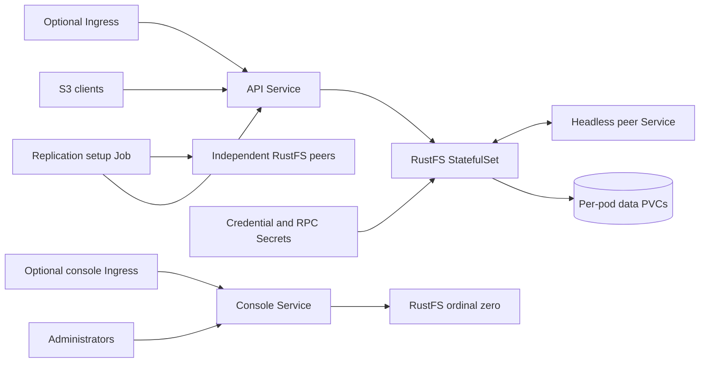

<!-- SPDX-License-Identifier: Apache-2.0 -->
# RustFS chart design

## Scope

The chart deploys official RustFS object storage as either a single-node store
or a distributed StatefulSet. It owns storage identity, credentials, S3 and
console listeners, Services, optional Ingress resources, NetworkPolicy,
disruption policy, and optional bootstrap Jobs for bucket or site replication.
StorageClass behavior, TLS certificates, identity policies, external backup,
replication destinations, observability backends, and disaster recovery remain
operator responsibilities.

## Architecture

One StatefulSet implementation serves standalone and distributed modes. Stable
Pod identities and per-Pod claim templates keep storage ownership explicit.
The API Service balances ready members; the distributed console Service selects
ordinal zero. A headless Service publishes not-ready peer addresses for cluster
bootstrap.

## Main Design Decisions

### Topology and storage invariants

Standalone requires one replica and may use an existing claim or ephemeral
storage. Distributed and `cluster` modes are equivalent, require at least four
members, and require an independent persistent claim per ordinal. Validation
rejects inconsistent combinations rather than silently changing replicas or
storage.

Generated resource base names reserve space for the StatefulSet revision label.
Long generated names retain a shortened prefix and a stable hash to reduce
collisions. Changing naming or topology on an existing installation requires
explicit migration planning because Helm cannot rename retained PVCs safely.

### Listener and Service contract

`containerPorts.api` and `containerPorts.console` configure the real RustFS
listeners through `RUSTFS_ADDRESS` and `RUSTFS_CONSOLE_ADDRESS`. The API listener
also carries internode RPC, so distributed peer URLs and the headless Service use
the same API port. Client-facing `service.port` and `consoleService.port` remain
independent and target named container ports. A non-default API listener is
validated against the running process, not only rendered metadata.

### Credentials and configuration rollout

ConfigMap content triggers StatefulSet rollout through a checksum annotation.
S3 credentials and the distributed RPC secret come from Kubernetes Secrets;
generated values are reused with Helm lookup, while existing Secrets support
GitOps ownership. Credential changes require an explicit Pod restart unless a
controller performs it.

### Replication setup

Replication relates independent RustFS deployments and is not a storage
architecture. A bounded post-install/post-upgrade hook Job runs the pinned
official CLI for bucket rules or whole-site relationships. Its ConfigMap carries
JSON and the packaged shell script; credentials mount read-only, and CLI state
uses ephemeral `/tmp` storage.

Bucket setup preserves unrelated rules, updates known IDs, and rejects silent
destination changes. Site setup adds all peers together and checks membership on
retries. Removing values or uninstalling the chart does not delete remote rules
or relationships. The Job is an idempotent setup operation, not a continuous
replication controller or health monitor.

## Security Boundary

The official container runs as UID/GID 10001 with a read-only root filesystem,
all Linux capabilities dropped, privilege escalation disabled, RuntimeDefault
seccomp, and no Kubernetes API token. Credentials never enter a ConfigMap.

NetworkPolicy restricts API, internode RPC, and console ingress to same-namespace
Pods by default; operators must declare peers for other namespaces. Ingress must
terminate TLS because S3 credentials and data are unsafe over plain HTTP. The
chart does not create application TLS, custom trust bundles, IAM users, bucket
policies, or encryption keys.

## Production Boundary

Production operators must provide durable storage with tested failure-domain
placement, strong existing Secrets, TLS, explicit resource sizing, monitoring,
and a backup and recovery process. Enabling a disruption budget limits voluntary
evictions but does not prove quorum or data durability. Scaling, changing
topology, replacing storage classes, or changing distributed peer ports requires
an upstream-supported migration procedure.

Site replication is asynchronous and does not provide DNS or application
failover. Every peer must trust the others' certificates and remain reachable by
both the setup Job and the RustFS servers. Only one release should own a site
relationship.

## Observability Boundary

Startup and liveness use `/health`; readiness uses `/health/ready`. The runtime
gate performs authenticated S3 upload, download, byte comparison, and cleanup,
and replication scenarios verify content on real local peer fixtures. Logs are
written to stdout and an ephemeral `/logs` mount unless the operator exports them.

RustFS supports OTLP through application environment values, but this chart does
not install an OpenTelemetry Collector, Prometheus, dashboards, or alert rules.
Operators should monitor quorum, readiness, capacity, latency, error rates,
replication lag, setup Job outcomes, and backup restores.

## Known Gaps and Limitations

- The chart remains alpha while multi-node disk and network failure
  scenarios and production storage drivers are not validated by HelmForge.
- The console is pinned to ordinal zero in distributed mode and is unavailable
  while that Pod is down, even if S3 traffic remains healthy.
- A health endpoint does not prove authenticated object I/O; the separate runtime
  smoke test provides that evidence only during validation.
- Replication credential, endpoint, and membership migrations require explicit
  upstream administration.
- Existing long-name releases need migration planning before adopting a changed
  generated resource name.

## Non-Goals

The chart does not provide automated topology conversion, PVC migration, storage
repair, synchronous cross-site replication, application-level failover, S3 user
or policy provisioning, Gateway API resources, custom certificate issuance,
observability backends, or deletion of remote replication state.

## Validation Design

CI scenarios declare prerequisites through same-name files under `ci/fixtures/`.
Those fixtures own Secrets, existing claims, and real RustFS peer Services. No
replication test depends on public DNS or an external cluster. Auxiliary Jobs and
Helm test Pods retain common metadata without matching storage Service selectors.

The runtime smoke validates every scenario on k3d, including custom application
listeners, authenticated S3 object content, clustered replicas, and both
replication modes. Rendering is necessary but is not treated as behavioral
evidence.
